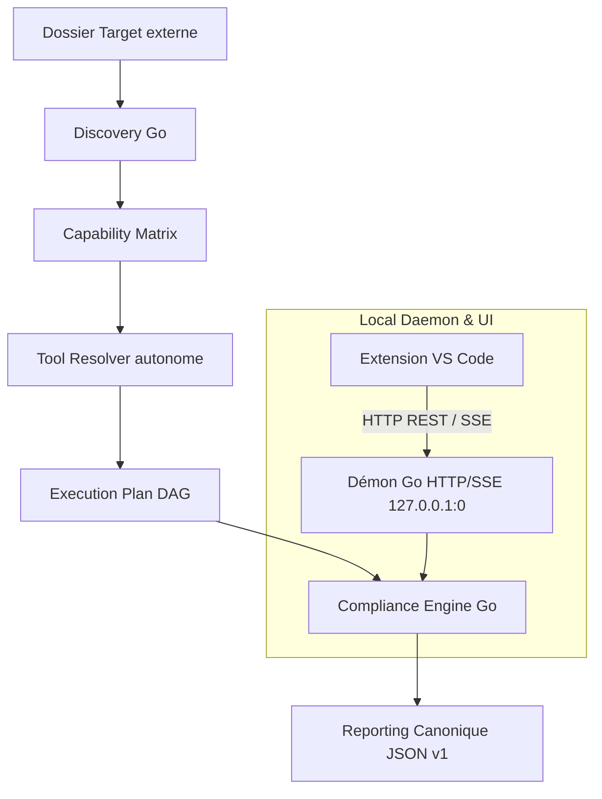

# ICP - IaC Compliance Platform

## Vue d'ensemble

Compliance Platform est un outil local d'audit autonome de dépôts multi-technologies. Il découvre automatiquement les technologies présentes dans un projet cible externe, évalue les capacités d'outillage disponibles et exécute un plan de contrôles de conformité selon un catalogue partagé, en générant un rapport JSON canonique et un verdict consultatif.

Le moteur d'exécution autonome écrit en Go (`core/`) et son démon local HTTP/SSE constituent l'unique autorité et source de vérité du produit. Le moteur fonctionne à **100 % en local** pour l'audit, sans dépendance envers une forge distante ni pipeline CI distante. L'approvisionnement des outils s'effectue via le registre auto-hébergé `tools-v1` ou le `PATH` local.

---

## Fonctionnalités Clés & Capacités

- **Moteur Go local** : Discovery, Capability Matrix, Tool Resolver, Compliance Engine, rapport canonique et démon HTTP/SSE. Le binaire est cross-compilé pour six cibles. **Seul Windows x64 est qualifié** sur cette machine ; Linux et macOS sont expérimentaux (binaires présents, selftest physique non fait).
- **Extension VS Code intégrée** : Interface TreeView locale connectée au démon local via HTTP et streaming d'événements temps réel (SSE), avec lecteur de rapports interactif natif et visualisations de findings.
- **Sécurité et confinement stricts** : Démon éphémère ou persistant sur `127.0.0.1:0`, jeton Bearer 256 bits généré localement, validation stricte des en-têtes `Host` et `Origin`, approbation explicite des dossiers cibles (*workspace approval*), confinement des processus enfants (Job Objects sous Windows avec vérification stricte, process groups POSIX sous Linux/macOS) et annulation immédiate sans processus orphelin.
- **Résolution d'outils découplée et registre auto-hébergé** : Registre d'archives précompilées et autonomes hébergées sur la release GitHub `tools-v1` (`https://github.com/LORD-SOUPEX/Compliance_Platform/releases/tag/tools-v1`), sans dépendance envers PyPI, npm ou PowerShell Gallery à l'exécution. Les 10 outils natifs sont fournis pour 5 plateformes (`windows-x64`, `linux-x64`, `linux-arm64`, `macos-x64`, `macos-arm64`). Les bundles complets pré-assemblés Python (`checkov`, `bandit`, `pylint`, `pytest`, `pip-audit`, `yamllint`), Node (`eslint`, `tsc`) et `PSScriptAnalyzer` sont publiés et qualifiés pour `windows-x64`. Sur Linux et macOS, les bundles complets peuvent être construits sur un hôte POSIX via `scripts/build_and_publish_tools.py` ou résolus via le `PATH` système.
- **Ordre strict de résolution des outils** :
  1. Pour `eslint`/`tsc` : `node_modules/.bin` de la Target en priorité, sinon bundle `~/.compliance/tools/node` téléchargé depuis le registre.
  2. Pour tous les autres outils : `.tools/bin` (dev local) ➔ `~/.compliance/tools/{bin,python,node,powershell-modules}` (registre installé) ➔ `PATH` système.
- **Autonomie hors dépôt** : Le catalogue et les schémas sont embarqués dans le binaire (`//go:embed`) et dans le VSIX. `compliance selftest` fonctionne sans clone Git.
- **Validation autonome intégrée (`compliance selftest`)** : Suite d'auto-test en 24 étapes vérifiant le cycle de vie du démon, la sécurité, l'exécution, l'annulation, les verrous, le PATH, le journal et la capture des sorties sur port éphémère.
- **Catalogue** : le tableau ci-dessous est la liste exécutable. Un test échoue s'il diverge de `.config/control-catalog.json`.

---

## Technologies et Contrôles Couverts

ESLint et `tsc` viennent du `node_modules` de la cible, ou de `~/.compliance/tools/node` après synchronisation. Sans configuration ESLint, le moteur applique une configuration minimale et audite les fichiers. `tsc` exige un `tsconfig.json`. Les outils de répertoire (Terraform, etc.) restent un contrôle par racine. Le rapport regroupe ces racines sous une carte par outil. Chaque racine se déroule vers les fichiers touchés, puis vers la ligne, la règle et le message. Checkov, TFLint, ShellCheck, Trivy et `terraform fmt` alimentent ces listes. Une technologie déjà exécutée sur une racine n'apparaît pas dans les contrôles non applicables. Markdown utilise `rumdl check`. Sans configuration Markdown du dépôt, la règle de longueur de ligne MD013 est désactivée. `pytest` qui ne collecte aucun test (code 5) n'est pas un échec. Gitleaks ignore les dossiers d'artefacts et les binaires. `testdata`, `fixtures` et `__snapshots__` ne sont ni des racines ni des anomalies.

Les outils du registre `tools-v1` peuvent être téléchargés en HTTPS après accord (version, source, dossier utilisateur). Une signature Ed25519 absente ou différente génère un avertissement journalisé sans bloquer l'installation. Une somme SHA-256 d'archive ou de binaire différente refuse l'outil. Rien n'est téléchargé à l'installation du VSIX. Les entreprises peuvent configurer un miroir privé via `compliance.registryUrl` (ou variable d'environnement `COMPLIANCE_REGISTRY_URL`) et un jeton enregistré par **ICP: Définir le jeton du registre d'outils** (stockage sécurisé de VS Code) ou `COMPLIANCE_REGISTRY_TOKEN`. Voir `docs/architecture.md`.

Les sessions conservées vont de 1 à 1000 (`compliance.maxSessions`, défaut 5). Extension installée : `~/.compliance/sessions/runs` (`%USERPROFILE%` sous Windows, `$HOME` ailleurs). Développement depuis le dépôt : `<dépôt>/.tools/state/runs`. `COMPLIANCE_SESSIONS_DIR` remplace ce chemin. Le démon utilise `~/.compliance` ou `COMPLIANCE_STATE_DIR`.

<!-- catalog-controls:start -->
| Identifiant | Technologie | Outil |
| --- | --- | --- |
| terraform.format.terraform | terraform | terraform |
| terraform.lint.tflint | terraform | tflint |
| terraform.security.checkov | terraform | checkov |
| opentofu.format.tofu | opentofu | tofu |
| opentofu.lint.tflint | opentofu | tflint |
| opentofu.security.checkov | opentofu | checkov |
| terragrunt.format.terragrunt | terragrunt | terragrunt |
| ansible.lint.ansible-lint | ansible | ansible-lint |
| ansible.lint.yamllint | ansible | yamllint |
| python.format.ruff | python | ruff |
| python.lint.ruff | python | ruff |
| python.lint.pylint | python | pylint |
| python.test.pytest | python | pytest |
| python.security.bandit | python | bandit |
| python.dependencies.pip-audit | python | pip-audit |
| powershell.lint.psscriptanalyzer | powershell | Invoke-ScriptAnalyzer |
| docker.lint.hadolint | docker | hadolint |
| docker.security.trivy | docker | trivy |
| kubernetes.security.checkov | kubernetes | checkov |
| kubernetes.security.trivy | kubernetes | trivy |
| kubernetes.policy.checkov | kubernetes | checkov |
| helm.security.checkov | helm | checkov |
| helm.security.trivy | helm | trivy |
| helm.policy.checkov | helm | checkov |
| shell.lint.shellcheck | shell | shellcheck |
| javascript.lint.eslint | javascript | eslint |
| typescript.lint.eslint | typescript | eslint |
| typescript.check.tsc | typescript | tsc |
| markdown.lint.rumdl | markdown | rumdl |
| secrets.security.gitleaks | secrets | gitleaks |
| yaml.lint.yamllint | yaml | yamllint |
| shell.format.shfmt | shell | shfmt |
| kubernetes.schema.kubeconform | kubernetes | kubeconform |
<!-- catalog-controls:end -->

---

## Arborescence du Dépôt

Le dépôt est organisé de manière modulaire, sans dette technique ni scripts obsolètes :

```text
Compliance_Platform/
├── core/                               # Moteur d'audit autonome en Go
│   ├── cmd/
│   │   └── compliance/                 # CLI autonome (main.go)
│   ├── internal/
│   │   ├── discovery/                  # Détection des technologies et racines
│   │   ├── distribution/               # Synchronisation et intégrité des outils
│   │   ├── embedded/                   # Catalogue et schémas embarqués (//go:embed)
│   │   ├── engine/                     # Moteur d'exécution DAG et gestion des runs
│   │   ├── logging/                    # Journal JSON du démon, rotation, flux en direct
│   │   ├── matrix/                     # Capability Matrix et sondes d'outils
│   │   ├── osutil/                     # Confinement multi-OS (Job Objects / POSIX)
│   │   ├── report/                     # Génération et validation du rapport v1
│   │   ├── selftest/                   # Suite de validation autonome intégrée (24 étapes)
│   │   └── server/                     # Démon local HTTP/SSE (127.0.0.1:0)
│   └── go.mod
├── vscode-extension/                   # Extension VS Code officielle (TypeScript)
│   ├── src/
│   │   ├── extension.ts                # Activation, commandes, TreeView, canal de log
│   │   ├── daemonClient.ts             # Client HTTP/SSE et cycle de vie du démon
│   │   ├── logger.ts                   # Journal structuré, niveaux et masquage des secrets
│   │   ├── sse.ts                      # Analyseur Server-Sent Events incrémental
│   │   ├── model.ts                    # Modèles d'état et normalisation multi-OS
│   │   ├── reportPanel.ts              # Panneau Webview du rapport
│   │   ├── reportLayout.ts             # Compteurs et sections du rapport
│   │   ├── reportActions.ts            # Actions de la Webview
│   │   ├── toolProvision.ts            # Autorisation machine et outils manquants
│   │   ├── daemonLifecycle.ts          # Identification des binaires du démon
│   │   ├── engineVersion.ts            # Version attendue du moteur
│   │   └── localSettings.ts            # Réglages de portée application
│   ├── package_vsix.py                 # Packaging OPC universel et cross-compilation
│   ├── package.json                    # Manifeste d'extension VS Code (v2.1.3)
│   └── tsconfig.json
├── .config/                            # Contrats de configuration partagés
│   ├── control-catalog.json            # Catalogue des contrôles (voir le tableau ci-dessus)
│   ├── tools-lock.json                 # Versions des linters publiées sur tools-v1
│   ├── platform-support.json           # Matrice d'éligibilité et statuts multi-OS
│   └── runtime-manifest.json           # Manifeste des binaires d'outils (signature facultative)
├── docs/                               # Documentation technique exhaustive
│   ├── extension.md                    # Page Marketplace, copiée dans le VSIX
│   ├── architecture.md                 # Architecture, flux et sécurité
│   ├── developpement.md                # Tests, packaging, signature
│   └── CHANGELOG.md                    # Historique publié avec l'extension
├── .gitignore                          # Règles d'exclusion Git (0 binaire versionné)
└── README.md                           # Documentation de référence du projet
```

---

## Architecture & Garanties Multi-OS



### 1. Gestion de la Casse et Normalisation Multi-OS

- Les comparaisons de chemins (`server.go` et `model.ts`) sont insensibles à la casse sur **Windows** et **macOS** (`runtime.GOOS == "windows" || runtime.GOOS == "darwin"`), et strictement sensibles sur **Linux**.
- `osutil.CanonicalPath` résout les liens symboliques, y compris le plus long ancêtre existant. Sur macOS, `/var` et `/tmp` sont donc ramenés à `/private/var` et `/private/tmp` avant l'approbation d'un workspace.
- Tous les chemins sont normalisés via `filepath.ToSlash` pour garantir l'uniformité des contrats JSON et des identifiants de contrôles.

### 2. Routage HTTP/SSE Résilient (RFC 3986)

- L'endpoint `GET /api/v1/runs/{id}/logs/{control_id...}` gère nativement les identifiants hiérarchiques avec slashs (ex. `python/linting/ruff/.`).
- Gestion résiliente de la troncature des dot-segments par les proxys HTTP clients : si le segment final `/.` est normalisé en routeur, le moteur résout automatiquement la variante exacte enregistrée dans la session.

### 3. Packaging VSIX Universel à la Volée

- Le script `package_vsix.py` (intégré à `npm run package`) synchronise `.config/` vers l'embed Go, cross-compile les binaires natifs pour 6 architectures, pose le mode Unix `0755` sur les binaires POSIX du VSIX, et embarque `extension/.config/` :
  - `windows-x64` (`compliance-windows-amd64.exe`)
  - `windows-arm64` (`compliance-windows-arm64.exe`)
  - `linux-x64` (`compliance-linux-amd64`)
  - `linux-arm64` (`compliance-linux-arm64`)
  - `macos-x64` (`compliance-darwin-amd64`)
  - `macos-arm64` (`compliance-darwin-arm64`)
- L'extension sélectionne automatiquement le binaire adapté à la plateforme hôte à l'exécution.

---

## Utilisation

### 1. Auto-validation de l'environnement (Selftest)

Pour valider l'intégrité du moteur Go autonome, la sécurité HTTP/SSE et le confinement des processus :

```bash
compliance selftest
```

### 2. Démarrage du démon local

```bash
compliance daemon -state-dir ~/.compliance
```

### 3. Exécution d'un audit en ligne de commande

```bash
# Découverte seule (lecture seule, sans exécution d'outil)
compliance discovery -repo "/chemin/du/projet"

# Planification seule (DAG des contrôles)
compliance run -repo "/chemin/du/projet" -plan-only

# Audit complet avec génération du rapport JSON
compliance run -repo "/chemin/du/projet" -report reports/audit.json
```

### 4. Audit dans VS Code

L'extension s'installe depuis le Marketplace, ou par le VSIX construit en local par `npm run package` dans `vscode-extension/dist/`. Le VSIX n'est pas versionné dans Git. Le manifeste et le catalogue se mettent à jour depuis la release `tools-v1` sans réinstaller ce VSIX :

- Sélection de la cible d'audit (Target externe).
- Préparation et inspection du plan ordonnancé.
- Une autorisation machine mémorisée (réseau, exécution de code, installation silencieuse des outils). La commande **ICP: Autoriser Compliance sur cette machine** modifie ce choix.
- Déroulement en streaming temps réel avec progression visuelle des contrôles.
- Visualisation du rapport final validé par le démon dans un panneau Webview dédié.

---

## Plateformes Prises en Charge

| Plateforme | Statut | Preuves de Qualification |
| :--- | :--- | :--- |
| **Windows x64** | **Qualified** | Selftest Go 24/24 PASS sur port éphémère, suite VS Code qualifiée, binaire natif inclus dans le VSIX. |
| **Windows ARM64** | Targeted | Binaire natif `compliance-windows-arm64.exe` cross-compilé et embarqué dans le VSIX universel. |
| **Linux x64** | Targeted | Binaire natif `compliance-linux-amd64` cross-compilé et embarqué dans le VSIX universel. |
| **Linux ARM64** | Targeted | Binaire natif `compliance-linux-arm64` cross-compilé et embarqué dans le VSIX universel. |
| **macOS x64** (`macos-x64`, binaire `compliance-darwin-amd64`) | Targeted | Binaire natif embarqué, catalogue autonome, résolution Homebrew. Le statut `qualified` attend un selftest physique sur Mac Intel. |
| **macOS ARM64** (`macos-arm64`, binaire `compliance-darwin-arm64`) | Targeted | Binaire natif embarqué, catalogue autonome, résolution `/opt/homebrew`. Le statut `qualified` attend un selftest physique sur Apple Silicon. |

---

## Documentation Technique

- [Extension (page Marketplace)](docs/extension.md)
- [Architecture, registre et compteurs](docs/architecture.md)
- [Développement et release](docs/developpement.md)
