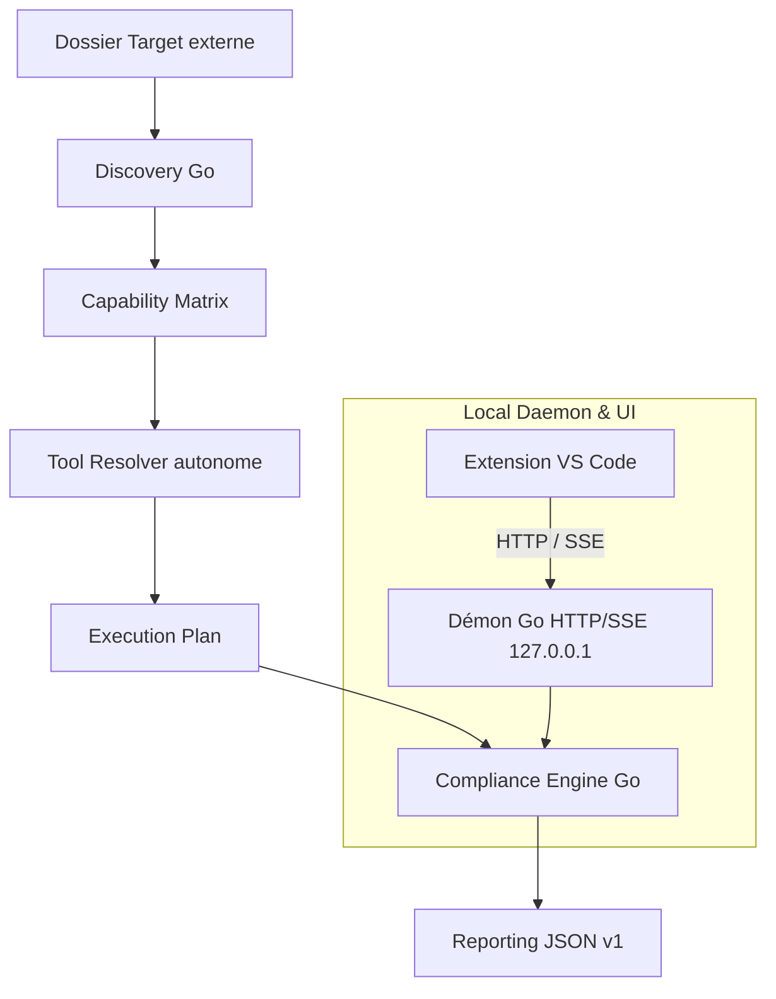

# Compliance Platform

## Vue d'ensemble

Compliance Platform est un outil local d'audit autonome de dépôts. Il découvre les technologies présentes, évalue les capacités d'outillage disponibles et exécute un plan de contrôles de conformité selon un catalogue partagé, en générant un rapport JSON canonique et un verdict consultatif.

Le moteur d'exécution autonome écrit en Go (`core/`) et son démon local HTTP/SSE constituent l'unique autorité et source de vérité du produit. Le projet fonctionne à **100 % en local**, sans dépendance envers une forge distante ni pipeline CI distante obligatoire.

## Fonctionnalités clés

- **Moteur Go autonome multi-OS** : Discovery, Capability Matrix, Tool Resolver, Compliance Engine, Reporting et serveur local (démon HTTP/SSE).
- **Extension VS Code intégrée** : Interface TreeView locale connectée au démon local via HTTP et streaming d'événements temps réel (SSE), avec lecteur de rapports interactif natif et visualisations de findings.
- **Sécurité et confinement stricts** : Démon éphémère ou persistant sur `127.0.0.1:0`, jeton Bearer 256 bits généré localement, validation stricte des en-têtes `Host` et `Origin`, approbation explicite des dossiers cibles (*workspace approval*), confinement des processus enfants et annulation immédiate sans processus orphelin.
- **Résolution d'outils découplée** : Résolution ordonnée via binaires autonomes (`.tools/bin/`), environnement Python autonome (`.tools/python/`), cache runtime et PATH système, sans dépendance à un `.venv` local.
- **Validation autonome (`compliance selftest`)** : Suite d'auto-test en 20 étapes vérifiant le cycle de vie du démon, la sécurité, l'exécution et l'annulation sur port éphémère.
- **Catalogue de 28 contrôles** couvrant Python, PowerShell, Terraform/OpenTofu, Terragrunt, Ansible, Docker/Compose, Kubernetes, Helm, Shell et Markdown.

## Architecture



Le parcours technique détaillé est documenté dans [l'architecture](docs/architecture-current.md) et la spécification de l'API locale dans [l'API du démon](docs/daemon-api.md).

---

## Utilisation recommandée (Moteur Go & Démon)

### 1. Validation de l'environnement (Selftest)

Pour valider l'intégrité du moteur Go autonome, la sécurité HTTP/SSE et le confinement des processus sur port éphémère :

```bash
compliance selftest
```

### 2. Démarrage du démon local

Le démon expose l'API de pilotage locale sur `127.0.0.1` :

```bash
compliance daemon -state-dir ~/.compliance
```

### 3. Exécution d'un audit en ligne de commande

```bash
# Découverte seule (lecture seule, sans exécution d'outil)
compliance discovery -repo "/chemin/du/projet"

# Planification seule
compliance run -repo "/chemin/du/projet" -plan-only

# Audit complet
compliance run -repo "/chemin/du/projet" -report reports/audit.json
```

### 4. Audit dans VS Code

L'extension locale [vscode-extension](vscode-extension/package.json) s'installe via le package VSIX autonome multi-OS ou se lance en mode développement :
- Sélection de la cible d'audit (Target externe).
- Préparation et inspection du plan.
- Demande explicite des permissions (réseau, exécution de code).
- Déroulement en streaming temps réel avec progression visuelle des contrôles.
- Visualisation du rapport final validé par le démon dans un panneau Webview dédié.

Le moteur Go assure 100 % de la validation, du contrat et du verdict (aucun repli PowerShell).

---

## Plateformes prises en charge

L'état de support est formalisé dans [`.config/platform-support.json`](.config/platform-support.json) :

| Plateforme | Statut | Preuves de qualification |
| :--- | :--- | :--- |
| **Windows x64** | **Qualified** | Selftest Go 20/20 PASS sur port éphémère, tests unitaires Go validés, extension VS Code 34/34 PASS. |
| **Linux x64** | Targeted | Binaires cross-compilés et distribués dans le package VSIX universel. |
| **Linux ARM64** | Targeted | Prise en charge ciblée dans le catalogue et l'architecture multi-OS. |
| **macOS x64 / ARM64** | Targeted | Binaires cross-compilés inclus dans le VSIX; selftest natif à qualifier sur hôte physique. |

---

## État des validations actuelles

Dernière mesure locale effectuée sur le socle autonome :

| Composant | Résultat mesuré | Remarque |
| :--- | :--- | :--- |
| **Compliance Selftest (Go)** | **20/20 PASS** | Validation complète du démon éphémère, sécurité Bearer, Host/Origin et zéro processus orphelin |
| **Tests unitaires Go (`core/`)** | **100 % PASS** | discovery, distribution, engine, matrix, osutil, report, selftest, server |
| **Tests extension VS Code** | **34/34 PASS** | Client démon, cycle de vie, validation de rapports, sessions isolées |

---

## Documentation

- [Tutoriel d'utilisation](docs/utilisation.md) : Auditer un projet externe via l'extension ou la CLI.
- [Architecture et contrats techniques](docs/architecture-current.md) : Description du moteur autonome, du résolveur et du modèle de sécurité.
- [Spécification de l'API Démon](docs/daemon-api.md) : Endpoints HTTP, format des requêtes, authentification et flux SSE.
- [Maintenance et packaging](docs/maintenance.md) : Packaging VSIX, gestion des outils et fonctionnement hors-ligne.
- [Extension VS Code](vscode-extension/README.md) : Guide spécifique de l'extension et de son intégration.
