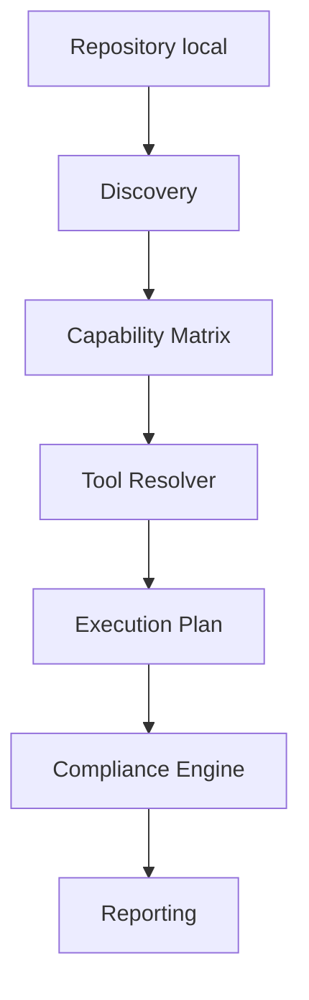

# Compliance Platform

## Vue d'ensemble

Compliance Platform est un outil local d'audit volontaire de dépôts. Il découvre les technologies, évalue les capacités disponibles et peut exécuter un plan de contrôles avec un rapport et un verdict consultatif. Il n'impose ni intégration à une forge ni blocage Git.

## Fonctionnalités clés

- Runtime partagé installé et vérifié par Bootstrap; roue Python, binaire et module PowerShell sont tracés dans l'index runtime.
- Discovery en lecture seule, avec preuves, racines, ambiguïtés et erreurs de parcours.
- Capability Matrix et Tool Resolver pour expliciter les outils disponibles et leurs limites.
- Compliance Engine v1 et catalogue de 28 contrôles, avec plan, permissions, résultats normalisés et rapport JSON.
- Quick/Full/Ci/Fix historiques maintenus pendant que les parcours historiques et Compliance coexistent.
- Adaptateurs locaux PowerShell, Git Bash et VS Code, plus un job GitLab informatif opt-in.

Une technologie détectée n'est pas nécessairement contrôlée ni qualifiée. Le catalogue comprend Python, PowerShell, Terraform/OpenTofu, Terragrunt, Ansible, Docker/Compose, Kubernetes, Helm, Shell, Markdown, JavaScript et TypeScript; les contrôles varient selon la technologie et la plateforme.

## Architecture



Le parcours Compliance est décrit dans [l'architecture actuelle](docs/architecture-current.md) et [l'index documentaire](docs/index.md). Les modes Quick/Full historiques conservent leur orchestration dédiée.

## Technologies reconnues

Les marqueurs de fichiers couvrent Python, PowerShell, Terraform/OpenTofu, Terragrunt, Ansible, Docker/Compose, Kubernetes, Helm, Shell, Markdown, JavaScript et TypeScript. Les ambiguïtés, racines et contrôles réellement configurés sont détaillés dans [Discovery](docs/discovery.md) et [Capability Matrix](docs/capability-matrix.md). La détection seule ne certifie ni la prise en charge ni la qualité sur des dépôts réels.

## Plateformes prises en charge

La seule plateforme exécutée localement est Windows x64 avec Windows PowerShell 5.1 et Python 3.11. Windows x64 est `experimental` au niveau produit; Windows ARM64, Linux x64/ARM64 et macOS x64/ARM64 sont `targeted`, pas qualifiés. Le marqueur `qualified` de l'index runtime signifie que l'installation a terminé, pas que le produit est certifié.

## Installation

Depuis la racine du dépôt, utiliser Windows PowerShell 5.1. L'installation initiale nécessite les artefacts configurés et un accès HTTPS. Git Bash ne fournit qu'un relais vers PowerShell; il ne constitue pas un runtime Linux/macOS.

```powershell
powershell -NoProfile -ExecutionPolicy Bypass -File scripts/bootstrap.ps1
```

## Bootstrap

Bootstrap installe les outils épinglés dans les espaces locaux du dépôt, sans modifier le PATH système ni les dépôts analysés. Pour réutiliser les artefacts déjà en cache:

```powershell
powershell -NoProfile -ExecutionPolicy Bypass -File scripts/bootstrap.ps1 -Offline -NoColor
```

Le mode hors ligne ne qualifie pas un poste neuf. Voir [Runtime](docs/runtime.md).

## Doctor

```powershell
powershell -NoProfile -ExecutionPolicy Bypass -File scripts/doctor.ps1 -NoColor
```

Doctor vérifie le snapshot Python, les versions, les hashes des roues, les binaires et PSScriptAnalyzer dans l'index local. Il n'est pas une qualification multi-plateforme.

## Discovery

```powershell
powershell -NoProfile -ExecutionPolicy Bypass -File scripts/quality-gate.ps1 -DiscoveryOnly -RepositoryPath "C:\chemin\du\depot"
```

Discovery n'exécute pas de contrôles. Il retourne les technologies, preuves, racines, ambiguïtés, matrice et résolution en JSON.

## Mode Compliance

```powershell
powershell -NoProfile -ExecutionPolicy Bypass -File scripts/quality-gate.ps1 -Compliance -RepositoryPath "C:\chemin\du\depot" -PlanOnly
powershell -NoProfile -ExecutionPolicy Bypass -File scripts/quality-gate.ps1 -Compliance -RepositoryPath "C:\chemin\du\depot"
```

`-PlanOnly` ne lance aucun contrôle et ne produit aucun verdict. Les contrôles nécessitant réseau ou exécution de code demandent explicitement `-AllowNetwork` et/ou `-AllowCodeExecution`. Ces permissions ne sont pas un sandbox. Consulter [Compliance Engine](docs/compliance-engine.md).

## Quick

Quick valide le socle et les contrôles applicables au dépôt plateforme. Son code 0 n'est pas une qualification produit ni une validation de couverture d'un dépôt consommateur.

```powershell
powershell -NoProfile -ExecutionPolicy Bypass -File scripts/quality-gate.ps1 -Mode Quick -NoColor
```

## Full

Full exécute les contrôles approfondis et les tests du socle. Le dernier résultat est **11 PASS, 1 FAIL, 1 WARN, 6 SKIP**; le seul FAIL est pip-audit sur `asteval==1.0.6` et `ecdsa==0.19.2`. Aucun finding n'est exclu ou masqué.

```powershell
powershell -NoProfile -ExecutionPolicy Bypass -File scripts/quality-gate.ps1 -Mode Full -NoColor
```

## Runtime

L'index runtime Windows x64 référence cinq binaires, le Python sélectionné, 154 packages/wheels et PSScriptAnalyzer. Les hashes et versions sont vérifiés par Bootstrap, Doctor et Resolver. La qualification du runtime ne lève pas le blocage de sécurité Full. Détails: [Runtime](docs/runtime.md) et [Resolver](docs/resolver.md).

## Reporting

Compliance émet le rapport JSON v1 avec résultats, findings, diagnostics, couverture, limitations, métriques et verdict. Les rapports historiques restent disponibles; voir [Reporting](docs/reporting.md). Les rapports peuvent contenir des chemins ou sorties sensibles; leur partage est à la charge de l'utilisateur.

## Modèle de sécurité

Réseau et exécution de code sont refusés par défaut en mode Compliance et doivent être autorisés explicitement. Les autorisations ne fournissent aucune isolation: n'exécuter que des contrôles et dépôts de confiance. Les rapports restent locaux; le moteur ne contacte pas une forge et n'exécute aucune opération Git de commit, push ou merge. Les hooks et la CI du dépôt peuvent néanmoins propager un code non nul.

## État actuel

Dernière validation locale consignée le 9 octobre 2026:

| Contrôle | Résultat |
| --- | --- |
| Bootstrap Offline | Succès, code 0 |
| Doctor | 71 PASS, 0 FAIL, 0 WARN, 3 SKIP |
| Tests | 49 scénarios Quality Gate; suites unitaires et intégrations réussies |
| Quick | 10 PASS, 0 FAIL, 1 WARN, 6 SKIP; code 0 |
| Full | 11 PASS, 1 FAIL, 1 WARN, 6 SKIP; seul pip-audit échoue |
| Hooks pre-commit | Succès |

Aucun test Python métier n'est présent; ShellCheck n'est pas fourni sur Windows.

## Blocages externes connus

- Quatre lignes d'avis pip-audit héritées des pins Checkov/ecdsa; décision sécurité ou correction fournisseur nécessaire, sans exclusion autorisée.
- Qualification sur poste neuf et runner GitLab réel non réalisée.
- Linux, macOS et architectures ARM64 non disponibles pour une qualification native.
- Aucun corpus consommateur autorisé pour mesurer précision, coût et utilité.
- Les décisions d'override/politique et la désignation des responsables support relèvent de décisions humaines.

## Documentation

Commencer par [l'index documentaire](docs/index.md); le rapport d'obsolescence est dans [docs/obsolescence-audit.md](docs/obsolescence-audit.md).

## Contribution

Les consignes projet sont dans [.github/copilot-instructions.md](.github/copilot-instructions.md) et le modèle de merge request dans [.github/merge_request_template.md](.github/merge_request_template.md). Toute modification des contrôles doit être suivie des tests, Quick et Full; les findings de sécurité ne doivent pas être masqués.

## Licence

Aucun fichier `LICENSE` n'est présent dans ce dépôt.
