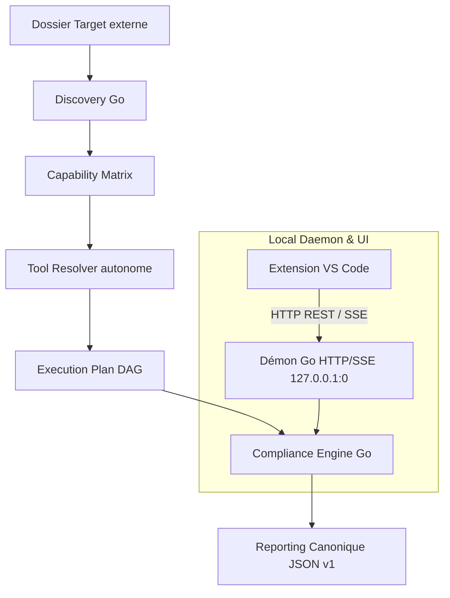

# Compliance Platform

## Vue d'ensemble

Compliance Platform est un outil local d'audit autonome de dépôts multi-technologies. Il découvre automatiquement les technologies présentes dans un projet cible externe, évalue les capacités d'outillage disponibles et exécute un plan de contrôles de conformité selon un catalogue partagé, en générant un rapport JSON canonique et un verdict consultatif.

Le moteur d'exécution autonome écrit en Go (`core/`) et son démon local HTTP/SSE constituent l'unique autorité et source de vérité du produit. Le projet fonctionne à **100 % en local**, sans dépendance envers une forge distante ni pipeline CI distante.

---

## Fonctionnalités Clés & Capacités

- **Moteur Go autonome multi-OS (v2.0.0)** : Discovery, Capability Matrix, Tool Resolver, Compliance Engine, Reporting canonique et serveur local (démon HTTP/SSE).
- **Extension VS Code intégrée** : Interface TreeView locale connectée au démon local via HTTP et streaming d'événements temps réel (SSE), avec lecteur de rapports interactif natif et visualisations de findings.
- **Sécurité et confinement stricts** : Démon éphémère ou persistant sur `127.0.0.1:0`, jeton Bearer 256 bits généré localement, validation stricte des en-têtes `Host` et `Origin`, approbation explicite des dossiers cibles (*workspace approval*), confinement des processus enfants (Job Objects sous Windows, process groups POSIX sous Linux/macOS) et annulation immédiate sans processus orphelin.
- **Résolution d'outils découplée** : Binaires locaux (`.tools/bin/`), Python autonome (`.tools/python/`), cache `~/.compliance/tools/bin/<plateforme>/`, préfixes macOS (Homebrew, `~/.local/bin`, pyenv) puis PATH. Un VS Code lancé depuis le Dock trouve les outils Homebrew sans hériter de `~/.zshrc`.
- **Autonomie hors dépôt** : Le catalogue et les schémas sont embarqués dans le binaire (`//go:embed`) et dans le VSIX. `compliance selftest` fonctionne sans clone Git.
- **Validation autonome intégrée (`compliance selftest`)** : Suite d'auto-test en 20 étapes vérifiant le cycle de vie du démon, la sécurité, l'exécution et l'annulation sur port éphémère.
- **Catalogue de 28 contrôles standardisés** couvrant les écosystèmes majeurs du développement et des infrastructures cloud modernes.

---

## Technologies et Contrôles Couverts

La plateforme détecte automatiquement les technologies suivantes et planifie les contrôles adaptés selon la disponibilité locale des outils :

| Écosystème | Technologies & Preuves | Capacités & Outils Associés |
| :--- | :--- | :--- |
| **Python** | `requirements.txt`, `pyproject.toml`, `setup.py`, `Pipfile` | Formatage et lint (`ruff`), lint (`pylint`), tests (`pytest`), sécurité AST (`bandit`), audit des dépendances (`pip-audit`) |
| **Conteneurs** | `Dockerfile`, `Containerfile` | Lint Dockerfile (`hadolint`), scan de vulnérabilités (`trivy`) |
| **Kubernetes** | Manifestes YAML Kubernetes | Sécurité et politique (`checkov`), scan (`trivy`) |
| **Ansible** | `playbook.yml`, `roles/`, `ansible.cfg` | Lint (`ansible-lint`), YAML (`yamllint`) |
| **Terraform & OpenTofu** | `*.tf`, `*.tofu` | Formatage (`terraform fmt`, `tofu fmt`), lint (`tflint`), sécurité (`checkov`) |
| **Terragrunt** | `terragrunt.hcl` | Formatage HCL (`terragrunt hcl fmt`) |
| **Helm** | `Chart.yaml`, `values.yaml` | Sécurité et politique (`checkov`), scan (`trivy`) |
| **Shell** | Scripts `.sh` | Analyse statique (`shellcheck`) |
| **Documentation** | Fichiers Markdown `.md` | Lint (`markdownlint`, via la commande `pre-commit`) |
| **PowerShell** | Scripts `.ps1`, `.psm1`, `.psd1` | Analyse statique (`PSScriptAnalyzer`, exécuté par `pwsh` ou Windows PowerShell) |
| **JavaScript & TypeScript** | `.js`, `.jsx`, `.ts`, `.tsx` | Technologie détectée ; aucun outil de lint n'est configuré dans le catalogue |

---

## Arborescence du Dépôt

Le dépôt est organisé de manière modulaire, sans dette technique ni scripts obsolètes :

```
Compliance_Platform/
├── core/                               # Moteur d'audit autonome en Go
│   ├── cmd/
│   │   └── compliance/                 # CLI autonome (main.go)
│   ├── internal/
│   │   ├── discovery/                  # Détection des technologies et racines
│   │   ├── distribution/               # Synchronisation et intégrité des outils
│   │   ├── embedded/                   # Catalogue et schémas embarqués (//go:embed)
│   │   ├── engine/                     # Moteur d'exécution DAG et gestion des runs
│   │   ├── matrix/                     # Capability Matrix et sondes d'outils
│   │   ├── osutil/                     # Confinement multi-OS (Job Objects / POSIX)
│   │   ├── report/                     # Génération et validation du rapport v1
│   │   ├── selftest/                   # Suite de validation autonome intégrée (20 étapes)
│   │   └── server/                     # Démon local HTTP/SSE (127.0.0.1:0)
│   └── go.mod
├── vscode-extension/                   # Extension VS Code officielle (TypeScript)
│   ├── src/
│   │   ├── extension.ts                # Activation, commandes et TreeView
│   │   ├── daemonClient.ts             # Client HTTP/SSE et gestion du cycle de vie du démon
│   │   ├── model.ts                    # Modèles d'état et normalisation multi-OS
│   │   └── reportPanel.ts              # Panneau Webview interactif de visualisation
│   ├── package_vsix.py                 # Packaging OPC universel et cross-compilation
│   ├── package.json                    # Manifeste d'extension VS Code (v2.0.0)
│   └── tsconfig.json
├── .config/                            # Contrats de configuration partagés
│   ├── control-catalog.json            # Spécification canonique des 28 contrôles
│   ├── platform-support.json           # Matrice d'éligibilité et statuts multi-OS
│   └── runtime-manifest.json           # Manifeste signé des binaires d'outils
├── docs/                               # Documentation technique exhaustive
│   ├── utilisation.md                  # Guide d'audit pas à pas (CLI et VS Code)
│   ├── architecture-current.md         # Architecture actuelle, flux SSE et sécurité
│   ├── daemon-api.md                   # Contrat d'API REST et streaming SSE du démon
│   └── maintenance.md                  # Maintenance, packaging VSIX et hors-ligne
├── .gitignore                          # Règles d'exclusion Git (0 binaire versionné)
├── go.work                             # Espace de travail Go multi-modules
└── README.md                           # Documentation de référence du projet
```

---

## Architecture & Garanties Multi-OS



### 1. Gestion de la Casse et Normalisation Multi-OS
- Les comparaisons de chemins (`server.go` et `model.ts`) sont insensibles à la casse sur **Windows** et **macOS** (`runtime.GOOS == "windows" || runtime.GOOS == "darwin"`), et strictement sensibles sur **Linux**.
- `osutil.CanonicalPath` résout les liens symboliques, y compris le plus long ancêtre existant. Sur macOS, `/var` et `/tmp` sont donc ramenés à `/private/var` et `/private/tmp` avant l'approbation d'un workspace.
- Tous les chemins sont normalisés via `filepath.ToSlash` pour garantir l'uniformité des contrats JSON et des identifiants de contrôles.

### 2. Routage HTTP/SSE Résilient (RFC 3986)
- L'endpoint `GET /api/v1/runs/{id}/logs/{control_id...}` gère nativement les identifiants hiérarchiques avec slashs (ex. `python/linting/ruff/.`).
- Gestion résiliente de la troncature des dot-segments par les proxys HTTP clients : si le segment final `/.` est normalisé en routeur, le moteur résout automatiquement la variante exacte enregistrée dans la session.

### 3. Packaging VSIX Universel à la Volée
- Le script `package_vsix.py` (intégré à `npm run package`) synchronise `.config/` vers l'embed Go, cross-compile les binaires natifs pour 6 architectures, pose le mode Unix `0755` sur les binaires POSIX du VSIX, et embarque `extension/.config/` :
  - `windows-x64` (`compliance-windows-amd64.exe`)
  - `windows-arm64` (`compliance-windows-arm64.exe`)
  - `linux-x64` (`compliance-linux-amd64`)
  - `linux-arm64` (`compliance-linux-arm64`)
  - `macos-x64` (`compliance-darwin-amd64`)
  - `macos-arm64` (`compliance-darwin-arm64`)
- L'extension sélectionne automatiquement le binaire adapté à la plateforme hôte à l'exécution.

---

## Utilisation

### 1. Auto-validation de l'environnement (Selftest)

Pour valider l'intégrité du moteur Go autonome, la sécurité HTTP/SSE et le confinement des processus :

```bash
compliance selftest
```

### 2. Démarrage du démon local

```bash
compliance daemon -state-dir ~/.compliance
```

### 3. Exécution d'un audit en ligne de commande

```bash
# Découverte seule (lecture seule, sans exécution d'outil)
compliance discovery -repo "/chemin/du/projet"

# Planification seule (DAG des contrôles)
compliance run -repo "/chemin/du/projet" -plan-only

# Audit complet avec génération du rapport JSON
compliance run -repo "/chemin/du/projet" -report reports/audit.json
```

### 4. Audit dans VS Code

L'extension locale s'installe via le package VSIX autonome multi-OS (`vscode-extension/dist/compliance-local-pipelines-2.0.0.vsix`) :
- Sélection de la cible d'audit (Target externe).
- Préparation et inspection du plan ordonnancé.
- Demande explicite des permissions (réseau, exécution de code).
- Déroulement en streaming temps réel avec progression visuelle des contrôles.
- Visualisation du rapport final validé par le démon dans un panneau Webview dédié.

---

## Plateformes Prises en Charge

| Plateforme | Statut | Preuves de Qualification |
| :--- | :--- | :--- |
| **Windows x64** | **Qualified** | Selftest Go 20/20 PASS sur port éphémère, suite VS Code qualifiée, binaire natif inclus dans le VSIX. |
| **Windows ARM64** | Targeted | Binaire natif `compliance-windows-arm64.exe` cross-compilé et embarqué dans le VSIX universel. |
| **Linux x64** | Targeted | Binaire natif `compliance-linux-amd64` cross-compilé et embarqué dans le VSIX universel. |
| **Linux ARM64** | Targeted | Binaire natif `compliance-linux-arm64` cross-compilé et embarqué dans le VSIX universel. |
| **macOS x64** (`macos-x64`, binaire `compliance-darwin-amd64`) | Targeted | Binaire natif embarqué, catalogue autonome, résolution Homebrew. Le statut `qualified` attend un selftest physique sur Mac Intel. |
| **macOS ARM64** (`macos-arm64`, binaire `compliance-darwin-arm64`) | Targeted | Binaire natif embarqué, catalogue autonome, résolution `/opt/homebrew`. Le statut `qualified` attend un selftest physique sur Apple Silicon. |

---

## Documentation Technique

- [Tutoriel d'utilisation](docs/utilisation.md) : Auditer un projet externe via l'extension ou la CLI.
- [Architecture et contrats techniques](docs/architecture-current.md) : Description du moteur autonome, du résolveur et du modèle de sécurité.
- [Spécification de l'API Démon](docs/daemon-api.md) : Endpoints HTTP, format des requêtes, authentification et flux SSE.
- [Maintenance et packaging](docs/maintenance.md) : Packaging VSIX, gestion des outils et fonctionnement hors-ligne.
- [Extension VS Code](vscode-extension/README.md) : Guide spécifique de l'extension et de son intégration.
