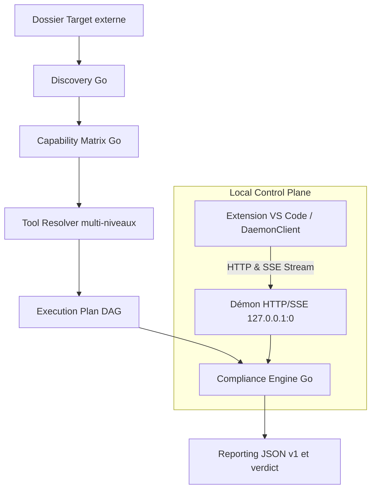

# Architecture et contrats techniques

Pour utiliser la plateforme sur un projet, consulter le [tutoriel d'utilisation](utilisation.md). Les commandes d'administration et de packaging sont décrites dans [Maintenance](maintenance.md), et les spécifications de l'API locale dans [l'API du démon](daemon-api.md).

## Parcours Compliance autonome (Go)

Le moteur reçoit un dossier local cible (la *Target*), sans compte de forge ni réseau obligatoire. Le moteur d'exécution autonome en Go (`core/`) constitue l'unique source de vérité et autorité d'exécution.

---

## Composants et sources de vérité

| Composant | Responsabilité | Implémentation Go / Contrat |
| :--- | :--- | :--- |
| **Discovery** | Inventaire des technologies, preuves, racines, ambiguïtés et erreurs de scan | `core/internal/discovery` |
| **Capability Matrix** | Matrice des contrôles applicables, profils et états préliminaires | `core/internal/matrix` |
| **Tool Resolver** | Résolution ordonnée découplée (`.tools/bin/`, Python autonome, cache runtime, PATH) | `core/internal/matrix`, `core/internal/toolchain` |
| **Catalogue de contrôles** | 28 contrôles, profils, permissions, timeouts, paramètres et dépendances | [`.config/control-catalog.json`](../.config/control-catalog.json), `core/internal/catalog` |
| **Compliance Engine** | Ordonnancement déterministe (DAG), exécution, verdict, limitations | `core/internal/engine` |
| **Serveur & Démon local** | API REST/SSE locale sur port éphémère, jeton Bearer 256 bits, contrôle Host/Origin | `core/internal/server` |
| **Client VS Code** | Interface TreeView, pilotage du démon, streaming SSE temps réel, lecteur de rapports | `vscode-extension/src/daemonClient.ts`, `sessionController.ts` |
| **Reporting v1** | Rapport JSON canonique conforme au schéma v1 avec traçabilité et verdict consultatif | [`.config/compliance-report.schema.json`](../.config/compliance-report.schema.json), `core/internal/report` |
| **Selftest** | Suite de validation autonome en 20 étapes garantissant 0 orphelin et sécurité stricte | `core/internal/selftest`, `compliance selftest` |

---

## Résolution d'outils (Tool Resolver multi-niveaux)

Le résolveur d'outils est entièrement découplé de l'environnement virtuel historique (`.venv`) et applique une recherche ordonnée et déterministe :

1. **Binaires autonomes (`.tools/bin/<command>[.exe]`)** : Outils CLI natifs pré-positionnés ou synchronisés (`compliance`, `hadolint`, `tflint`, `terraform`, `tofu`, `terragrunt`, `shellcheck`, `trivy`, `gitleaks`, `ruff`).
2. **Environnement Python autonome (`.tools/python/Scripts/` ou `.tools/python/bin/`)** : Outils Python installés dans la distribution autonome locale (`bandit`, `pylint`, `pytest`, `pip-audit`, `checkov`).
3. **Cache runtime multi-OS (`.tools/runtime/<platform>/<command>/...`)** : Outils déployés par plateforme.
4. **Modules PowerShell (`.tools/powershell-modules/`)** : Module `PSScriptAnalyzer` inspecté par son manifeste `.psd1` pour le contrôle dédié `powershell.lint.psscriptanalyzer`.
5. **PATH système** : Découverte des exécutables déclarés sur le système d'exploitation hôte via `exec.LookPath`.

---

## Modèle de sécurité et confinement du démon

Le démon HTTP/SSE local (`core/internal/server`) implémente un modèle de sécurité en profondeur pour l'exécution locale :

- **Écoute strictement locale** : Liaison exclusive sur `127.0.0.1` avec attribution d'un port TCP éphémère (`:0`) pour éliminer tout conflit de port.
- **Authentification par jeton Bearer 256 bits** : Généré aléatoirement à chaque démarrage, stocké dans `daemon.json` avec permissions restreintes (`0600`), exigé sur toutes les requêtes (sauf GET `/api/v1/health`).
- **Validation stricte des en-têtes `Host` et `Origin`** : Rejet systématique avec code HTTP 403 si l'en-tête `Host` ne correspond pas à `127.0.0.1:<port>` ou si `Origin` ne provient pas d'un client local autorisé (`vscode-webview://` ou localhost).
- **Approbation explicite des dossiers cibles (*Workspace Approval*)** : Tout chemin `target_path` doit être préalablement canonisé et approuvé via `POST /api/v1/workspaces/approve`. Toute tentative d'audit hors des dossiers autorisés est rejetée (code 403).
- **Confinement des processus enfants et zéro processus orphelin** :
  - Sous Windows : Rattachement de tous les processus fils à un Windows Job Object configuré avec `JOB_OBJECT_LIMIT_KILL_ON_JOB_CLOSE`.
  - Sous POSIX : Création d'un groupe de processus dédié (`Setpgid: true`) et terminaison du groupe complet via `syscall.Kill(-pgid, SIGKILL)` en cas d'annulation ou de timeout.
- **Verrou d'instance unique** : Gestion d'un fichier de verrou (`daemon.lock`) pour garantir qu'un seul démon s'exécute pour un répertoire d'état donné.

---

## Reporting et validation de rapport

Le rapport Compliance v1 émis par le moteur Go respecte strictement le contrat JSON [`.config/compliance-report.schema.json`](../.config/compliance-report.schema.json) :

- **Structure normalisée** : `metadata`, `discovery`, `matrix`, `resolver`, `execution_plan`, `execution_results`, `findings`, `diagnostics`, `summary`, `coverage`, `limitations`, `verdict`, `verdict_reasons`, `advisory: true`.
- **Validation native via le démon (`POST /api/v1/reports/validate`)** : Le démon effectue une validation en mémoire de la structure du rapport, compare son empreinte SHA-256 avec les octets stables du fichier, et calcule les présentations visuelles des contrôles pour l'interface utilisateur.
- **Sécurisation anti-TOCTOU** : Le lecteur de rapport de l'extension vérifie que le fichier n'a subi aucune modification concurrente pendant la phase de validation.
