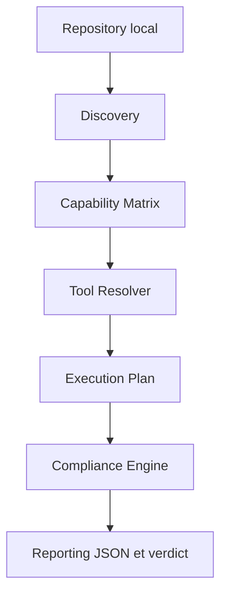

# Architecture et contrats techniques

Pour utiliser la plateforme sur un projet, commencer par le [tutoriel](utilisation.md). Les commandes de qualification et de mise à jour sont dans [Maintenance](maintenance.md).

## Parcours Compliance

Le moteur reçoit un dossier local, sans compte de forge. Le runtime reste dans la plateforme, pas dans chaque projet. Les modes Quick/Full/Ci/Fix historiques conservent une orchestration distincte du mode Compliance.

## Composants et sources de vérité

| Composant | Responsabilité | Source |
| --- | --- | --- |
| Bootstrap et Doctor | Installer, vérifier et diagnostiquer les outils locaux | [Bootstrap](../scripts/bootstrap.ps1), [Doctor](../scripts/doctor.ps1) |
| Discovery, Matrix, Resolver | Inventaire, capacités et sélection d'outils | [Quality Gate](../scripts/quality-gate.ps1) |
| Catalogue | 28 contrôles, profils, permissions, paramètres et dépendances | [Catalogue](../.config/control-catalog.json), [schéma](../.config/control-catalog.schema.json), [module](../src/Control.Catalog.psm1) |
| Compliance Engine | Plan déterministe, DAG, exécution, résultats et verdict | [Module](../src/Compliance.Engine.psm1) |
| Runtime | Provenance, versions et intégrité des artefacts | [Module de provenance](../src/Tool.Provenance.psm1) |
| Qualification produit | Six couples système/architecture et leurs preuves | [Matrice](../.config/platform-support.json), [module](../src/Platform.Support.psm1) |
| Adaptateurs | Contrat local PowerShell/Bash/VS Code/GitLab | [Module](../src/Compliance.Adapter.psm1), [wrapper](../scripts/compliance-adapter.ps1) |
| Reporting | Rapport v1 et cohérence résultats/findings/verdict | [Schéma](../.config/compliance-report.schema.json), validateur `Test-ComplianceReport` |

Les schémas sont des contrats documentés et testés; les validations runtime sont implémentées en PowerShell. Le [YAML de politique](../.config/quality-gate.yml) est descriptif, pas un moteur de politique. La CLI n'accepte pas de profil consommateur ni d'override déclaratif.

## Discovery et capacités

Discovery distingue `detected`, `ambiguous` et `absent`; il conserve `evidence`, `roots`, `ambiguities`, `scan_complete` et `scan_errors`.

| Technologie | Signaux principaux | Limite |
| --- | --- | --- |
| Python | `.py`, manifeste Python le plus proche | Tests reconnus par segment `tests` |
| PowerShell | `.ps1`, `.psm1`, `.psd1` | Les fichiers de données sont aussi inventoriés |
| Terraform/OpenTofu | `.tf`, `.tofu`, marqueurs de version/configuration | `.tf` sans marqueur reste ambigu; marqueur recherché par racine |
| Terragrunt | `terragrunt.hcl`, `terragrunt.stack.hcl` | HCL générique non classé |
| Ansible | Configuration, rôles, playbooks, `hosts:` | `hosts:` seul reste ambigu |
| Docker/Compose | Dockerfile/Containerfile et manifeste Compose | Hadolint ne valide pas Compose |
| Kubernetes/Helm | `apiVersion`/`kind`, `Chart.yaml` | Templates ambigus; pas de rendu implicite |
| Shell/Markdown | `.sh`, `.md` | Shell sans extension non détecté |
| JavaScript/TypeScript | Extensions, package.json, tsconfig | Pas de linter configuré dans le catalogue actuel |

Les dossiers générés sont exclus avant parcours: `.git`, `.venv`, `.tools`, `reports`, caches Python, Terraform et Terragrunt. Les répertoires de réanalyse ne sont pas parcourus; les liens de fichiers ne sont pas explicitement filtrés. Les erreurs de lecture/parcours rendent le scan incomplet, sans effacer l'inventaire partiel.

La Matrix expose `required`, `availability`, candidats et raisons. Les capacités sont `available`, `partially_available`, `unavailable`, `unconfigured`, `not_applicable` ou `ambiguous`. Un outil absent ne transforme jamais une technologie détectée en technologie absente.

Avec `all`, les outils sont complémentaires; avec `alternative`, le premier disponible dans l'ordre du profil suffit. Le Resolver déduplique les commandes au sein de chaque technologie, conserve les capacités non résolues et des métriques de sélection. Ces métriques ne prouvent pas un nombre de processus évités par les modes historiques.

## Runtime et intégrité

Le snapshot local `.tools/runtime/index.json` contient cinq binaires Windows x64, Python, 154 packages/wheels et PSScriptAnalyzer. Il conserve versions, chemins, hashes, provenance, dates et méthode de validation. Les vues `python.packages` et `python_packages` doivent être cohérentes, sans doublons.

Bootstrap distingue le hash de l'archive publiée de celui du binaire extrait. Les wheels PyPI vérifiées restent dans `.tools/cache/wheels`; leur provenance ne prouve pas les octets historiquement utilisés pour installer `.venv`. PSScriptAnalyzer possède des hashes de manifeste/arbre, sans somme officielle publiée par la galerie.

Resolver vérifie les hashes requis, les chemins et le lock, puis effectue des sondes bornées de version/exécution. Il conserve `execution_probe`; échec ou timeout interdit `available`. Les outils d'une technologie absente/ambiguë ne sont pas sondés. Les commandes trouvées uniquement dans le PATH ne disposent pas d'une provenance éditeur attestée par l'index.

L'exécuteur vérifie aussi les binaires runtime et les copies historiques sous `.tools/bin`. Le rollback local, l'altération d'artefacts et le rejet d'un index corrompu avant remplacement d'un binaire sont testés.

## Plan, permissions et exécution

Le plan v1 conserve identifiant, technologie, capacité, outil, racine relative, applicabilité, ordre, timeout, dépendances et effets. Les dépendances sont triées topologiquement; cycles et références absentes sont refusés. Un prérequis non réussi bloque ses dépendants requis.

Les états préalables sont `applicable`, `not_applicable`, `capability_unavailable`, `tool_unavailable`, `technology_absent` et `ambiguous`. Les candidats non retenus ne sont pas exécutés. Réseau et exécution de code nécessitent `-AllowNetwork` et `-AllowCodeExecution`; Checkov demande les deux. Ces consentements ne sont pas un sandbox: un processus autorisé peut écrire ou accéder au réseau.

L'exécution borne le temps global et par contrôle, capture stdout/stderr séparément et termine l'arbre Windows au timeout. Les sorties conservées sont plafonnées après buffering en mémoire: ce n'est pas une limite de mémoire du processus. Aucun apply, destroy, déploiement ou build d'image n'est configuré.

## Reporting et verdict

Le rapport Compliance v1 contient metadata, discovery, matrix, resolver, execution_plan, execution_results, findings, diagnostics, summary, coverage, limitations, verdict, verdict_reasons et `advisory: true`. Les métriques Discovery/Resolver/Compliance/Reporting et certains champs metadata sont facultatifs pour compatibilité v1. Le hash du catalogue réellement chargé identifie ses octets.

Les résultats sont `success`, `fail`, `error` ou `skipped`. Un défaut exécuté ou une erreur critique donne FAIL. Un scan incomplet empêche l'exécution; un résultat manquant/dupliqué devient une erreur critique. PASS ne garantit pas une couverture complète: vérifier `coverage.complete`, les omissions et permissions.

Le mode Compliance écrit le même JSON sur stdout et sur disque (UTF-8 sans BOM); `-HumanSummary` ajoute le résumé sur stderr. Le rapport par défaut et les chemins relatifs sont sous `reports/` de la plateforme. Un chemin absolu explicite permet une autre destination. Une entrée invalide ou une panne d'écriture ne garantit pas de rapport persistant.

`-ReportRedactionPattern` et `-ReportRedactionReplacement` masquent des champs textuels sensibles, sans remplacer une revue avant partage. `-ReportRetentionDays` vaut 0 par défaut; une valeur positive nettoie uniquement les anciens `compliance-report*.json` du dossier reports de la plateforme, en conservant le rapport courant et en ignorant les liens de réanalyse.

Discovery émet une enveloppe JSON v1 sans verdict. Quick/Full/Ci/Fix produisent aussi le rapport Compliance de référence tout en conservant leur enveloppe historique; le `-ReportPath` historique relatif est sous le dépôt analysé. Les avis détaillés pip-audit restent en console, pas dans les lignes `controles` du rapport historique.

## Modes historiques et intégrations

Quick/Full/Ci/Fix et `-Category` servent les usages historiques du socle. Full/Ci ajoutent l'audit des dépendances de la plateforme et ses tests. Ces parcours ne suivent pas partout les racines/permissions du moteur Compliance et ne constituent pas un audit consommateur complet. `Fix` applique des corrections explicites Python/Terraform et de normalisation; il ne se combine pas avec `-Compliance` et n'est pas un correcteur universel.

Les adaptateurs PowerShell, Git Bash et VS Code utilisent le wrapper commun. Git Bash peut relayer PowerShell mais ne qualifie pas Linux/macOS. La tâche VS Code `Compliance v1` cible actuellement le workspace de la plateforme; pour un projet externe, utiliser le tutoriel avec `-RepositoryPath`.

L'extension ajoute une TreeView native, des commandes et un OutputChannel, sans serveur ni moteur de workflow supplémentaire. Elle prépare avec `-PlanOnly`, puis lance le wrapper commun en audit global avec un `-ProgressRunId` explicite. Sa source est le parent du dossier d'extension, indépendamment de la Target choisie. Les permissions sont demandées à partir du plan fraîchement préparé et transmises au moteur ; `reason_code` distingue notamment le refus `permission_denied` sans changer les états canoniques du rapport v1. Les statuts visuels sont produits par le backend ; l'interface ne calcule pas le verdict ni les dépendances.

Les fichiers d'audit sont sous `.tools/state/runs/<run_id>/` de la source, déjà exclu via `.tools/`. Les liens de réanalyse sont refusés et les métadonnées/snapshots/rapports backend remplacés atomiquement. Le [contrat local de session](../.config/compliance-session.schema.json) décrit session et événements NDJSON v1 : début, préparation, snapshot, début/fin de contrôle, annulation, rapport et fin de session. Séquence, identité et résultats terminaux sont contrôlés côté extension. Les callbacks du moteur restent optionnels et ne polluent pas son flux de résultats ; hors `-ProgressRunId`, stdout et codes de sortie restent historiques. Le rapport d'audit reçoit le même identifiant que la session et le snapshot.

Le runner conserve sa capture de sorties en fin de contrôle ; il vérifie le signal d'annulation toutes les 200 ms pendant l'attente, sans streaming ligne par ligne. L'arbre Windows est terminé au timeout ou à l'annulation. Un battement de vie local permet de détecter la disparition du host. Le rapport interrompu ajoute une erreur critique de session et une couverture incomplète, tout en conservant les résultats obtenus. Les sorties sont masquées avant persistance et consultées comme texte brut ; les chemins sont confinés au dossier de session. Les lancements partiels ne sont pas implémentés.

Le lecteur Webview local réutilise `Test-ComplianceReport` par le wrapper `-ValidateReportPath` et la même fonction de présentation PowerShell que les événements ; il ne duplique ni schéma complet ni calcul de verdict dans TypeScript. Le wrapper renvoie un hash des octets validés et les statuts associés aux identifiants de contrôle. Le modèle d'affichage défensif refuse les tableaux/identités incohérents, sans inventer les localisations des findings. Session, plan, événements, résultats et sections du lecteur utilisent les identifiants stables, pas leurs libellés.

Le panneau utilise HTML/CSS/script locaux, les couleurs des thèmes VS Code, une CSP sans réseau, un nonce et des messages à actions fermées. Tous les textes non fiables sont échappés ; aucune sortie n'est injectée par innerHTML. Les ressources locales n'incluent ni Target ni dossier de rapport. Les historiques explicitement choisis et la dernière référence persistée restent signalés comme historiques, sans session active ni consentements restaurés. Un accès de finding est limité à la Target confirmée et refuse les réanalyses ; un rapport manuel ne transmet aucune autorisation d'exécution. Aucun rapport Markdown parallèle, framework frontend, serveur ou base de données n'est ajouté.

Le job GitLab `compliance-report` est opt-in (`COMPLIANCE_ADAPTER_ENABLED=true`), avec `allow_failure: true`; l'adaptateur transforme un verdict FAIL en succès, sans effacer les erreurs techniques. Le job historique `quality-gate` reste indépendant et peut échouer. Les artifacts ont sept jours de rétention; aucune intégration distante réelle n'est qualifiée.
