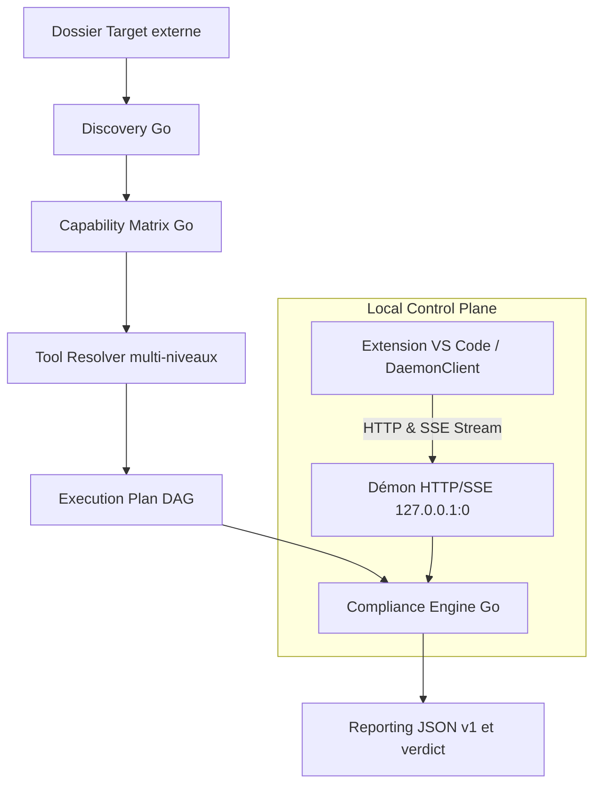

# Architecture et contrats techniques

Version courante : 2.0.15. Les chiffres de contrôles figés dans d'anciennes notes (notamment « 28 contrôles ») sont obsolètes. La liste actuelle est le tableau `catalog-controls` des README, vérifié contre `.config/control-catalog.json`.

Le guide d'usage est le [README](../README.md). Le packaging et la signature sont dans [développement](developpement.md). Les outils sont dans [outils](outils.md).

## Parcours Compliance autonome (Go)

Le moteur reçoit un dossier local cible (la *Target*), sans compte de forge ni réseau obligatoire. Le moteur d'exécution autonome en Go (`core/`) constitue l'unique source de vérité et autorité d'exécution.

---

## Composants et sources de vérité

| Composant | Responsabilité | Implémentation Go / Contrat |
| :--- | :--- | :--- |
| **Discovery** | Inventaire des technologies, preuves, racines, ambiguïtés et erreurs de scan | `core/internal/discovery` |
| **Capability Matrix** | Matrice des contrôles applicables, profils et états préliminaires | `core/internal/matrix` |
| **Tool Resolver** | Résolution stricte à 3 niveaux : Target `node_modules` (JS/TS), `.tools/bin/` local, registre `~/.compliance/tools/`, `PATH` système | `core/internal/distribution`, `core/internal/matrix`, `core/internal/osutil` |
| **Catalogue de contrôles** | Identifiants, outils et plateformes de [`.config/control-catalog.json`](../.config/control-catalog.json). Le nombre vivant est celui du fichier, pas un chiffre de documentation. | `core/internal/matrix` |
| **Compliance Engine** | Ordonnancement déterministe (DAG), exécution, verdict, limitations | `core/internal/engine` |
| **Serveur & Démon local** | API REST/SSE locale sur port éphémère, jeton Bearer 256 bits, contrôle Host/Origin | `core/internal/server` |
| **Client VS Code** | Interface TreeView, pilotage du démon, streaming SSE temps réel, lecteur de rapports | `vscode-extension/src/daemonClient.ts` (`SessionController`), `vscode-extension/src/reportPanel.ts` |
| **Reporting v1** | Rapport JSON canonique conforme au schéma v1 avec traçabilité et verdict consultatif | [`.config/compliance-report.schema.json`](../.config/compliance-report.schema.json), `core/internal/report` |
| **Selftest** | Suite de validation autonome en 20 étapes garantissant 0 orphelin et sécurité stricte | `core/internal/selftest`, `compliance selftest` |

---

## Résolution d'outils (Tool Resolver strict)

Le résolveur d'outils applique un ordre de résolution rigoureux et déterministe, découplé de tout environnement virtuel tiers :

1. **Pour les outils JavaScript et TypeScript (`eslint`, `tsc`)** :
   - **Priorité 1** : `node_modules/.bin` de la Target auditée.
   - **Priorité 2** : Bundle autonome `~/.compliance/tools/node` issu du registre.
2. **Pour tous les autres outils du catalogue** :
   - **Priorité 1 — Développement local** : Répertoire `.tools/bin/` à la racine du dépôt.
   - **Priorité 2 — Registre installé (`~/.compliance/tools/`)** :
     - *Binaires natifs* : `~/.compliance/tools/bin/<platform>/<tool>[.exe]`.
     - *Bundle Python relocalisable* : `~/.compliance/tools/python/python[.exe]`. L'exécution passe exclusivement par le mode module (`python -m <module>`) afin de ne jamais dépendre de shebangs ou de lanceurs figés par un venv.
     - *Bundle Node* : `~/.compliance/tools/node/bin/`.
     - *Modules PowerShell* : `~/.compliance/tools/powershell-modules/PSScriptAnalyzer`.
   - **Priorité 3 — Système** : Préfixes système standards (`PATH`, Homebrew `/opt/homebrew/bin` ou `/usr/local/bin` sur macOS, shims pyenv).

Sur Windows, `ansible`, `ansible-lint` et `molecule` sont marqués incompatibles avant cette recherche : la présence du paquet ne prouve pas que le contrôleur s'exécute. Le plan ne les propose pas comme installables depuis le manifeste. `ansible-lint` est réservé à Linux et macOS ; `yamllint` couvre Ansible sur Windows. Une commande qui reçoit une longue liste de fichiers est découpée sous 24 000 caractères et les sorties sont agrégées.

La découverte borne l'échantillon de fichiers affiché et le nombre de racines. Chaque racine retenue conserve une preuve (nom de fichier et extension). Le plan compare les jetons du catalogue à cette preuve, pas seulement à l'échantillon tronqué. Les jetons `Dockerfile` et `Containerfile` couvrent aussi `Dockerfile.*`, `*.Dockerfile` et `.gitpod.Dockerfile`. Un plan refusé nomme le contrôle, la racine et la raison. Le compteur Indisponibles du rapport et le canal Output comptent les mêmes codes : outil absent, capacité absente, dépôt non configuré, plateforme indisponible.

---

## Modèle de sécurité et confinement du démon

Le démon HTTP/SSE local (`core/internal/server`) implémente un modèle de sécurité en profondeur pour l'exécution locale :

- **Écoute strictement locale** : Liaison exclusive sur `127.0.0.1` avec attribution d'un port TCP éphémère (`:0`) pour éliminer tout conflit de port.
- **Authentification par jeton Bearer 256 bits** : Généré aléatoirement à chaque démarrage, stocké dans `daemon.token` avec permissions `0600` réappliquées après écriture. `daemon.json` est écrit avec le même mode. Sous Windows, une ACL restrictive est posée en plus. Le jeton est exigé sur toutes les requêtes (sauf GET `/api/v1/health`).
- **Validation stricte des en-têtes `Host` et `Origin`** : Rejet systématique avec code HTTP 403 si l'en-tête `Host` ne correspond pas à `127.0.0.1:<port>` ou si `Origin` ne provient pas d'un client local autorisé (`vscode-webview://` ou localhost).
- **Approbation explicite des dossiers cibles (*Workspace Approval*)** : Tout chemin `target_path` est canonisé (`EvalSymlinks`, puis le plus long ancêtre existant si la feuille n'existe pas encore) avant `POST /api/v1/workspaces/approve`. Sur macOS, `/var/folders/...` et `/private/var/folders/...` désignent le même dossier. Toute cible hors des dossiers autorisés est rejetée (code 403).
- **Confinement des processus enfants et zéro processus orphelin** :
  - Sous Windows : Rattachement de tous les processus fils à un Windows Job Object configuré avec `JOB_OBJECT_LIMIT_KILL_ON_JOB_CLOSE`.
  - Sous POSIX : Création d'un groupe de processus dédié (`Setpgid: true`) et terminaison du groupe complet via `syscall.Kill(-pgid, SIGKILL)` en cas d'annulation ou de timeout.
- **Verrou d'instance unique** : Sur POSIX, `daemon.lock` est tenu par `syscall.Flock` exclusif non bloquant pendant toute la vie du processus. Sur Windows, le fichier porte le PID du démon vivant. Les deux modes réappliquent `0600`. `SIGINT` et `SIGTERM` arrêtent le démon et libèrent le verrou.

---

## Reporting et validation de rapport

Le rapport Compliance v1 émis par le moteur Go respecte strictement le contrat JSON [`.config/compliance-report.schema.json`](../.config/compliance-report.schema.json) :

- **Structure normalisée** : `metadata`, `discovery`, `matrix`, `resolver`, `execution_plan`, `execution_results`, `findings`, `diagnostics`, `summary`, `coverage`, `limitations`, `verdict`, `verdict_reasons`, `advisory: true`. L'interface déroule les anomalies dans la carte du contrôle (dossier, fichier, ligne). Un chemin remonté comme `/fichier` ou `\fichier` est joint au dossier du contrôle avant d'être rendu relatif à la Target. `pytest` avec le code 5 et zéro anomalie est enregistré en succès. Ruff, Pylint, Bandit, pytest, pip-audit et yamllint ont le même format de finding que Checkov et TFLint.
- **Validation native via le démon (`POST /api/v1/reports/validate`)** : Le démon effectue une validation en mémoire de la structure du rapport, compare son empreinte SHA-256 avec les octets stables du fichier, et calcule les présentations visuelles des contrôles pour l'interface utilisateur.
- **Sécurisation anti-TOCTOU** : Le lecteur de rapport de l'extension vérifie que le fichier n'a subi aucune modification concurrente pendant la phase de validation.
