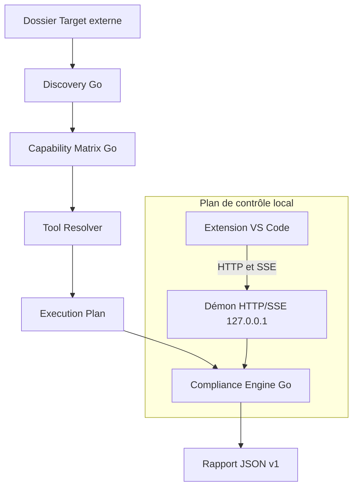

# Architecture

Version courante : 2.1.3. Le nombre de contrôles est celui de `.config/control-catalog.json`, repris dans le tableau `catalog-controls` des README. Le guide d'usage est le [README](../README.md). La construction, la signature et le VSIX sont dans [développement](developpement.md).

## Parcours

Le moteur reçoit un dossier local. Il ne demande ni compte de forge ni réseau pour l'audit lui-même. `core/` est la source d'exécution.

| Composant | Rôle | Code |
| --- | --- | --- |
| Discovery | Technologies, preuves, racines, ambiguïtés | `core/internal/discovery` |
| Capability Matrix | Contrôles applicables | `core/internal/matrix` |
| Tool Resolver | Outil retenu pour chaque contrôle | `core/internal/distribution`, `core/internal/matrix`, `core/internal/osutil` |
| Catalogue | Identifiants, arguments, plateformes | `.config/control-catalog.json` |
| Engine | Ordre, exécution, verdict | `core/internal/engine` |
| Démon | API locale, jeton, Host/Origin | `core/internal/server` |
| Extension | Arbre, pilotage, rapport | `vscode-extension/src/` |
| Rapport | JSON v1 | `.config/compliance-report.schema.json`, `core/internal/report` |
| Selftest | 24 étapes : démon, sécurité, annulation, verrous, PATH, journal, capture | `compliance selftest` |

## Résolution des outils

1. Outils Node (`eslint`, `tsc`, `stylelint`, `htmlhint`) : `node_modules/.bin` de la racine du contrôle puis de ses parents, sinon `~/.compliance/tools/node`.
2. Les autres outils : `.tools/bin` du dépôt de développement, puis `~/.compliance/tools/{bin,python,node,powershell-modules}`, puis `PATH`. `COMPLIANCE_TOOLS_DIR` remplace `~/.compliance/tools` (tests isolés sur le poste).
3. ESLint, `tsc` et Gitleaks forment un seul contrôle par technologie. ESLint tourne une fois dans chaque racine réunie ; `tsc` vérifie chaque `tsconfig.json` ; Gitleaks parcourt le dépôt entier.
4. OpenTofu : TFLint et Checkov lisent une copie temporaire de la racine où chaque `.tofu` devient `.tf` ; les anomalies citent les fichiers `.tofu`.
5. Windows sur ARM : un outil absent de l'entrée `windows-arm64` du manifeste vient de `windows-x64` et s'installe sous `bin/windows-x64`.
6. `secrets` (Gitleaks, tout le dépôt), `yaml` (yamllint hors Ansible et hors templates) et `dependencies` (osv-scanner, Trivy en alternative) sont des technologies transverses détectées par la découverte.
7. `css` et `html` appartiennent au `package.json` le plus proche, sinon à leur dossier ; `go` à son `go.mod`. golangci-lint exige la commande `go` dans le `PATH`.

Les outils Python du registre passent par `python -m`, pas par un shebang figé. Checkov est qualifié par un import court (`python -c`), pas par le CLI, avec un délai de 60 secondes et un interpréteur isolé (`PYTHONNOUSERSITE`, `PYTHONPATH` vide). Trivy est qualifié avec un cache local et sans vérification de version en ligne. Un échec ou un délai de sonde est `probe_failed` : le rapport le montre et ne propose pas de le réinstaller. Seul un binaire absent du disque reste « installable depuis le manifeste ». Sur Windows, `ansible` et `ansible-lint` sont incompatibles avant cette recherche : `yamllint` couvre les playbooks. Une longue liste de fichiers est découpée sous 24 000 caractères. L'extraction d'une archive utilise les chemins étendus Windows quand le chemin dépasse 248 caractères.

Le registre est la release GitHub `tools-v1` (`https://github.com/LORD-SOUPEX/Compliance_Platform/releases/tag/tools-v1`). Les assets sont à plat : `<plateforme>-<outil>-<version>.<ext>`.

- Quinze binaires natifs (`ruff`, `gitleaks`, `tflint`, `trivy`, `terraform`, `tofu`, `hadolint`, `terragrunt`, `shellcheck`, `rumdl`, `shfmt`, `kubeconform`, `biome`, `osv-scanner`, `golangci-lint`) pour `windows-x64`, `linux-x64`, `linux-arm64`, `macos-x64` et `macos-arm64`.
- Bundle Python : CPython 3.11.9 et `checkov`, `bandit`, `pylint`, `pytest`, `pip-audit`, `yamllint` (plus `ansible-lint` hors Windows). Il contient des roues compilées : il se construit sur un hôte natif de chaque plateforme.
- Bundle Node pour les cinq plateformes : Node 22.14.0, ESLint 9.21.0, TypeScript 5.7.3, Stylelint 17.16.0, HTMLHint 1.9.2. Les paquets sont du JavaScript pur, installés une fois ; seul le binaire `node` change. Windows reçoit des lanceurs `.cmd`, Linux et macOS des liens symboliques dans `node_modules/.bin` et `node/bin/node` en `0755`. Aucun `npm install` sur le poste audité.
- `PSScriptAnalyzer` 1.23.0 dans `~/.compliance/tools/powershell-modules`.

L'URL du registre se change avec `compliance.registryUrl`, `-registry-url` ou `COMPLIANCE_REGISTRY_URL`. Le jeton est conservé dans le stockage sécurisé de VS Code (`SecretStorage`) et passe au moteur par `COMPLIANCE_REGISTRY_TOKEN`, jamais en argument de ligne de commande. Une signature Ed25519 absente ou différente produit un avertissement et n'empêche pas l'installation. Une somme SHA-256 d'archive ou de binaire différente refuse l'outil. Le bundle d'autorité de certification d'entreprise est lu depuis `COMPLIANCE_CA_BUNDLE`, `SSL_CERT_FILE`, un fichier local, puis le magasin Windows, et il est transmis aux sondes, aux contrôles et aux téléchargements. Les variables `HTTPS_PROXY` et `HTTP_PROXY` du processus sont conservées.

Au démarrage, le démon interroge `<registry_base_url>/runtime-manifest.json` et `<registry_base_url>/control-catalog.json` pendant au plus 3 secondes. Si le manifeste distant annonce une version d'outil plus haute, un `catalog_revision` plus grand, ou un outil nouveau, les deux fichiers sont écrits dans `~/.compliance/registry-cache/`. Un outil déjà installé dans `~/.compliance/tools/` est alors remplacé par cette version. Hors ligne, le démon utilise ce cache, puis les fichiers embarqués dans le binaire. La version du `.vsix` ne change pas.

## Adaptateurs d'outils

Chaque outil du catalogue a un adaptateur (`core/internal/engine/adapters.go`) : son lecteur de sortie, s'il faut lire stderr (Stylelint, Bandit, pip-audit, yamllint, golangci-lint, Terragrunt) et comment reconnaître un arrêt de l'outil sur sa propre erreur (rendu en `error`, jamais en `fail`). Un test exige un adaptateur pour chaque outil du catalogue. Le lecteur SARIF commun sert Biome, osv-scanner, golangci-lint et ansible-lint ; il lit les URI `file:///` des trois OS. Ajouter un outil : une entrée de catalogue, un cas de commande dans `BuildInvocation`, un adaptateur.

## Compteurs du rapport

Un contrôle écarté n'entre pas dans **Applicables**. Les codes hors périmètre sont `technology_absent`, `not_applicable`, `platform_unsupported`, `alternative_not_selected`, `ambiguous` et `user_disabled`.

**Applicables** = contrôles exécutés (réussi, échec, erreur) + contrôles indisponibles. **Indisponibles** reprend exactement ces contrôles qui devaient tourner et ne l'ont pas fait (`tool_unavailable`, `probe_failed`, `capability_unavailable`, `repository_unconfigured`, `platform_unavailable`, `permission_denied`, et les autres codes qui restent dans le périmètre). Le bouton d'installation ne retient que `tool_unavailable`. Le bandeau et la section du bas utilisent ce même compte. La section liste les raisons dédoublonnées par technologie, outil et message, avec le nombre de racines quand il y en a plusieurs. Elle est absente quand le compte est 0.

**Lacunes de couverture** liste les technologies détectées dont un contrôle est indisponible, plus la note Vue lorsqu'elle s'applique. La liste est visible. La section est absente quand elle est vide. Un YAML Helm non confirmé (`ambiguous`) ou une alternative non retenue ne crée ni un applicable ni un indisponible.

## Sorties des contrôles

- `yamllint` est lancé en `-f parsable`. `-c` n'est passé que si un fichier de configuration existe dans la cible ou à côté du binaire. Chaque ligne `fichier:ligne:colonne` devient une anomalie, y compris avec un chemin Windows.
- `pip-audit` n'audite pas l'environnement Python global. Sans `requirements*.txt` ni `pyproject.toml` dans la racine, le contrôle est non applicable. Chaque ligne de `requirements*.txt` sans version exacte (`==`) devient une anomalie sur ce fichier et cette ligne. Seules les lignes épinglées sont envoyées à l'outil (`--no-deps`, sans `--strict`). Une erreur de résolution est rattachée au fichier concerné. Un `pyproject.toml` seul est audité comme projet.
- Pour `hadolint`, `trivy`, `shellcheck`, `ruff`, `pylint`, `bandit` et `pytest`, une racine parente n'audite pas les fichiers déjà couverts par une sous-racine planifiée du même outil.
- `bandit` écrit une ligne par anomalie (`{abspath}:{line}:{col}: {test_id} {severity}: {msg}`), pour que le bloc `metrics` du JSON ne consomme pas la capture avant les résultats. Un JSON précédé de texte ou coupé après un objet complet reste lu.
- `hadolint` reste en `--format json`, une anomalie par fichier et par ligne.
- Sans `eslint.config.*` ni `.eslintrc`, ESLint reçoit `--no-config-lookup` et une configuration minimale de règles de base. Les fichiers TypeScript utilisent `@typescript-eslint/parser` s'il est installé, sinon le TypeScript du bundle Node pour effacer les types avant l'analyse. `tsc` exige toujours un `tsconfig.json`.

## Journaux

Les trois OS suivent la même disposition, sous `~/.compliance` ou `COMPLIANCE_STATE_DIR`.

| Fichier ou flux | Contenu |
| --- | --- |
| `logs/daemon.log` | Journal JSON du démon, une ligne par évènement (`daemon_starting`, `registry_selected`, `daemon_ready`, `tool_probe`, `control_invocation`, `control_completed`, `session_ended`…). Rotation à 5 Mio, 5 fichiers conservés, mode `0600`. `COMPLIANCE_LOG_LEVEL` : `trace`, `debug` (défaut), `info`, `warn`, `error`. |
| `logs/daemon-console.log` | stdout et stderr du processus démon (panique, erreur avant l'ouverture du journal). Les dernières lignes sont reprises dans le message d'échec de démarrage. |
| `GET /api/v1/logs/stream?level=…` | Flux SSE du journal (`event: daemon_log`) à partir de la connexion. L'extension le suit pendant une préparation ou un audit. |
| `<session>/logs/<contrôle>.stdout.log` et `.stderr.log` | Flux complets de chaque processus (50 Mio au plus par flux), après application des motifs de masquage. Les appels suivants d'un même contrôle sont numérotés `.2`, `.3`. |
| `execution_results[].invocations[]` | Exécutable, arguments, `cwd`, variables ajoutées ou retirées, timeout, durée, code retour, octets lus et chemins des flux. Les valeurs de variables sensibles (`*TOKEN*`, `*SECRET*`, `*PASSWORD*`, `*KEY*`…) et les identifiants dans les URL sont masqués. |

Le canal **Compliance** de VS Code est un `LogOutputChannel` : le niveau se règle par « Developer: Set Log Level… ». Au niveau Info, il affiche le déroulé de l'audit et les avertissements du démon. Au niveau Debug, il ajoute la commande exacte de chaque outil, son dossier, ses variables et ses fichiers de sortie. Au niveau Trace, il reprend tout le journal du démon.

## Démarrage et état du démon

1. Le démon choisit le manifeste et le catalogue sans réseau (cache plus récent, sinon fichiers locaux), prend le verrou, écrit `daemon.json` et écoute.
2. En arrière-plan : vérification du registre distant (3 s au plus), bascule à chaud du catalogue s'il est plus récent, puis mise à jour des outils installés sous le verrou exclusif des outils.
3. `GET /api/v1/health` renvoie `phase`, `registry` (source, chemins, vérification en cours), `tools_upgrading`, `clients` et `active_runs`. `GET /api/v1/registry` renvoie le manifeste et le catalogue utilisés.

Le verrou d'instance est un `flock` (Linux, macOS) ou un `LockFileEx` (Windows) sur `daemon.lock`, libéré par le système si le processus meurt. Un second démon sort avec le code 3 ; l'extension attend alors le premier au lieu de signaler une erreur.

Chaque fenêtre VS Code s'enregistre par `POST /api/v1/clients` et renouvelle cet enregistrement toutes les minutes. Une fenêtre fermée se retire (`DELETE /api/v1/clients/{id}`). Le démon s'arrête seul quand plus aucune fenêtre n'est connue depuis 3 minutes, qu'aucun audit ne tourne et que la dernière requête date de plus de `COMPLIANCE_DAEMON_IDLE_MINUTES` (30 par défaut). Les sondes `/health` ne comptent pas comme activité.

`~/.compliance/tools/.install.lock` sérialise l'accès aux outils : partagé pendant un plan ou un audit, exclusif pendant une installation. `.generation` change après chaque installation et invalide le cache des sondes de tous les démons.

## Sécurité du démon

- Écoute sur `127.0.0.1` et port éphémère.
- Jeton Bearer 256 bits, fichier en `0600`. Sous Windows, une ACL restrictive est aussi posée. Toutes les routes l'exigent sauf `GET /api/v1/health`.
- `Host` doit être `127.0.0.1:<port>`. `Origin` doit être un client local (`vscode-webview://` ou localhost). Sinon HTTP 403.
- Chaque cible est canonisée avant `POST /api/v1/workspaces/approve`.
- Windows : Job Object `KILL_ON_JOB_CLOSE`. Si l'assignation échoue, le fils est tué. POSIX : groupe de processus terminé par `SIGKILL`.
- Un seul démon. `SIGINT` et `SIGTERM` libèrent le verrou.

## Rapport

Le JSON suit `.config/compliance-report.schema.json` : `metadata`, `discovery`, `matrix`, `resolver`, `execution_plan`, `execution_results`, `findings`, `diagnostics`, `summary`, `coverage`, `limitations`, `verdict`, `verdict_reasons`, `advisory`. `POST /api/v1/reports/validate` vérifie la forme, compare le SHA-256 du fichier et calcule les présentations. L'extension relit la taille et la date du fichier après cet appel pour écarter une modification concurrente. Un rapport volumineux envoie une charge utile sans findings ni sorties capturées. Les lignes se chargent quand le contrôle est ouvert.
