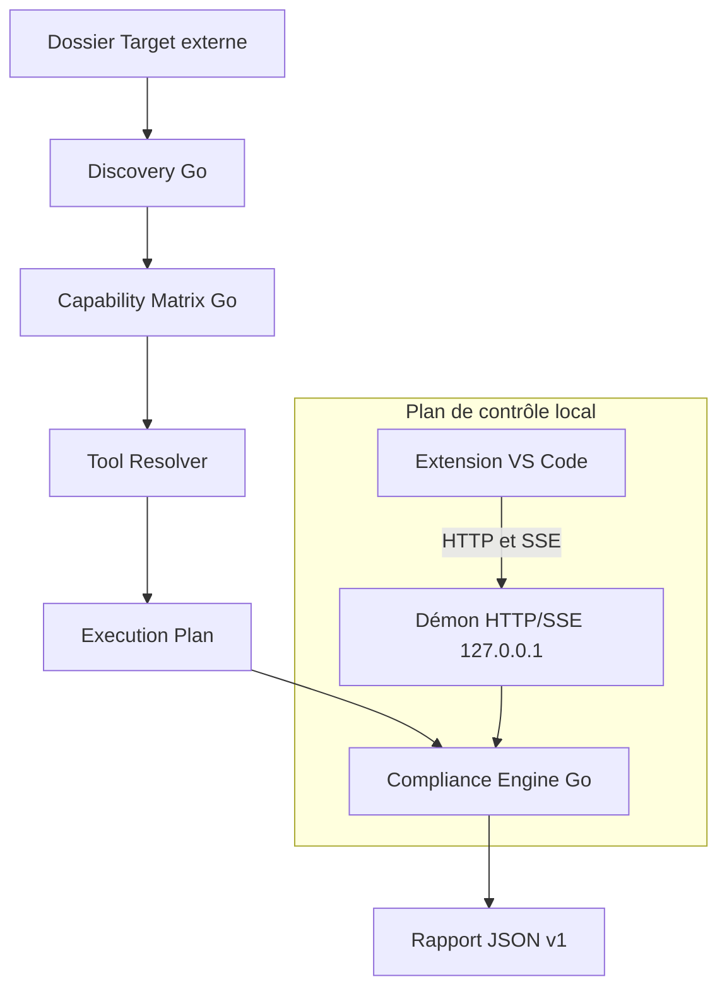

# Architecture

Version courante : 2.1.0. Le nombre de contrôles est celui de `.config/control-catalog.json`, repris dans le tableau `catalog-controls` des README. Le guide d'usage est le [README](../README.md). La construction, la signature et le VSIX sont dans [développement](developpement.md).

## Parcours

Le moteur reçoit un dossier local. Il ne demande ni compte de forge ni réseau pour l'audit lui-même. `core/` est la source d'exécution.

| Composant | Rôle | Code |
| --- | --- | --- |
| Discovery | Technologies, preuves, racines, ambiguïtés | `core/internal/discovery` |
| Capability Matrix | Contrôles applicables | `core/internal/matrix` |
| Tool Resolver | Outil retenu pour chaque contrôle | `core/internal/distribution`, `core/internal/matrix`, `core/internal/osutil` |
| Catalogue | Identifiants, arguments, plateformes | `.config/control-catalog.json` |
| Engine | Ordre, exécution, verdict | `core/internal/engine` |
| Démon | API locale, jeton, Host/Origin | `core/internal/server` |
| Extension | Arbre, pilotage, rapport | `vscode-extension/src/` |
| Rapport | JSON v1 | `.config/compliance-report.schema.json`, `core/internal/report` |
| Selftest | 20 étapes, pas de processus orphelin | `compliance selftest` |

## Résolution des outils

1. `eslint` et `tsc` : `node_modules/.bin` de la cible, sinon `~/.compliance/tools/node`.
2. Les autres outils : `.tools/bin` du dépôt de développement, puis `~/.compliance/tools/{bin,python,node,powershell-modules}`, puis `PATH`.

Les outils Python du registre passent par `python -m`, pas par un shebang figé. Sur Windows, `ansible` et `ansible-lint` sont incompatibles avant cette recherche : `yamllint` couvre les playbooks. Une longue liste de fichiers est découpée sous 24 000 caractères.

Le registre est la release GitHub `tools-v1` (`https://github.com/LORD-SOUPEX/Compliance_Platform/releases/tag/tools-v1`). Les assets sont à plat : `<plateforme>-<outil>-<version>.<ext>`.

- Dix binaires natifs (`ruff`, `gitleaks`, `tflint`, `trivy`, `terraform`, `tofu`, `hadolint`, `terragrunt`, `shellcheck`, `rumdl`) pour `windows-x64`, `linux-x64`, `linux-arm64`, `macos-x64` et `macos-arm64`.
- Bundle Python Windows x64 : CPython 3.11.9 et `checkov`, `bandit`, `pylint`, `pytest`, `pip-audit`, `yamllint`. Sur Linux et macOS, le même bundle se construit sur un hôte POSIX ou les outils viennent du `PATH`.
- Bundle Node Windows x64 : Node 22.14.0, ESLint 9.21.0, TypeScript 5.7.3. Aucun `npm install`.
- `PSScriptAnalyzer` 1.23.0 dans `~/.compliance/tools/powershell-modules`.

L'URL du registre se change avec `compliance.registryUrl`, `-registry-url` ou `COMPLIANCE_REGISTRY_URL`. Le jeton passe par `compliance.registryToken` ou `COMPLIANCE_REGISTRY_TOKEN`, jamais en argument de ligne de commande. Une signature Ed25519 ou un SHA-256 différent produit un avertissement et n'empêche pas l'installation.

Au démarrage, le démon interroge `<registry_base_url>/runtime-manifest.json` et `<registry_base_url>/control-catalog.json` pendant au plus 3 secondes. Si le manifeste distant annonce une version d'outil plus haute, un `catalog_revision` plus grand, ou un outil nouveau, les deux fichiers sont écrits dans `~/.compliance/registry-cache/`. Un outil déjà installé dans `~/.compliance/tools/` est alors remplacé par cette version. Hors ligne, le démon utilise ce cache, puis les fichiers embarqués dans le binaire. La version du `.vsix` ne change pas.

## Compteurs du rapport

Un contrôle écarté n'entre pas dans **Applicables**. Les codes hors périmètre sont `technology_absent`, `not_applicable`, `platform_unsupported`, `alternative_not_selected`, `ambiguous` et `user_disabled`.

**Applicables** = contrôles exécutés (réussi, échec, erreur) + contrôles indisponibles. **Indisponibles** reprend exactement ces contrôles qui devaient tourner et ne l'ont pas fait (`tool_unavailable`, `capability_unavailable`, `repository_unconfigured`, `platform_unavailable`, `permission_denied`, et les autres codes qui restent dans le périmètre). Le bandeau et la section du bas utilisent ce même compte. La section liste les raisons dédoublonnées par technologie, outil et message, avec le nombre de racines quand il y en a plusieurs. Elle est absente quand le compte est 0.

**Lacunes de couverture** liste les technologies détectées dont un contrôle est indisponible, plus la note Vue lorsqu'elle s'applique. La liste est visible. La section est absente quand elle est vide. Un YAML Helm non confirmé (`ambiguous`) ou une alternative non retenue ne crée ni un applicable ni un indisponible.

## Sorties des contrôles

- `yamllint` est lancé en `-f parsable`. `-c` n'est passé que si un fichier de configuration existe dans la cible ou à côté du binaire. Chaque ligne `fichier:ligne:colonne` devient une anomalie, y compris avec un chemin Windows.
- `pip-audit` n'audite pas l'environnement Python global. Sans `requirements*.txt` ni `pyproject.toml` dans la racine, le contrôle est non applicable. Chaque ligne de `requirements*.txt` sans version exacte (`==`) devient une anomalie sur ce fichier et cette ligne. Seules les lignes épinglées sont envoyées à l'outil (`--no-deps`, sans `--strict`). Une erreur de résolution est rattachée au fichier concerné. Un `pyproject.toml` seul est audité comme projet.
- Pour `hadolint`, `trivy`, `shellcheck`, `ruff`, `pylint`, `bandit` et `pytest`, une racine parente n'audite pas les fichiers déjà couverts par une sous-racine planifiée du même outil.
- `bandit` écrit une ligne par anomalie (`{abspath}:{line}:{col}: {test_id} {severity}: {msg}`), pour que le bloc `metrics` du JSON ne consomme pas la capture avant les résultats. Un JSON précédé de texte ou coupé après un objet complet reste lu.
- `hadolint` reste en `--format json`, une anomalie par fichier et par ligne.
- Sans `eslint.config.*` ni `.eslintrc`, ESLint reçoit `--no-config-lookup` et une configuration minimale de règles de base. Les fichiers TypeScript utilisent `@typescript-eslint/parser` s'il est installé, sinon le TypeScript du bundle Node pour effacer les types avant l'analyse. `tsc` exige toujours un `tsconfig.json`.

## Sécurité du démon

- Écoute sur `127.0.0.1` et port éphémère.
- Jeton Bearer 256 bits, fichier en `0600`. Sous Windows, une ACL restrictive est aussi posée. Toutes les routes l'exigent sauf `GET /api/v1/health`.
- `Host` doit être `127.0.0.1:<port>`. `Origin` doit être un client local (`vscode-webview://` ou localhost). Sinon HTTP 403.
- Chaque cible est canonisée avant `POST /api/v1/workspaces/approve`.
- Windows : Job Object `KILL_ON_JOB_CLOSE`. Si l'assignation échoue, le fils est tué. POSIX : groupe de processus terminé par `SIGKILL`.
- Un seul démon. `SIGINT` et `SIGTERM` libèrent le verrou.

## Rapport

Le JSON suit `.config/compliance-report.schema.json` : `metadata`, `discovery`, `matrix`, `resolver`, `execution_plan`, `execution_results`, `findings`, `diagnostics`, `summary`, `coverage`, `limitations`, `verdict`, `verdict_reasons`, `advisory`. `POST /api/v1/reports/validate` vérifie la forme, compare le SHA-256 du fichier et calcule les présentations. L'extension relit la taille et la date du fichier après cet appel pour écarter une modification concurrente. Un rapport volumineux envoie une charge utile sans findings ni sorties capturées. Les lignes se chargent quand le contrôle est ouvert.
