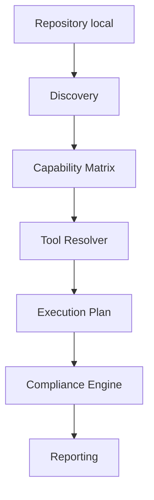

# Documentation

Point d'entrée documentaire de Compliance Platform. Les consignes d'agent et modèles d'intégration restent dans leurs emplacements conventionnels sous `.github/`.

## Architecture

- [Architecture actuelle](architecture-current.md): parcours et état réel des composants.
- [Roadmap](roadmap.md): vision, critères et statuts détaillés des phases.
- [Statuts synthétiques](roadmap-status.md): résumé de la roadmap.
- [Rapport d'obsolescence](obsolescence-audit.md): preuves, impacts, risques de suppression et recommandations.
- [Rapport historique Lot 1](archive/lot-1-report.md): photographie datée, à ne pas lire comme l'état actuel.

## Composants

- [Discovery](discovery.md): signaux, racines, ambiguïtés et limites.
- [Capability Matrix](capability-matrix.md): capacités et disponibilité.
- [Tool Resolver](resolver.md): sélection et qualification des outils.
- [Runtime et Bootstrap](runtime.md): index, qualification, installation et mises à jour.
- [Cache local `.tools`](runtime-local-cache.md): contenu local généré et précautions.
- [Compliance Engine](compliance-engine.md): plan, permissions, exécution et verdict.
- [Reporting](reporting.md): contrats Discovery, Quality Gate et Compliance.
- [Policy Engine](policy-engine.md): portée du YAML descriptif et comportement actuel.
- [Intégrations](integrations.md): PowerShell, Git Bash, VS Code et GitLab.

## Validation et contribution

- [Tests et validations](testing.md): suites, résultats, dates et limites de preuve.
- [Consignes Copilot](../.github/copilot-instructions.md): règles locales de contribution.
- [Modèle de merge request](../.github/merge_request_template.md).

## Parcours d'exécution

Le diagramme décrit le parcours Compliance v1. Quick/Full/Ci/Fix conservent aussi une orchestration historique pendant la transition.
