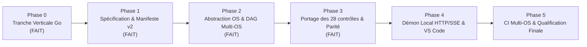

# Plan d'évolution et de migration : Serveur multi-OS et pipelines locaux

> **Statut du document** : Plan directeur d'architecture et de migration technique (Version 1.1 intégrant les arbitrages d'ingénierie).  
> **Auteur** : Antigravity (audit réel du dépôt et retours de revue d'architecture).  
> **Périmètre** : Plateforme Compliance Platform (`m:\Git\Compliance_Platform`).  
> **Règle de rigueur** : Tous les éléments sont qualifiés explicitement par les mentions **FAIT (constaté dans le code)**, **RECOMMANDATION**, **HYPOTHÈSE** ou **À DÉCIDER**.

---

## 1. État des lieux (basé sur l'audit réel du dépôt)

### 1.1 Cartographie des composants actuels et dépendances Windows/PowerShell

L'audit exhaustif des sources (`src/`), scripts (`scripts/`), configurations (`.config/`), extension (`vscode-extension/`), tests (`tests/`) et CI (`.gitlab-ci.yml`) démontre un couplage structurel profond à l'écosystème Windows et à Windows PowerShell 5.1.

| Composant / Fichier | Fonctions et mécanismes clés | Dépendances spécifiques Windows / PowerShell | Statut de portabilité |
| :--- | :--- | :--- | :--- |
| [`scripts/quality-gate.ps1`](file:///m:/Git/Compliance_Platform/scripts/quality-gate.ps1) (1 419 lignes, 101 Ko) | `Invoke-BoundedProcess` (L174-239), `Get-Technology` (L389-544), `Get-ExecutionPlatform` (L545), `Resolve-CandidateTool` (L649), `Get-CapabilityMatrix` (L808), `Resolve-CapabilityTool` (L869) | **FAIT (constaté dans le code)** :<br>1. Appel direct `& taskkill /PID $process.Id /T /F` (L216) pour tuer l'arbre de processus au timeout/annulation sous `Win32NT`.<br>2. Échappement des arguments CLI selon la grammaire de ligne de commande Windows (`(\\*)" -> $1$1\"`, L205).<br>3. Capture en mémoire intégrale via `.StandardOutput.ReadToEndAsync()` (L208) avant troncature par octets UTF-8 (L227) : pas de streaming ni de plafond mémoire process.<br>4. Monolithique avec variables d'état globales (`$repoRoot`, `$ProgressSession`, `$LASTEXITCODE`) et appels `exit`. | **Non portable** (dépend de `taskkill`, Win32 API, syntaxe PowerShell 5.1). |
| [`src/Compliance.Engine.psm1`](file:///m:/Git/Compliance_Platform/src/Compliance.Engine.psm1) (748 lignes, 51 Ko) | `New-CompliancePlan` (L3), `Get-ComplianceInvocation` (L188), `Invoke-CompliancePlan` (L288), `Get-ComplianceVerdict` (L387), `New-ComplianceReport` (L575), `Test-ComplianceReport` (L525) | **FAIT (constaté dans le code)** :<br>1. Chemins en dur vers `.venv/Scripts/python.exe` (L246) au lieu de `.venv/bin/python`.<br>2. Détection de scripts wrappers Windows `.cmd` pour Checkov (L244, L335).<br>3. Appel en dur de `Join-Path $PSHOME 'powershell.exe'` avec `-ExecutionPolicy Bypass` pour `Invoke-ScriptAnalyzer` (L252-253).<br>4. Séparateurs de chemins Windows dans les préfixes de validation (`TrimEnd('\', '/') + [IO.Path]::DirectorySeparatorChar`, L20, L328). | **Non portable** dans son exécution, bien que la logique algorithmique (DAG de dépendances, tri topologique) soit conceptuellement portable. |
| [`scripts/bootstrap.ps1`](file:///m:/Git/Compliance_Platform/scripts/bootstrap.ps1) (895 lignes, 56 Ko) | `Assert-ToolManifest` (L60), `Initialize-WindowsCaBundle` (L222), `Get-VerifiedDownload` (L242), installation des binaires et wheels | **FAIT (constaté dans le code)** :<br>1. `Initialize-WindowsCaBundle` extrait les certificats X.509 depuis les magasins Windows `Cert:\CurrentUser\Root` et `Cert:\LocalMachine\Root` (L225) vers `windows-root-ca.pem` : preuve que la plateforme est déployée en environnement d'entreprise avec proxy/CA privée.<br>2. Télécharge exclusivement les binaires Windows (`python-3.11.9-amd64.zip`, `windows_amd64.zip`, `hadolint-windows-x86_64.exe`, etc.).<br>3. Chemins hardcodés `Scripts\python.exe` (L20). | **Strictement Windows x64**. Inopérant sous Linux/macOS. |
| [`scripts/doctor.ps1`](file:///m:/Git/Compliance_Platform/scripts/doctor.ps1) (317 lignes, 23 Ko) | `Test-Executable` (L44), `Get-DoctorRuntimePlatform` (L77), vérification d'index | **FAIT (constaté dans le code)** :<br>Vérifie la présence de `Scripts\python.exe` (L14) et valide l'index ciblant la clé `windows-x64`. | **Strictement Windows x64**. |
| [`src/Compliance.Session.psm1`](file:///m:/Git/Compliance_Platform/src/Compliance.Session.psm1) (110 lignes, 6,8 Ko) | `New-ComplianceSession` (L21), `Write-ComplianceEvent` (L51), `Test-ComplianceCancellation` (L67) | **FAIT (constaté dans le code)** :<br>1. Détection des liens symboliques via l'attribut .NET `[IO.FileAttributes]::ReparsePoint` (L8, L30).<br>2. Émission d'événements NDJSON sur stdout et disque via `[Console]::Out.WriteLine` et `AppendAllText`.<br>3. Protocole d'annulation par fichiers sentinelles (`cancel` et `heartbeat`). | **Partiellement portable** (.NET Core / pwsh), mais repose sur l'environnement d'hébergement PowerShell. |
| [`src/Control.Catalog.psm1`](file:///m:/Git/Compliance_Platform/src/Control.Catalog.psm1) & [`.config/control-catalog.json`](file:///m:/Git/Compliance_Platform/.config/control-catalog.json) | `Import-ControlCatalog`, catalogue de 28 contrôles | **FAIT (constaté dans le code)** :<br>1. 24 contrôles sur 28 déclarent `platform_support: ["windows-x64"]`.<br>2. 2 contrôles (`ansible.lint.ansible-lint`, `shell.lint.shellcheck`) déclarent `platform_support: ["linux-x64", "macos-arm64"]` et sont donc inopérants sur Windows natif.<br>3. 2 contrôles (`javascript.lint.unconfigured`, `typescript.lint.unconfigured`) n'ont aucun outil ni plateforme configurés (`NO_TOOL`). | **Portable par contrat de données JSON**, mais les définitions de binaires sont quasi-exclusivement Windows. |
| [`src/Tool.Provenance.psm1`](file:///m:/Git/Compliance_Platform/src/Tool.Provenance.psm1) | Vérification SHA-256, intégrité d'arbre, index | **FAIT (constaté dans le code)** :<br>Calculs SHA-256 via `System.Security.Cryptography.SHA256`. | **Algorithmiquement portable**. |
| [`src/Platform.Support.psm1`](file:///m:/Git/Compliance_Platform/src/Platform.Support.psm1) & [`.config/platform-support.json`](file:///m:/Git/Compliance_Platform/.config/platform-support.json) | Définition des 6 couples OS/Arch | **FAIT (constaté dans le code)** :<br>`windows-x64` est `experimental` ; `windows-arm64`, `linux-x64`, `linux-arm64`, `macos-x64`, `macos-arm64` sont `targeted`. | **Portable par contrat**. |
| [`vscode-extension/src/backend.ts`](file:///m:/Git/Compliance_Platform/vscode-extension/src/backend.ts) & [`auditBackend.ts`](file:///m:/Git/Compliance_Platform/vscode-extension/src/auditBackend.ts) | Pilotage processus et audit depuis TypeScript | **FAIT (constaté dans le code)** :<br>1. Verrou strict : `if (process.platform !== 'win32') throw new Error('Cette premiere iteration cible Windows x64 uniquement.')` (backend.ts L81).<br>2. Lance `C:\Windows\System32\WindowsPowerShell\v1.0\powershell.exe` avec `-ExecutionPolicy Bypass` (L39).<br>3. Tue les processus via `taskkill.exe /PID ... /T /F` (L57 et auditBackend.ts L69).<br>4. Vérifie en dur la clé `index.platforms?.['windows-x64']` (auditBackend.ts L15). | **Strictement verrouillé à Windows x64**. |
| [`scripts/compliance-adapter.ps1`](file:///m:/Git/Compliance_Platform/scripts/compliance-adapter.ps1) & [`compliance.sh`](file:///m:/Git/Compliance_Platform/scripts/compliance.sh) | Wrappers CLI / Git Bash / GitLab | **FAIT (constaté dans le code)** :<br>`compliance.sh` cherche `powershell.exe` puis `pwsh` pour relayer vers le script PowerShell. Sous Git Bash Windows, il lance PowerShell Windows. | **Façade non portable sans moteur PowerShell sous-jacent**. |
| [`.gitlab-ci.yml`](file:///m:/Git/Compliance_Platform/.gitlab-ci.yml) | Pipelines CI de validation | **FAIT (constaté dans le code)** :<br>Exécute les scripts sur un runner étiqueté `tags: [windows]` via `powershell -ExecutionPolicy Bypass`. | **Strictement Windows**. |
| [`tests/`](file:///m:/Git/Compliance_Platform/tests/) | Suites de tests unitaires et intégration | **FAIT (constaté dans le code)** :<br>1. Tests rédigés en scripts `.Tests.ps1` utilisant un moteur d'assertion maison `Assert-Compliance` (pas de framework Pester).<br>2. [`quality-gate.Tests.ps1`](file:///m:/Git/Compliance_Platform/tests/integration/quality-gate.Tests.ps1#L15-L19) extrait les fonctions de `quality-gate.ps1` par manipulation directe de l'AST PowerShell (`[Management.Automation.Language.Parser]::ParseFile`) car le script n'est pas un module.<br>3. `scripts/test.ps1` lance chaque `.Tests.ps1` via `powershell.exe`. 0 test Python existant dans le dépôt. | **Non portable hors d'un hôte PowerShell 5.1/7**. |

### 1.2 Ce qui est déjà portable vs ce qui ne l'est pas

| Domaine | Déjà portable (à conserver et capitaliser) | Non portable (à réécrire ou abstraire) |
| :--- | :--- | :--- |
| **Contrats de données** | **FAIT** : Schémas JSON v1 (`compliance-report.schema.json`, `control-catalog.schema.json`, `compliance-session.schema.json`), format des événements NDJSON, format du rapport v1. | Aucun (les schémas JSON et NDJSON sont agnostiques de l'OS). |
| **Règles métier** | **FAIT** : Catalogue des 28 contrôles, classification des capacités, politique de sélection (`all` vs `alternative`), logique du DAG et tri topologique, calcul du verdict consultatif (`PASS` / `FAIL`). | Implémentation actuelle enfermée dans des modules PowerShell (`.psm1`). |
| **Gestion des processus** | Rien (tout repose sur `taskkill`, les shims `.cmd` et les conventions Win32). | Création de processus, gestion de l'arbre de processus (process group / Job Object), streaming des sorties, timeouts stricts sans fuite d'enfants orphelins. |
| **Système de fichiers** | Règles d'exclusion relatives (`.git`, `.venv`, `.tools`, `reports`). | Séparateurs `\`, majuscules/minuscules (insensibilité Windows vs sensibilité Linux), gestion des liens symboliques et permissions POSIX (`0755` pour exécutables). |
| **Distribution des outils** | Modèle conceptuel du Runtime Index (`.tools/runtime/index.json`) avec hashes SHA-256 et provenance officielle. | `bootstrap.ps1` télécharge uniquement des archives Windows x64 et lit le magasin de certificats Windows (`Cert:\`). |

### 1.3 Dette technique et risques identifiés

1. **Monolithe de script `quality-gate.ps1`** : 1 419 lignes mélangeant découverte des technos, résolution des outils, exécution des processus, politique de gate et génération de rapport, sans encapsulation modulaire propre (d'où l'extraction par AST dans les tests).
2. **Buffering mémoire non borné avant troncature** : Dans `Invoke-BoundedProcess`, `.ReadToEndAsync()` accumule tous les octets en mémoire vive. Un processus générant 500 Mo de logs sature la mémoire du runtime avant que la coupure à 1 Mo n'intervienne.
3. **Risque d'orphelins sous Linux/macOS** : Le code PowerShell actuel fait `$process.Kill()` sur non-Windows, ce qui ne tue pas les descendants (ex. un sous-processus lancé par `checkov` ou `pytest`).
4. **Vulnérabilités connues dans les dépendances gelées** : **FAIT (constaté dans `docs/maintenance.md` L80-87)** : Le mode Full échoue avec code 1 en raison de 4 avis `pip-audit` sur `asteval 1.0.6` et `ecdsa 0.19.2`, imposés par le pin de `checkov 3.3.23`.
5. **Absence de tests natifs sous Linux/macOS** : Aucune preuve d'exécution automatisée n'existe à ce jour en dehors de Windows x64.

---

## 2. Choix du langage / runtime du cœur multi-OS

### 2.1 Matrice d'évaluation comparative

| Critère | Go (Golang) | Node.js / TypeScript | Python 3.11+ | Rust | PowerShell 7 (pwsh) |
| :--- | :--- | :--- | :--- | :--- | :--- |
| **Distribution & Autonomie** | **Maximale** : Binaire statique unique sans dépendance runtime. | **Moyenne** : Nécessite runtime Node.js ou packaging SEA/pkg. | **Faible** : Nécessite runtime Python embarqué ou PyInstaller. | **Maximale** : Binaire statique unique. | **Très faible** : Nécessite installation de pwsh (~100 Mo). |
| **Portabilité native (6 cibles)** | **Excellente** : Compilation croisée native Windows, Linux, macOS (x64 et ARM64). | Bonne, mais dépendance aux versions V8/Node par plateforme. | Bonne, mais gestion de venv et wheels C par OS. | **Excellente** : Cross-compilation via `cross` / Cargo. | Moyenne : pwsh a des comportements divergents selon l'OS. |
| **Gestion des sous-processus** | **Native et robuste** : Windows Job Objects natifs via `syscall`, Process Groups POSIX (`setpgid` / `SIGKILL`). | Limitée sans modules C natifs (recours fréquent à `taskkill`). | Nécessite `psutil` ou code CTypes complexe sous Windows. | **Excellente** mais complexe (`job-api` sous Windows, `nix` sous POSIX). | Faible sous Linux/macOS (pas de gestion native d'arbre). |
| **Compétences & Maintenabilité équipe** | Syntaxe simple, forte adoption DevOps/SRE, mais nécessite validation des compétences de l'équipe. | **Forte synergie** : TypeScript est déjà présent dans le dépôt (`vscode-extension/`). | Très répandu, mais gestion de dépendances lourde. | Courbe d'apprentissage abrupte, maintenance lourde. | Compétences limitées à l'écosystème Windows / sysadmin. |
| **Aptitude serveur API / SSE** | **Idéale** : Serveur HTTP standard (`net/http`), streaming SSE trivial sans dépendance externe. | Bon via Fastify / Express, mais monothreadé pour orchestrer. | Bon via FastAPI, mais nombreuses dépendances. | Excellente via `axum`, mais boilerplate lourd. | Inadapté pour un serveur démon permanent. |

### 2.2 Recommandation et condition de décision d'équipe

> **DÉCISION VALIDÉE : Adopter Go (Golang) pour le cœur multi-OS et le démon local, SOUS CONDITION EXPLICITE DE MAINTENABILITÉ.**

#### La condition clé : Qui maintient ce code dans 1 an ?
Le gain technique de Go (binaire autonome sans runtime externe, gestion irréprochable des arbres de processus via Windows Job Objects et PGID POSIX sans `taskkill`, serveur HTTP/SSE dans la bibliothèque standard) est indéniable.
**Cependant, ce gain est annulé si personne dans l'équipe ne sait ou ne souhaite maintenir du Go dans 1 an.**
- Si l'équipe possède ou intègre des compétences Go (culture Cloud Native, Kubernetes, Terraform providers) : **Go est le choix optimal absolu**.
- Si l'équipe est exclusivement compétente en Web/JavaScript/TypeScript : **TypeScript (exécuté via un runtime Node autonome ou Bun) doit prévaloir**, car la maintenabilité à long terme prime sur les micro-performances de démarrage.
- **Validation par la Phase 0** : La Phase 0 en tranche verticale (détaillée en section 7 et 10) sert précisément de crash-test pour valider concrètement l'adhésion et la maintenabilité du code Go par l'équipe avant d'engager la réécriture complète.

#### Ce que cela implique pour PowerShell
- **Phase 0 à 2 (Transition)** : PowerShell reste utilisé comme adaptateur de compatibilité pour les scripts historiques du socle.
- **Phase 3 à 5 (Bascule)** : Le moteur d'orchestration, le DAG, la résolution et le démon tournent à 100 % en Go.
- **Cible finale** : **Suppression complète de la dépendance à PowerShell pour le moteur Compliance**. PowerShell ne subsiste que comme *technologie auditée* (le contrôle `powershell.lint.psscriptanalyzer` sera exécuté en invoquant `pwsh` s'il est présent sur la machine hôte).

---

## 3. Architecture cible

### 3.1 Schéma des composants (Mermaid)

```mermaid
flowchart TD
    subgraph Storage["Distribution Décentralisée (Fichiers Statiques)"]
        RepoStatic["Stockage Statique Interne\n(GitLab Packages / Artifactory / S3)\n- runtime-manifest.json signé\n- Archives binaires zippées"]
    end

    subgraph ClientHost["Poste du Développeur (Local Multi-OS)"]
        VSC["Extension VS Code\n(Client HTTP / SSE Node.js)"]
        CLI["CLI Compliance\n(Binaire Go autonome)"]

        subgraph Daemon["Démon Local Compliance (Go) - 127.0.0.1:8765"]
            APIServer["API REST & SSE\n(Auth Bearer + Host validation)"]
            
            subgraph CoreEngine["Cœur Métier Go"]
                Discovery["Discovery Multi-Technos"]
                Matrix["Capability Matrix"]
                Resolver["Tool Resolver"]
                DAG["Moteur de Pipelines & DAG"]
                VerdictEngine["Calculateur de Verdict (Autorité unique)"]
                ReportGen["Générateur de Rapport JSON v1"]
            end

            subgraph OSAbstraction["Couche d'Abstraction OS"]
                ProcManager["Gestionnaire d'Arbre de Processus\n(Win: Job Objects | POSIX: PGID)"]
                FSManager["Gestionnaire FS & Chemins\n(UTF-8, Symlinks, Scope Allowlist)"]
                StreamManager["Streaming Borné & Masquage\n(io.LimitReader, Redaction regex)"]
                CertManager["Injecteur CA & Proxies\n(Propagation SSL_CERT_FILE / PIP_CERT)"]
            end

            LocalCache["Cache Local Outils (~/.compliance/tools)\n(Vérification SHA-256 à chaud)"]
        end

        subgraph TargetWorkspace["Target Workspace Local (Code Source)"]
            CodeFiles["Fichiers sources (Le code ne quitte JAMAIS la machine)"]
        end
    end

    RepoStatic -->|Téléchargement HTTPS & vérification SHA-256| LocalCache
    VSC <-->|HTTP REST & Flux SSE (Localhost)| APIServer
    CLI <-->|Appel direct ou via Démon| APIServer
    APIServer --> CoreEngine
    CoreEngine --> OSAbstraction
    OSAbstraction --> LocalCache
    OSAbstraction --> TargetWorkspace
    CoreEngine --> VerdictEngine --> ReportGen
```

### 3.2 Séparation stricte : Cœur / Abstraction OS / Clients

1. **Le Cœur Métier (OS-agnostique)** :
   - Reçoit des chemins normalisés, résout les dépendances du DAG, ordonnance les étapes, calcule le verdict final et produit le rapport JSON v1.
   - **Autorité unique** : Ni VS Code, ni la CLI, ni aucun client externe ne calcule l'applicabilité ou le verdict.
2. **La Couche d'Abstraction OS** :
   - **Processus & Arbres** : Interface unifiée `ExecuteBounded(ctx, cmd, args, limits)` garantissant l'arrêt immédiat et sans fuite de tous les descendants via Windows Job Objects (`JOB_OBJECT_LIMIT_KILL_ON_JOB_CLOSE`) ou POSIX Process Groups (`syscall.Kill(-pgid, syscall.SIGKILL)`).
   - **Chemins & Portée** : Chemins absolus canoniques après résolution des liens symboliques (`filepath.EvalSymlinks`). Restriction de portée stricte aux dossiers explicitement approuvés.
   - **Streaming & Masquage** : Capture bornée en mémoire (`io.LimitReader`) avec masquage regex en continu des données sensibles.
3. **Les Clients (Extension VS Code, CLI, CI)** :
   - Simples consommateurs HTTP/SSE communiquant avec le démon local.

---

## 4. Distribution des outils via stockage statique et gestion des prérequis

### 4.1 Simplification majeure : Distribution par fichiers statiques

> **ARBITRAGE TECHNIQUE VALIDÉ** : Il n'est **pas nécessaire d'opérer un serveur d'API partagé dynamique** pour distribuer les outils.

Un registre de packages d'entreprise ou un stockage d'objets statique suffit amplement :
- **Hébergement statique** : Registre de packages GitLab, JFrog Artifactory, Sonatype Nexus ou bucket S3 interne.
- **Contenu servi** :
  1. `runtime-manifest.json` : Manifeste listant les versions, URLs et hashes SHA-256 pour les 6 couples OS/Arch.
  2. `runtime-manifest.json.sig` : Signature cryptographique Minisign/Cosign du manifeste.
  3. Archives binaires compressées (`.tar.gz`, `.zip`) nommées de façon déterministe.
- **Rôle du démon local** : Le démon tourne uniquement sur le poste du développeur. À l'initialisation ou lors d'une commande `compliance tool sync`, il télécharge le manifeste statique, vérifie sa signature avec la clé publique embarquée, télécharge les archives manquantes, vérifie leur SHA-256 et peuple le cache local `~/.compliance/tools/`.

### 4.2 Vérité sur le « Zéro prérequis » (Markdownlint & PSScriptAnalyzer)

L'affirmation d'un « zéro prérequis absolu » sur le poste hôte doit être traitée avec honnêteté technique :

1. **Le binaire `compliance`** est à 100 % autonome et sans prérequis (Windows, Linux, macOS).
2. **Les outils binaires compilés** (Gitleaks, TFLint, Terragrunt, Hadolint, Trivy, ShellCheck, Terraform/OpenTofu, Ruff) sont distribués sous forme d'exécutables autonomes sans prérequis.
3. **Python Core** est distribué sous forme de bundle autonome précompilé (*python-build-standalone*), permettant d'exécuter Bandit, Pylint, Pytest, Pip-audit et Checkov sans exiger de Python préinstallé sur le poste.
4. **Cas particulier 1 : Markdownlint** :
   - Repose aujourd'hui sur `markdownlint-cli2` via Node.js.
   - **Stratégie retenue** : Distribuer un binaire autonome prépackagé (binaire Node standalone ou linter Markdown natif en Go/Rust comme `markdownlint-cli2` standalone). Si aucun runtime compatible n'est disponible, le contrôle est marqué explicitement `tool_unavailable` avec le motif structuré `node_runtime_missing`. Aucun crash silencieux.
5. **Cas particulier 2 : PSScriptAnalyzer** :
   - Repose sur le moteur PowerShell (`pwsh` ou PowerShell 5.1).
   - **Stratégie retenue** : Nous n'embarquons pas un runtime PowerShell de 100 Mo dans la distribution standard. Le Tool Resolver sonde la présence de `pwsh` (Linux, macOS, Windows) ou `powershell.exe` (Windows). Si aucun interpréteur PowerShell n'est trouvé, le contrôle bascule à l'état `tool_unavailable` avec le diagnostic clair : `powershell_runtime_missing: PSScriptAnalyzer requiert pwsh sur Linux/macOS ou PowerShell sur Windows`.

### 4.3 Support des proxys, miroirs internes et certificats d'entreprise (CA Bundle)

L'audit de `bootstrap.ps1` (`Initialize-WindowsCaBundle` extrayant `windows-root-ca.pem`, L222-240) prouve que la plateforme est exploitée au sein d'un réseau d'entreprise protégé par un proxy d'inspection SSL et une autorité de certification privée.

- **Comportement des outils** :
  - **Go** : Lit nativement le magasin de certificats racine du système d'exploitation sur Windows, Linux et macOS.
  - **Python / Pip / Checkov / Requests** : **Ne lisent pas** le magasin de certificats Windows et échouent immédiatement avec `CERTIFICATE_VERIFY_FAILED` s'ils ne sont pas configurés.
- **Mécanisme du démon local** :
  1. Le démon Go exporte ou localise le bundle de certificats racine d'entreprise dans `~/.compliance/certs/ca-bundle.pem`.
  2. Lors de l'invocation de tout sous-processus Python ou outil tiers, le moteur injecte automatiquement les variables d'environnement requises :
     ```bash
     SSL_CERT_FILE=~/.compliance/certs/ca-bundle.pem
     REQUESTS_CA_BUNDLE=~/.compliance/certs/ca-bundle.pem
     PIP_CERT=~/.compliance/certs/ca-bundle.pem
     ```
  3. Prise en compte transparente des variables de proxy standard (`HTTP_PROXY`, `HTTPS_PROXY`, `NO_PROXY`) et support de la redirection vers des miroirs internes d'artefacts (ex: PyPI mirror Artifactory) définis dans la configuration du démon.

### 4.4 Équivalents multi-OS pour chaque outil épinglé

| Outil actuel | Version | Windows x64 | Windows ARM64 | Linux x64 | Linux ARM64 | macOS Intel | macOS Apple Silicon | Stratégie d'empaquetage / Disponibilité |
| :--- | :--- | :---: | :---: | :---: | :---: | :---: | :---: | :--- |
| **Python Core** | 3.11.9 | Dispo | Dispo | Dispo | Dispo | Dispo | Dispo | *python-build-standalone* : archive tar.gz/zip autonome précompilée sans installation système. |
| **Gitleaks** | 8.30.1 | Dispo | Dispo | Dispo | Dispo | Dispo | Dispo | Binaires officiels GitHub Releases pour toutes les cibles. |
| **TFLint** | 0.64.0 | Dispo | Émulé/Dispo | Dispo | Dispo | Dispo | Dispo | Binaires officiels GitHub Releases. |
| **Terragrunt** | 1.1.6 | Dispo | Émulé/Dispo | Dispo | Dispo | Dispo | Dispo | Binaires officiels Gruntwork (Go cross-compilé). |
| **Hadolint** | 2.15.1 | Dispo | Non officiel | Dispo | Dispo | Dispo | Dispo | Binaires officiels x64/arm64 Linux/macOS. Sous Windows ARM64 : émulation x64. |
| **Trivy** | 0.75.0 | Dispo | Dispo | Dispo | Dispo | Dispo | Dispo | Binaires officiels Aqua Security multi-OS. |
| **ShellCheck** | 0.11.0 | Dispo (zip) | Dispo | Dispo | Dispo | Dispo | Dispo | **RECOMMANDATION** : Binaire Windows officiel `shellcheck-v0.11.0.zip` intégré au manifeste. |
| **Markdownlint** | 0.18.1 | via Node | via Node | via Node | via Node | via Node | via Node | Binaire autonome ou sonde Node hôte ; sinon `tool_unavailable` explicite. |
| **Terraform / OpenTofu**| 1.15.8 / 1.8+ | Dispo | Dispo | Dispo | Dispo | Dispo | Dispo | Binaires officiels HashiCorp / OpenTofu. |
| **PSScriptAnalyzer** | 1.25.0 | Dispo (PS 5.1) | Dispo | Dispo (pwsh)| Dispo (pwsh)| Dispo (pwsh)| Dispo (pwsh)| Module exécuté via `pwsh` hôte ; si absent, `tool_unavailable` explicite. |
| **Ruff** | 0.16.10 | Dispo | Dispo | Dispo | Dispo | Dispo | Dispo | Wheels PyPI binaires natifs précompilés en Rust pour toutes les architectures. |
| **Pylint / Bandit / Pytest**| Multiples | Dispo | Dispo | Dispo | Dispo | Dispo | Dispo | Pure Python wheels dans l'environnement Python géré. |
| **Pip-audit** | 2.10.1 | Dispo | Dispo | Dispo | Dispo | Dispo | Dispo | Pure Python wheel dans l'environnement Python géré. |
| **Checkov** | 3.3.23 | Dispo | Dispo | Dispo | Dispo | Dispo | Dispo | Python wheel multiplateforme. |
| **Ansible-lint** | 25.12.2 | **Incompatible natif** | **Incompatible** | Dispo | Dispo | Dispo | Dispo | **ARBITRAGE VALIDÉ** : Natif sous Linux/macOS. Sous Windows natif : marqué `tool_unavailable` avec diagnostic explicite. |

---

## 5. Pipelines déclaratifs par technologie et garde-fous stricts

### 5.1 Format déclaratif des pipelines (`pipeline.schema.json`)

Chaque technologie détectée se voit associer des pipelines déclaratifs découpés en étapes ordonnées par un DAG de dépendances.

```yaml
version: "1"
id: "terraform.dev-deployment"
name: "Terraform Dev Deployment"
technology: "terraform"
category: "dev_deployment" # quality | dev_deployment | ephemeral_sandbox | maintenance
side_effect_level: "apply_destroy"
guardrails:
  allowed_environments: ["sandbox", "dev-local", "ephemeral-*"]
  forbidden_environments: ["prod", "production", "staging", "shared"]
  require_plan_preview: true
  require_explicit_confirmation: true
steps:
  - id: "init"
    name: "Terraform Init"
    tool: "tofu"
    args: ["init", "-input=false"]
    side_effect: "network"
    timeout_seconds: 180
  - id: "plan"
    name: "Terraform Plan Preview"
    tool: "tofu"
    args: ["plan", "-input=false", "-out=tfplan"]
    side_effect: "read_only"
    depends_on: ["init"]
    timeout_seconds: 300
  - id: "apply"
    name: "Terraform Apply Local Dev"
    tool: "tofu"
    args: ["apply", "-input=false", "tfplan"]
    side_effect: "apply_destroy"
    depends_on: ["plan"]
    timeout_seconds: 600
```

### 5.2 Garde-fous stricts sur les contrôles `apply_destroy`

L'exécution d'un `apply` ou `destroy` (Terraform, Docker Compose, Kubernetes/Helm) depuis la machine d'un développeur comporte des risques majeurs : utilisation intempestive de credentials cloud à privilèges élevés, altération d'un backend d'état distant partagé (`remote state`), ou écrasement d'une infrastructure partagée.

Le moteur de pipeline applique des **garde-fous techniques obligatoires et non contournables** :

1. **Allowlist d'environnements autorisés** :
   - Le moteur inspecte les variables d'environnement, les fichiers `.tfvars` ou les manifestes de déploiement.
   - L'exécution est **immédiatement rejetée** si l'environnement ciblé correspond à `prod`, `production`, `staging`, `shared` ou ne figure pas explicitement dans l'allowlist configurée (ex. `sandbox`, `dev-local`, `test-*`).
2. **Validation stricte du backend d'état (`state backend`)** :
   - Pour Terraform/OpenTofu, le moteur vérifie que le backend configuré est soit local (`local`), soit explicitement préfixé par un namespace de développement individuel.
   - Rejet immédiat si le backend pointe vers un bucket S3 ou un espace de production identifié.
3. **Protection absolue « Run All »** :
   - Le bouton global « Lancer tout l'audit » ou la commande d'audit global **n'exécute JAMAIS** les étapes de classe `apply_destroy`.
   - Celles-ci ne peuvent être déclenchées qu'unitairement, de manière intentionnelle.
4. **Dialogue de prévisualisation et confirmation bloquante** :
   - Une étape d'`apply` exige obligatoirement la réussite préalable de l'étape `plan`.
   - L'extension VS Code et la CLI présentent le résumé du plan (ressources créées, modifiées, détruites) avant de requérir une confirmation explicite de l'utilisateur.
5. **Journal d'audit immuable** :
   - Toute exécution d'étape `apply_destroy` est consignée dans un journal d'audit local non modifiable (`~/.compliance/audit/deployments.log`) avec horodatage UTC, identité utilisateur, empreinte git du commit audité, empreinte du plan et statut de sortie.

---

## 6. Mode serveur / Démon local & Sécurité de l'API

### 6.1 Modèle d'architecture : Démon local exclusif

> **ARBITRAGE VALIDÉ** : Le démon tourne **exclusivement en local sur la machine du développeur** (`127.0.0.1`).

- **Confidentialité totale** : Le code source ne quitte jamais le poste de travail. Aucun téléversement d'archive de code vers un serveur externe.
- **Ressources locales** : Le démon orchestre l'exécution locale des outils hébergés dans `~/.compliance/tools/`.
- **Légèreté opérationnelle** : Aucun serveur partagé lourd à exploiter, administrer ou sécuriser en production.

### 6.2 Sécurité renforcée de l'API locale

Pour éviter qu'une page web malveillante ouverte dans le navigateur de l'utilisateur ne puisse interagir avec le démon local via JavaScript, les protections suivantes sont appliquées au niveau du serveur HTTP Go :

1. **Écoute strictement restreinte à l'interface de boucle locale** :
   - Le serveur bind exclusivement sur `127.0.0.1` ou `[::1]`. Toute écoute sur `0.0.0.0` est formellement interdite.
2. **Protection stricte contre le DNS Rebinding** :
   - Le serveur valide systématiquement l'en-tête HTTP `Host` sur chaque requête entrante.
   - Si la valeur de l'en-tête `Host` ne correspond pas exactement à `127.0.0.1:{port}` ou `localhost:{port}`, la requête est **immédiatement rejetée avec le code HTTP 403 Forbidden**. Cela bloque toute attaque par rebinding DNS (ex. `attacker-domain.com` résolvant vers `127.0.0.1`).
3. **Authentification locale par Jeton Bearer** :
   - Au démarrage, le démon génère un jeton cryptographique aléatoire de 256 bits, enregistré dans `~/.compliance/daemon.token` avec les permissions POSIX `0600` (lecture seule par l'utilisateur propriétaire).
   - Toute requête HTTP doit fournir l'en-tête `Authorization: Bearer <token>`.
4. **Restriction stricte du périmètre (`target_path scope`)** :
   - Le démon refuse catégoriquement d'analyser un dossier arbitraire du système (ex. `C:\Windows` ou `/etc`).
   - Le paramètre `target_path` doit obligatoirement être un sous-dossier explicitement enregistré dans la liste des workspaces autorisés par l'utilisateur lors du démarrage ou validé via le Workspace Trust de VS Code.
5. **Communication Extension VS Code <-> Démon** :
   - L'extension VS Code communique avec le démon local depuis son **processus d'extension Node.js en arrière-plan**, et non depuis le contexte d'une page Web/Webview. Les contraintes de CORS de navigateur ne s'appliquent donc pas, renforçant l'étanchéité du canal.

---

## 7. Compatibilité et stratégie de migration en tranches

### 7.1 Phase 0 : Tranche verticale (Proof of Concept de bout en bout) - FAIT

> **Approche au fil de l'eau (développeur unique)** : Aucun calendrier fixe ou estimation en semaines. La progression se fait par ordre séquentiel des dépendances techniques, à son propre rythme.



#### Objectifs et livrables de la Phase 0 (Validée)
- **Objectif** : Valider la faisabilité technique, la maintenabilité du code Go, la distribution statique et la gestion des processus sous Windows avec compilation croisée **avant de s'engager sur le reste du projet**.
- **Périmètre de la tranche verticale** :
  1. Un binaire Go `compliance` compilé pour Windows x64, Linux x64 et macOS ARM64.
  2. Implémentation de la couche d'abstraction de processus : vérification que les sous-processus sont tués sans fuite d'orphelins via Windows Job Objects et POSIX PGID.
  3. Découverte (Discovery) restreinte à **une seule technologie** : **Python**.
  4. Exécution d'**un seul pipeline de qualité** : Formatage et Linting Python via Ruff (outil binaire autonome) et Bandit.
  5. Téléchargement et synchronisation depuis un manifeste statique signé (Ed25519) avec vérification de double hash SHA-256 et injection du bundle de certificats.
  6. Émission du rapport JSON v1 canonique validé contre le schéma.
- **Résultat de la Phase 0** : Validé et testé dans `core/` (voir `docs/phase0-report.md`).

### 7.2 Séquencement des phases

| Phase | Périmètre d'ingénierie | Critère d'acceptation (Definition of Done) |
| :--- | :--- | :--- |
| **Phase 0** *(Fait)* | **Tranche verticale Go** : Discovery Python + pipeline Ruff/Bandit sur Windows (compilation croisée Linux/macOS) avec Job Objects, streaming borné et SHA-256. | PoC validé avec tests automatisés dans `core/` ; rapport `docs/phase0-report.md`. |
| **Phase 1** *(Fait)* | **Schémas v2 & Manifeste statique** : Schémas JSON v2 (manifeste de distribution et pipelines avec garde-fous), manifeste statique signé Ed25519 certifié sur Windows x64 (outils qualifiés à empreintes uniques) et cibles multi-OS initialisées. | Manifeste v2 complet et signé (`runtime-manifest.json.sig`), validé par `runtime-manifest.schema.json` et `pipeline.schema.json` avec tests réels de synchronisation. |
| **Phase 2** *(Fait)* | **Moteur Go & DAG complet** : Portage de la Discovery multi-technologies, moteur de DAG déterministe, gestion des timeouts et capture bornée. Discovery alignée sur `quality-gate.ps1 -DiscoveryOnly` (champs `evidence`, `roots`, `ambiguities` sérialisés à `[]`, `scan_errors` tracées). Note d'arbitrage : l'expansion dynamique de `capability_matrix` et `tool_resolution` est rattachée à la Phase 3. | Discovery et ordonnancement validés sur 100 % du corpus de fixtures historiques ; rapport `docs/phase2-report.md`. |
| **Phase 3** *(Fait)* | **Portage des contrôles & Parité canonique** : Implémentation des 28 contrôles en Go, peuplement dynamique de `capability_matrix` et `tool_resolution`, gestion explicite des statuts d'indisponibilité, masquage regex, normalisation et émission des rapports canoniques. | Parité canonique à 100 % démontrée entre le moteur PowerShell et le moteur Go (28/28 contrôles ordonnancés et applicabilités identiques) ; rapport `docs/phase3-report.md`. |
| **Phase 4** | **Démon Local & Extension VS Code** : API HTTP/SSE locale avec protection DNS rebinding, mise à jour de l'extension VS Code (retrait du verrou win32). | L'extension pilote l'audit en direct via SSE sous Linux, macOS et Windows sans PowerShell. |
| **Phase 5** | **Qualification CI & Dépréciation PS 5.1** : Runners CI multi-OS (GitLab/GitHub), mise à jour de la documentation, dépréciation de `quality-gate.ps1`. | CI verte sur les 3 OS ; statuts `qualified` officialisés. |

---

## 8. Qualification multi-OS et tests

### 8.1 Matrice de tests par plateforme

| Plateforme & Architecture | Statut Actuel | Statut Cible (Fin Phase 5) | Environnement de test CI | Machine physique requise |
| :--- | :---: | :---: | :---: | :---: |
| **Windows x64** | `experimental` | **`qualified`** | GitLab / GitHub Windows Runner | Non |
| **Windows ARM64** | `targeted` | `experimental` | Émulation ou runner dédié | Oui (Surface / Dev Kit Snapdragon) |
| **Linux x64** (Ubuntu) | `targeted` | **`qualified`** | GitLab / GitHub Ubuntu Runner | Non |
| **Linux ARM64** | `targeted` | **`qualified`** | GitHub / AWS Graviton Runner | Non |
| **macOS Intel** (x64) | `targeted` | `experimental` | GitHub macOS-13 Runner | Non |
| **macOS Apple Silicon** (ARM64) | `targeted` | **`qualified`** | GitHub macOS-14+ (M1/M2/M3) Runner | Oui (pour validation visuelle VS Code) |

### 8.2 Parité des rapports par normalisation canonique

> **CORRECTION MÉTHODOLOGIQUE** : La comparaison « octet par octet » stricte est physiquement impossible en raison de la variabilité naturelle des horodatages d'exécution, des durées en millisecondes et des conventions de fin de ligne.

Pour valider la non-régression stricte entre l'ancien moteur PowerShell et le nouveau moteur Go, les tests comparent les rapports après **normalisation canonique** :
1. **Normalisation des horodatages** : Les champs temporels (`generated_at`, `execution_start`, `execution_end`) sont remplacés par la valeur fixe `"2026-10-13T00:00:00Z"`.
2. **Normalisation des durées** : Les métriques de temps (`duration_ms`, `metrics.*_ms`) sont remplacées par `0`.
3. **Normalisation des chemins** : Tous les séparateurs de dossiers (`\` et `/`) sont uniformisés au format `/`.
4. **Tri déterministe** : Les clés des objets JSON et les listes de contrôles/findings sont triées par ordre alphabétique d'identifiant (`id`, `control_id`).
5. **Règle d'équivalence stricte** : Après cette normalisation, les documents JSON doivent être **strictement identiques** en termes de :
   - Verdict final (`verdict: "PASS"` ou `"FAIL"`).
   - Statuts de chaque contrôle (`success`, `fail`, `error`, `skipped`).
   - Identifiants de findings et diagnostics associés.
   - Raisons de verdict (`verdict_reasons`).

---

## 9. Sécurité

### 9.1 Modèle de menace Supply Chain

| Menace | Risque | Contre-mesure technique obligatoire |
| :--- | :--- | :--- |
| **Altération binaire en transit** | Exécution d'un binaire corrompu ou malveillant. | 1. Téléchargement HTTPS exclusif.<br>2. Recalcul et vérification stricte du SHA-256 avant tout stockage ou exécution.<br>3. Rejet bloquant en cas de divergence. |
| **Compromission du manifeste** | Injection de faux hashes dans `runtime-manifest.json`. | Signature cryptographique du manifeste (`runtime-manifest.json.sig`). Le démon local valide la signature avec la clé publique embarquée avant de lire le contenu. |
| **Attaque par DNS Rebinding sur le Démon** | Contrôle du démon local depuis un site web malveillant. | Rejet systématique de toute requête HTTP dont l'en-tête `Host` ne correspond pas strictement à `127.0.0.1:{port}` ou `localhost:{port}`. |
| **Accès non autorisé à l'API locale** | Processus local non autorisé pilotant le démon. | Jeton Bearer aléatoire de 256 bits généré par session dans `~/.compliance/daemon.token` (droits `0600`). |
| **Inspection non autorisée du disque hôte** | Analyse de répertoires sensibles du système (`/etc`, `C:\Windows`). | Allowlist stricte des répertoires cibles autorisés (`target_path scope validation`). |

### 9.2 Gestion des secrets, masquage et rétention

1. **Masquage en streaming réel (Redaction)** :
   - Application d'un filtre de masquage regex au niveau de l'`io.Reader` des flux de sous-processus.
   - Les données sensibles (clés privées, tokens `ghp_`, `glpat-`, secrets AWS) sont masquées avant d'être transmises au flux SSE ou écrites dans les logs.
2. **Rétention des sessions** :
   - Purge automatique des sessions et journaux locaux sous `~/.compliance/state/runs/` (par défaut : conservation des 20 dernières sessions ou suppression après 7 jours).

---

## 10. Backlog et séquencement des tâches

### 10.1 Liste ordonnée des tâches d'ingénierie

| ID | Description de la tâche | Fichiers / Modules concernés | Dépendances | Taille | Risque | Critère d'acceptation |
| :--- | :--- | :--- | :---: | :---: | :---: | :--- |
| **TASK-00** | **Tranche verticale PoC Go** *(FAIT)* : Découverte Python + pipeline Ruff/Bandit + abstraction processus (Job Objects / PGID) + SHA-256 sur Windows/Linux/macOS. | `core/` (binaire `compliance`) | Aucune | **L** | Moyen | Pipeline exécuté avec succès ; tests unitaires validés (voir `docs/phase0-report.md`). |
| **TASK-01** | **Spécification des schémas JSON** *(FAIT)* : Schéma de manifeste statique v2 multi-OS et schéma des pipelines déclaratifs avec garde-fous `apply_destroy`. | `.config/runtime-manifest.schema.json`, `.config/pipeline.schema.json` | TASK-00 | **S** | Faible | Schémas validés par tests JSON Schema Draft 2020-12. |
| **TASK-02** | **Inventaire & Manifeste v2 signé** *(FAIT)* : Schéma d'inventaire multi-plateforme (`tool-versions-multiarch.json`), manifeste signé Ed25519 avec les 4 outils qualifiés Windows x64 réels (`runtime-manifest.json` : ruff, gitleaks, tflint, trivy à hashes certifiés) et cibles multi-OS initialisées. | `.config/tool-versions-multiarch.json`, `.config/runtime-manifest.json`, `.config/runtime-manifest.json.sig` | TASK-01 | **M** | Faible | Manifeste v2 signé validé par test cryptographique, hashes distincts vérifiés par extraction directe des archives et sync hors-ligne fonctionnel. |
| **TASK-03** | **Abstraction OS & Processus** *(FAIT)* : Implémentation de la couche d'abstraction OS (Job Objects Windows, PGID POSIX, streaming borné `io.LimitReader`). | `core/internal/osutil/` | TASK-00 | **M** | Moyen | Tests unitaires prouvant 0 processus orphelin après timeout ou annulation. |
| **TASK-04** | **Tool Resolver unifié** *(FAIT)* : Résolution ciblée outil par outil, mode hors-ligne strict, écriture atomique et tests unitaires avec mock CI autonome. | `core/internal/toolchain/` | TASK-02, TASK-03 | **M** | Faible | Outils téléchargés et vérifiés sans faille en mode en-ligne et hors-ligne. |
| **TASK-05** | **Discovery multi-technologies** *(FAIT)* : Portage des 13 technologies, gestion des racines, parité dynamique démontrée avec `quality-gate.ps1 -DiscoveryOnly` et zéro `null`. | `core/internal/discovery/` | TASK-03 | **M** | Faible | Parité de détection des 13 technologies validée contre l'interpréteur PowerShell réel. |
| **TASK-06** | **Moteur de DAG & Garde-fous** *(FAIT)* : Ordonnancement déterministe, détection de cycles, rejet de schéma strict et verrouillage absolu des étapes `apply_destroy`. | `core/internal/engine/dag.go` | TASK-03 | **M** | Faible | Ordonnancement validé et garde-fous testés unitairement. |
| **TASK-07** | **Exécuteur de contrôles borné & Masquage regex** *(FAIT)* : Portage des 28 contrôles, streaming borné `io.LimitReader`, Job Objects Windows, timeout sans orphelin et masquage regex des secrets. | `core/internal/engine/runner.go`, `executor.go` | TASK-04, TASK-06 | **L** | Élevé | 28 contrôles portés, capture bornée vérifiée et statuts d'indisponibilité respectés. |
| **TASK-08** | **Rapport canonique v1 & Parité stricte 100%** *(FAIT)* : Calcul du verdict, findings, diagnostics, limitations, couverture et parité canonique démontrée contre `quality-gate.ps1`. | `core/internal/report/`, `engine/parity_test.go` | TASK-07 | **M** | Faible | Rapport validé par `compliance-report.schema.json` et parité à 100 % (28/28 contrôles). |
| **TASK-09** | Développer le serveur HTTP/SSE du démon local avec protection DNS Rebinding (validation en-tête `Host`), auth Bearer et restriction `target_path`. | `core/internal/server/` | TASK-08 | **M** | Moyen | API locale sécurisée testée avec succès ; requêtes avec en-tête Host externe rejetées. |
| **TASK-10** | Créer la CLI Go unifiée (`compliance run`, `compliance daemon`, `compliance doctor`). | `core/cmd/compliance/` | TASK-09 | **S** | Faible | CLI opérationnelle sur les 3 OS. |
| **TASK-11** | Mettre à jour l'extension VS Code : connexion HTTP/SSE au démon local, suppression du verrou win32, dialogues d'autorisation `apply_destroy`. | `vscode-extension/src/backend.ts`, `auditBackend.ts`, `model.ts` | TASK-09 | **M** | Moyen | Extension opérationnelle sous Windows, Linux et macOS. |
| **TASK-12** | Mettre en place la CI GitLab et GitHub multi-OS (Windows, Ubuntu, macOS). | `.gitlab-ci.yml`, `.github/workflows/ci.yml` | TASK-10 | **M** | Moyen | Pipelines CI automatisés sur les 3 plateformes. |
| **TASK-13** | Déprécier les anciens scripts PowerShell et mettre à jour l'ensemble de la documentation. | `scripts/`, `docs/`, `README.md` | TASK-12 | **S** | Faible | Documentation et guides utilisateurs à jour. |

---

## 11. Risques, inconnues et décisions prises

### 11.1 Tableau des risques actualisé

| Risque identifié | Impact | Probabilité | Stratégie d'atténuation |
| :--- | :---: | :---: | :--- |
| **Manque de compétences Go dans l'équipe dans 1 an** | Critique | Moyenne | **Validation obligatoire en Phase 0** (tranche verticale) : si l'équipe rejette Go, bascule immédiate vers TypeScript avant d'engager la suite. |
| **Outils POSIX incompatibles sous Windows natif** (`ansible-lint`) | Élevé | Certaine | **Arbitrage validé** : Marquer explicitement `tool_unavailable` avec message clair recommandant Linux/macOS ou conteneur. Aucun blocage silencieux. |
| **Blocage réseau / proxy d'entreprise lors du téléchargement des outils** | Élevé | Élevée | Distribution par stockage statique interne (Artifactory/GitLab) + injection automatique de `ca-bundle.pem` et propagation à Python. |
| **Dérive ou destruction accidentelle d'infrastructure via `apply_destroy`** | Critique | Faible | Garde-fous stricts : allowlist d'environnements autorisés, rejet dur sur la production, vérification du backend d'état, double confirmation obligatoire. |
| **Attaque locale par DNS Rebinding sur le démon** | Élevé | Moyenne | Validation stricte de l'en-tête HTTP `Host` (`127.0.0.1` ou `localhost` exclusivement) + jeton d'authentification Bearer 256 bits. |

### 11.2 Synthèse des 3 décisions d'arbitrage validées

1. **Décision 1 : Choix de Go sous condition de maintenabilité d'équipe** :
   - Validé techniquement pour ses capacités système (binaire unique sans dépendance, Job Objects Windows, PGID POSIX, lib standard HTTP/SSE).
   - Conditionné à la validation par l'équipe lors de la **Phase 0** en tranche verticale.
2. **Décision 2 : Démon local exclusif & Distribution par fichiers statiques** :
   - Validé : le code source ne quitte jamais la machine du développeur.
   - Les outils sont servis via des archives statiques signées hébergées sur le registre de packages interne (GitLab/Artifactory/S3), éliminant le besoin d'un serveur d'API applicatif distant.
3. **Décision 3 : Gestion pragmatique des outils POSIX sous Windows** :
   - Validé : `ansible-lint` est déclaré explicitement `tool_unavailable` sous Windows natif avec diagnostic actionnable, sans imposer l'installation de conteneurs ou WSL en prérequis obligatoire.

---

## 12. Documentation à mettre à jour

| Fichier documentaire | Modifications prévues par phase |
| :--- | :--- |
| [`README.md`](file:///m:/Git/Compliance_Platform/README.md) | **Phase 0 & 4** : Présentation de la CLI multi-OS `compliance` et retrait des restrictions Windows 5.1 exclusives. |
| [`docs/architecture-current.md`](file:///m:/Git/Compliance_Platform/docs/architecture-current.md) | **Phase 2 & 4** : Documentation du modèle Démon Local / Stockage statique / Abstraction OS et protocole d'arrêt des arbres de processus. |
| [`docs/utilisation.md`](file:///m:/Git/Compliance_Platform/docs/utilisation.md) | **Phase 4** : Mise à jour du tutoriel pour l'extension multi-OS connectée au démon local et guide d'utilisation des pipelines déclaratifs. |
| [`docs/maintenance.md`](file:///m:/Git/Compliance_Platform/docs/maintenance.md) | **Phase 1 & 5** : Remplacement des guides `bootstrap.ps1` par `compliance tool sync` et documentation de la gestion des bundles de certificats d'entreprise. |
| [`.config/platform-support.json`](file:///m:/Git/Compliance_Platform/.config/platform-support.json) | **Phase 5** : Transition des statuts de `linux-x64` et `macos-arm64` de `targeted` vers `qualified`. |
