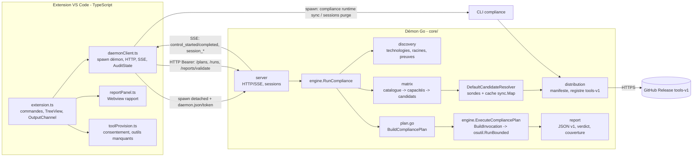
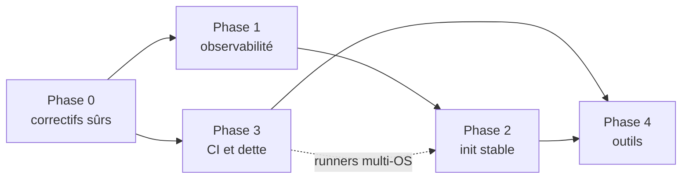

# Plan d'Architecture & Roadmap - Extension Compliance

> Audit de cadrage réalisé sur `main` @ `4f74bc4` (version 2.1.3), le 2026-10-22. Aucun code source n'a été modifié.
> Les numéros de ligne renvoient à cette révision. Les causes de l'instabilité au premier démarrage sont des **hypothèses classées** : elles viennent de la lecture du code, pas d'une reproduction instrumentée. La phase 1 de la roadmap (observabilité) sert justement à les confirmer.

---

## 1. Vue d'ensemble du projet

### 1.1 Rôle

ICP (*IaC Compliance Platform*) audite en local un dossier « Target » externe. Il détecte les technologies présentes, choisit les contrôles du catalogue qui s'appliquent, résout les outils sur la machine, les exécute, puis produit un rapport JSON v1 avec un verdict consultatif. L'extension VS Code ne fait qu'**orchestrer et afficher**. Toute la logique métier est dans un **démon Go local** (`core/`), qui écoute en HTTP/SSE sur `127.0.0.1`.

### 1.2 Flux de données



| Étape | Où | Entrée → sortie |
| --- | --- | --- |
| Détection | [core/internal/discovery/discovery.go](core/internal/discovery/discovery.go) (`DiscoverAll`, l. 251) | Arborescence → `TechnologyRecord` (technologie, racines, preuves, ambiguïtés). Ignore `.gitignore`, `.complianceignore` et une liste fixe ([ignore.go](core/internal/discovery/ignore.go)). |
| Matrice / solver | [core/internal/matrix/matrix.go](core/internal/matrix/matrix.go) (`BuildCapabilityMatrix` l. 505, `ResolveCapabilityTools` l. 642, `ResolveCandidate` l. 149) | Catalogue ([.config/control-catalog.json](.config/control-catalog.json)) + plateforme → outil candidat par capacité, qualifié par une sonde (`--version`, `python -c import checkov`…). |
| Distribution | [core/internal/distribution/](core/internal/distribution/) (`RefreshRegistry`, `SyncRuntime`, `installBinary`/`installBundle`) | Manifeste [.config/runtime-manifest.json](.config/runtime-manifest.json) → archives `tools-v1` extraites sous `~/.compliance/tools`. |
| Plan | [core/internal/engine/plan.go](core/internal/engine/plan.go) (`BuildCompliancePlan` l. 92) | Matrice → contrôles ordonnés, permissions (`network`, `code_execution`), exclusions de sous-racines. |
| Exécution | [core/internal/engine/engine.go](core/internal/engine/engine.go) (`BuildInvocation` l. 109, `ExecuteCompliancePlan` l. 1296) | Invocation → [osutil.RunBounded](core/internal/osutil/process.go) (Job Object Windows / process group POSIX, timeout, capture bornée). |
| Parsing | [core/internal/engine/runner.go](core/internal/engine/runner.go) (`parseToolFindings` l. 58) | stdout/stderr → `LocatedLeak` (fichier, ligne, règle, message). |
| Rapport | [core/internal/report/report.go](core/internal/report/report.go) | `ExecutionResult`, findings, couverture, verdict. Schéma [.config/compliance-report.schema.json](.config/compliance-report.schema.json). |
| Restitution | [vscode-extension/src/reportPanel.ts](vscode-extension/src/reportPanel.ts), [reportLayout.ts](vscode-extension/src/reportLayout.ts) | Rapport validé par le démon (`POST /api/v1/reports/validate`) → Webview. |

### 1.3 Composants et cycle de vie de l'extension

- **Manifeste** ([vscode-extension/package.json](vscode-extension/package.json)) : `engines.vscode ^1.81`, pas d'`activationEvents` explicites. VS Code les déduit des contributions (`onView:compliance.pipelines` et `onCommand:compliance.*`). L'activation est donc paresseuse, ce qui est sain. 13 commandes, une vue dans l'Explorer et 7 réglages en portée `application`.
- **`activate()`** ([extension.ts:57](vscode-extension/src/extension.ts:57)) est une seule fermeture d'environ 240 lignes. Elle crée `SessionController`, `PipelineTree`, `ReportPanel`, l'`OutputChannel` « Compliance » (texte brut, l. 67), un `setInterval` d'une seconde (rafraîchissement de l'arbre et détection des contrôles lents) et un `FileSystemWatcher` sur la source. Elle lance ensuite `reports.restore()` sans l'attendre (l. 297). Ce `restore()` peut **démarrer le démon dès l'activation** via `loadReport → ensureDaemon`.
- **Pas d'export `deactivate()`**. L'arrêt passe par un disposable qui appelle `void shutdownComplianceDaemon()` (l. 232) : la promesse n'est pas attendue.
- **Démon** : il est lancé par `DaemonClient.ensureDaemon` ([daemonClient.ts:109](vscode-extension/src/daemonClient.ts:109)) en `detached`, `stdio: 'ignore'`, puis découvert par sondage de `~/.compliance/daemon.json` toutes les 200 ms pendant 15 s au plus. Le binaire est d'abord copié dans `~/.compliance/bin/<version>/` (`stageDaemonRuntime`, l. 525). Un démon d'une autre version est arrêté puis remplacé.
- **Communication** : HTTP REST (`request`, l. 443) et SSE (`streamEvents`, l. 310). Un **nouveau `DaemonClient` est instancié à chaque appel** (`prepare`, `validateSource`, `audit`, `loadReport`, `purgeSessions`, `syncTools`). Aucun état de connexion ni promesse de démarrage n'est partagé.
- **Sous-processus lancés directement par l'extension** : `compliance sessions purge` (`execFile`), `compliance runtime sync` (`spawn`, un processus par outil), `powershell.exe Get-CimInstance` pour lister ou tuer les démons, `xattr` sur macOS.

---

## 2. Diagnostic des instabilités à l'initialisation

### 2.1 Séquence du premier lancement (telle que codée)

1. Ouverture de la vue → `activate()`. Si un `compliance.lastReport` existe dans le `workspaceState`, `restore()` démarre le démon en arrière-plan.
2. **ICP : Sélectionner la cible** → `validateTarget` → modale de consentement machine → `refresh()`.
3. `refresh()` → `purgeSessions` (copie et chmod du binaire, puis `execFile sessions purge`) → `validateSource` → **`ensureDaemon`** → `prepare` → **`ensureDaemon`** (deuxième contrôle de santé) → `POST /plans`.
4. Au démarrage, le démon exécute **d'abord** `RefreshRegistry` (réseau, budget de 3 s, [main.go:117](core/cmd/compliance/main.go:117)). Il lance ensuite **en tâche de fond** `UpgradeInstalledTools` (l. 124), puis seulement `StartDaemon` : verrou, jeton, écoute, écriture de `daemon.json` ([server.go:944](core/internal/server/server.go:944)).
5. **ICP : Lancer l'audit** → `audit()` → `validateSource` → `prepare` → `stream` : trois appels à `ensureDaemon` par audit. L'audit tourne. Si des outils manquent (`tool_unavailable`), `provisionFromReport` lance `compliance runtime sync` (processus séparé du démon) puis **relance l'audit** (`launch(depth + 1)`).

### 2.2 Hypothèses sur le besoin de « Reload Window » ou de redémarrage, par probabilité

Un « Reload Window » arrête le démon (disposable de l'extension), puis l'activation suivante en relance un neuf. Tout ce qui est réparé par un **redémarrage du démon** est donc un bon suspect.

| # | Hypothèse | Mécanisme dans le code | Pourquoi le reload « répare » | Comment confirmer |
| --- | --- | --- | --- | --- |
| H1 | **Cache de sondes jamais invalidé dans le démon** | `DefaultCandidateResolver.cache` (`sync.Map`, [matrix.go:146](core/internal/matrix/matrix.go:146)) stocke tout résultat `available` **et** tout `runtime_error` non transitoire (l. 212, 242, 285, 311). La clé est seulement `chemin:commande`. Il n'existe ni `Delete`, ni TTL, ni prise en compte du mtime. Le démon vit aussi longtemps que la fenêtre. | Une sonde ratée au premier passage (antivirus qui scanne un `python.exe` ou un `trivy.exe` fraîchement extrait, bundle en cours d'extraction, CA d'entreprise pas encore exportée) reste en échec pour toute la vie du démon, même après une installation réussie. Seul un nouveau démon vide le cache. | Journaliser les hits et misses du cache (phase 1). Reproduire : installer trivy pendant qu'un démon tourne, provoquer un `probe_failed`, puis relancer l'audit sans redémarrer. |
| H2 | **Course au remplacement du démon (mise à jour du VSIX ou premier démarrage d'une nouvelle version)** | `ensureDaemon` détecte une version différente → `shutdown()` (POST `/shutdown` avec 500 ms de timeout, puis `process.kill`) → **spawn immédiat** du nouveau démon. Sous Windows, le verrou est un **fichier PID** ([lock_windows.go](core/internal/server/lock_windows.go)). Tant que l'ancien PID est vivant (la terminaison est asynchrone), le nouveau démon sort avec `ErrDaemonAlreadyRunning` → `earlyExit` → « Le démon s'est arrêté immédiatement (code 1) ». | Au second essai, l'ancien processus est mort et le démarrage réussit. | Ajouter un code de sortie dédié à `ErrDaemonAlreadyRunning` et journaliser stderr du démon (aujourd'hui `stdio: 'ignore'`, [daemonClient.ts:146](vscode-extension/src/daemonClient.ts:146)). |
| H3 | **Délai de démarrage de 15 s dépassé au premier lancement** | Avant d'écouter, le démon fait jusqu'à 3 s de requêtes réseau, plus la signature (même contexte), plus `CleanupStaleSessions`. Au tout premier lancement sous Windows, l'exécutable de plus de 20 Mo copié dans `~/.compliance/bin/<version>` est scanné par Defender et SmartScreen. Derrière un proxy d'entreprise, la connexion TCP peut consommer tout le budget. | Le démon détaché **continue de démarrer** après l'abandon du client. À la tentative suivante, `daemon.json` est sain. | Horodater chaque phase du démarrage du démon (phase 1) ; exposer `phase` dans `/health`. |
| H4 | **Mise à jour d'outils concurrente d'un audit** | `go UpgradeInstalledTools` (démarrage du démon) et `compliance runtime sync` (lancé par l'extension) écrivent dans `~/.compliance/tools` **sans verrou inter-processus**. Les bundles Python et Node sont extraits **en place** (`O_TRUNC`, [install.go:472](core/internal/distribution/install.go:472)), pas dans un dossier temporaire renommé. Une sonde ou un contrôle qui démarre pendant l'extraction voit un bundle partiel. Sous Windows, l'écrasement d'un `python.exe` en cours d'exécution échoue et laisse un bundle mixte. | Le redémarrage arrive après la fin de l'extraction (et vide aussi le cache, cf. H1). | Journaliser les débuts et fins de mise à jour avec horodatage. Test Go : extraction concurrente d'une sonde. |
| H5 | **PATH figé** | Le démon hérite du `process.env` de l'Extension Host. `exec.LookPath` ([path_search.go:89](core/internal/osutil/path_search.go:89)) lit ce PATH. Sous Windows, un outil installé par winget, MSI ou `setx` modifie le PATH dans le registre, mais ni VS Code ni le démon ne le relisent. Sous Linux, `AugmentedEnviron` n'ajoute rien (l. 106 : seulement Darwin). | **Seul un redémarrage complet de VS Code** (et du démon) corrige. C'est le cas « je dois fermer VS Code ». | Inscrire dans le rapport le PATH effectif (`resolver.path_snapshot`). |
| H6 | **Plusieurs fenêtres VS Code, un seul démon** | Un démon unique par utilisateur (verrou). Le disposable de **chaque** fenêtre appelle `shutdownComplianceDaemon()`, qui fait aussi `killStagedDaemons()` : fermer ou recharger la fenêtre A tue le démon dont la fenêtre B se sert, éventuellement en plein audit. Deux fenêtres qui démarrent ensemble lancent deux `spawn` : le perdant échoue (cf. H2). | Recharger B relance un démon. | Ouvrir deux fenêtres, lancer un audit dans B, fermer A. |
| H7 | **Désynchronisation des manifestes** | `provisionTools` lit le manifeste **embarqué dans le VSIX** ([extension.ts:170](vscode-extension/src/extension.ts:170)), tandis que `syncTools` et le démon utilisent `~/.compliance/registry-cache` quand il est plus récent (`registryAsset`, [daemonClient.ts:24](vscode-extension/src/daemonClient.ts:24)). Un outil ajouté côté registre est déclaré « absent du manifeste » par l'extension. | Non résolu par un reload : à corriger quand même. | Test unitaire sur `selectManifestTools` avec un cache plus récent. |
| H8 | **Démarrage concurrent sans mutualisation** | Aucun singleton : `restore()` (à l'activation) et une commande utilisateur peuvent appeler `ensureDaemon` en même temps. Au premier lancement, aucun `daemon.json` n'existe : deux `spawn` partent, un échoue (H2). | Idem H2. | Compter les `spawn` par activation dans les logs. |
| H9 | **Erreurs avalées ou exceptions hors promesse** | Dans `stream()`, une erreur relancée **à l'intérieur** du callback `res.on('data')` ([daemonClient.ts:973](vscode-extension/src/daemonClient.ts:973)) n'est pas une rejection de la promesse : c'est une exception non gérée dans l'Extension Host. La promesse SSE ne se résout pas et l'arbre reste « Running ». Les erreurs de `JSON.parse` des événements sont ignorées (l. 363). Le parser SSE réinitialise `event:`, `id:` et `data:` à **chaque chunk** (l. 342-344) : un événement coupé entre deux chunks perd ses champs. `request()` n'a **aucun timeout** : un démon figé bloque l'extension indéfiniment. | L'état de l'UI (`controller.busy`) reste bloqué : seul un reload le remet à zéro. | Test de parser SSE avec des chunks fractionnés ; test de callback qui lève une exception. |
| H10 | **Verrou PID Windows et réutilisation de PID** | Si un démon a été tué (`TerminateProcess` : pas de `ReleaseLock`), `daemon.lock` garde son PID. Si Windows réattribue ce PID à un autre processus, `isProcessAlive` renvoie vrai et **tout nouveau démon est refusé** jusqu'à la suppression du fichier ou au redémarrage de la machine. | Un redémarrage de la machine « corrige ». Cas rare mais bloquant. | Vérifier l'image du processus détenteur ; passer à `LockFileEx`. |

Points secondaires repérés : `prepareComplianceBinary` appelle `chmodSync` et `execFileSync('xattr')` de façon synchrone dans l'Extension Host à chaque recherche de binaire. `killStagedDaemons` lance PowerShell et `Get-CimInstance` (1 à 3 s) à chaque arrêt. `TRIVY_SKIP_DB_UPDATE=true` ([toolenv.go:104](core/internal/osutil/toolenv.go:104)) empêche Trivy d'obtenir sa base au premier lancement (à vérifier selon les scanners activés). `PYTHONDONTWRITEBYTECODE=1` (l. 96) oblige Checkov à recompiler ses imports à chaque exécution, ce qui ralentit et ré-expose les sondes aux antivirus.

### 2.3 Solution technique préconisée

**A. Côté extension : un superviseur unique et non bloquant**

- Nouveau module `src/daemonSupervisor.ts`, singleton par Extension Host :
  - machine d'états `stopped → starting → ready → degraded → failed` avec événement `onDidChangeState` ;
  - `ready(): Promise<DaemonHealth>` **mémoïsé** : tous les appelants (`prepare`, `audit`, `loadReport`, `purge`, `sync`) partagent le même démarrage. Fin des `new DaemonClient()` ad hoc : un client unique est injecté ;
  - démarrage **anticipé et non attendu** juste après l'activation (`void supervisor.start()`), pour que le démon soit chaud avant la première commande ;
  - retries avec backoff (3 essais) ; budget de **60 s au premier démarrage d'une version** (binaire jamais lancé) et 15 s ensuite. Un `ErrDaemonAlreadyRunning` (code de sortie dédié) n'est **pas** une erreur : on se remet à sonder `daemon.json` ;
  - mise à jour de version : après `shutdown`, **attendre la mort effective** de l'ancien PID et la libération du verrou (sondage `process.kill(pid, 0)`, 5 s au plus) avant le `spawn` ;
  - `stdio` redirigé vers un fichier `~/.compliance/logs/daemon-<pid>.log` au lieu de `'ignore'` ; en cas d'échec, les dernières lignes sont affichées dans le canal de log.
- **`StatusBarItem`** (`compliance.status`) : `$(sync~spin) ICP : démarrage…`, `$(cloud-download) ICP : installation de trivy (2/5)`, `$(pass) ICP v2.1.3`, `$(warning) ICP : démon indisponible`. Un clic affiche le canal de log ou propose « Redémarrer le démon ».
- **`vscode.window.withProgress`** (`ProgressLocation.Notification`, annulable) pour les opérations longues et visibles : premier démarrage, installation d'outils (une étape par outil, progression incrémentale), audit (`Window` pour rester discret).
- **Rechargement à chaud** après installation d'outils : l'extension appelle `POST /api/v1/tools/invalidate` (nouveau, cf. B) puis relance la préparation. Elle **ne redémarre pas** le démon.
- Arrêt : exporter `deactivate()` qui **retourne** la promesse d'arrêt (VS Code l'attend quelques secondes). Le démon n'est plus tué par une fenêtre : il passe en mode **refcount et arrêt sur inactivité**, chaque fenêtre s'enregistrant (`POST /api/v1/clients`, heartbeat SSE). Le démon s'arrête seul après N minutes sans client ni run. `compliance.reset` reste l'arrêt explicite.
- Robustesse HTTP : timeout par défaut sur `request()` (10 s, 120 s pour `/plans`), `AbortSignal` propagé. Parser SSE réécrit : état conservé entre chunks, `data:` multi-lignes concaténés, erreurs remontées par `reject`. Tout `void promise` reçoit un `.catch(log.error)`.
- `restore()` n'est plus lancé à l'activation : différé à la première ouverture du rapport, ou exécuté après `supervisor.ready()`, avec un journal plutôt qu'un `showWarningMessage` au démarrage.
- Écouteurs d'événements : `onDidChangeConfiguration('compliance')` (filtres, registre, maxSessions), `onDidGrantWorkspaceTrust` (restaurer la session et préchauffer), `FileSystemWatcher` sur `~/.compliance/registry-cache/*.json` pour recharger le manifeste.

**B. Côté démon : démarrage rapide et état cohérent**

- **Écouter d'abord, rafraîchir ensuite** : `StartDaemon` (verrou, jeton, `daemon.json`) en premier, puis `RefreshRegistry` et `UpgradeInstalledTools` en goroutine. `/api/v1/health` expose `phase: starting|ready`, `registry: {source, refreshing}` et `tools_upgrading: [...]`.
- **Code de sortie dédié** (par exemple 3) pour `ErrDaemonAlreadyRunning`.
- **Verrou Windows** par `LockFileEx` sur `daemon.lock`, libéré par le système à la mort du processus, à la place du fichier PID (H10).
- **Invalidation du cache de sondes** (H1) :
  - clé = `chemin + taille + mtime` de l'exécutable (et du `python.exe` du bundle) ;
  - résultats négatifs avec TTL court (60 s) ; vidage complet sur `POST /api/v1/tools/invalidate` et à la fin de chaque `SyncRuntime` effectué par le démon ;
  - compteur `cache_hit` / `cache_miss` dans `ToolResolutionMetrics`.
- **Un seul écrivain pour `~/.compliance/tools`** (H4) : déplacer l'installation dans le démon (`POST /api/v1/tools/sync` en SSE de progression) plutôt que dans un processus CLI séparé. Garder un verrou fichier inter-processus `tools/.install.lock`, pris aussi par la CLI `runtime sync`. Extraire les bundles dans `tools/.staging/<tool>-<version>`, qualifier, puis faire un **renommage atomique** du dossier (ancien dossier renommé en `.old` puis supprimé). `UpgradeInstalledTools` ne démarre pas pendant un run et un run attend la fin d'une mise à jour en cours.
- **PATH vivant** (H5) : à chaque `POST /plans`, reconstruire le PATH effectif. Sous Windows, relire `HKCU\Environment\Path` et `HKLM\SYSTEM\CurrentControlSet\Control\Session Manager\Environment\Path` (avec expansion des `%VAR%`). Sous macOS et Linux, l'extension transmet `process.env.PATH` (déjà résolu par VS Code depuis le shell de login) dans la requête. Le résultat est fusionné et dédoublonné avec l'existant, et inscrit dans le rapport (`resolver.path_entries`).
- **Manifeste actif exposé** (H7) : `GET /api/v1/registry` renvoie le manifeste et le catalogue réellement utilisés. `provisionTools` s'en sert au lieu du fichier embarqué.

---

## 3. Plan d'amélioration de l'observabilité (Logs)

### 3.1 Emplacements actuels d'exécution des sous-processus

| Lieu | Appel | Ce qui est tracé aujourd'hui | Manques |
| --- | --- | --- | --- |
| [daemonClient.ts:142](vscode-extension/src/daemonClient.ts:142) | `spawn(compliance daemon …)` | Rien, `stdio: 'ignore'` | Ligne de commande, PID, stderr du démon (`[WARN]` de mise à jour, `[INFO]` du registre) **perdus**. |
| [daemonClient.ts:228](vscode-extension/src/daemonClient.ts:228) | `execFile(sessions purge)` | stdout ligne à ligne vers l'Output | Commande et durée absentes. |
| [daemonClient.ts:257](vscode-extension/src/daemonClient.ts:257) | `spawn(runtime sync -tool X)` | stderr seulement, et seulement en cas d'échec | stdout (`[INFO] Synchronisation…`, chemins installés) ignoré ; pas de progression ; URL, version et SHA absents. |
| [daemonClient.ts:585](vscode-extension/src/daemonClient.ts:585), [599](vscode-extension/src/daemonClient.ts:599) | `powershell Get-CimInstance`, `ps`, `xattr` | Rien | Échecs silencieux. |
| [matrix.go:196](core/internal/matrix/matrix.go:196) et l. 269 | `osutil.ProbeQuiet` (sondes `--version`) | Message d'échec dans `Reason` (`FormatProbeFailure`) | Pas de trace de succès, ni de durée, ni d'indication de cache. |
| [engine.go:1244](core/internal/engine/engine.go:1244) | `ProbeToolVersion` (64 Ko, avant chaque contrôle) | Version si succès | Échec silencieux. |
| [engine.go:1509](core/internal/engine/engine.go:1509) | `osutil.RunBounded` (contrôle et ses `Followups`) | stdout/stderr agrégés, `exit_code`, `duration_ms`, `output_truncated` dans `ExecutionResult` ([report.go:69](core/internal/report/report.go:69)) | **Exécutable, arguments, cwd, variables ajoutées ou retirées et timeout effectif absents.** Les `Followups` sont fusionnés sans séparation. stdout et stderr sont **tronqués en mémoire** (`BoundedCapture`, [process.go:47](core/internal/osutil/process.go:47)) et l'excédent est perdu. |
| [server.go:775](core/internal/server/server.go:775) | `WriteControlLog` | Fichier `logs/<ctrl>.log` = stdout + `\n` + stderr | Flux mélangés, pas d'en-tête (commande, code retour, durée). |
| [extension.ts](vscode-extension/src/extension.ts) | `output.appendLine(...)` | Texte libre en français : durées de phases, statut des contrôles | Pas de niveau, pas d'horodatage, pas de `run_id` ou `control_id` systématique, aucun réglage de verbosité. |

### 3.2 Architecture cible

1. **Extension : `LogOutputChannel` natif** (`vscode.window.createOutputChannel('Compliance', { log: true })`, disponible depuis VS Code 1.74, compatible avec `^1.81`). Il fournit `trace`, `debug`, `info`, `warn` et `error`, l'horodatage, le filtrage et le réglage du niveau par l'utilisateur (« Developer: Set Log Level… »). Un module `src/logger.ts` l'enveloppe :
   - `log.child({ runId, controlId })` pour la corrélation ;
   - `log.command(spec)` pour toute exécution locale (`spawn`/`execFile` de l'extension) ;
   - masquage centralisé (`redact()`) : `*_TOKEN`, `*_KEY`, `*PASSWORD*`, identifiants dans les URL de proxy, `Authorization`, motifs de `compliance.reportRedactionPatterns`.
   - Un second canal facultatif `Compliance — Exécutions` reçoit les sorties brutes des contrôles en flux continu (niveau `trace`) sans noyer le journal principal.
2. **Démon : `log/slog`** (gestionnaire JSON) vers `~/.compliance/logs/daemon.log`, avec rotation par taille (5 × 5 Mo), et vers stderr en développement. Tous les `fmt.Fprintf(os.Stderr, "[WARN]…")` de `distribution` et `main.go` passent par ce logger.
3. **Remontée temps réel** : nouveaux événements SSE (le schéma reste `schema_version: 1`, les types sont additifs) :
   - `daemon_log` (niveau ≥ seuil demandé par le client), sur un flux global `GET /api/v1/logs/stream` ;
   - `tool_probe` : outil, chemin, arguments, durée, cache hit/miss, résultat ;
   - `control_invocation` : avant chaque appel de `RunBounded` ;
   - `control_output` : morceaux de stdout/stderr en flux, plafonnés, uniquement si le client s'abonne au niveau `trace`.
4. **Rapport** : nouveau champ facultatif `invocations[]` dans `ExecutionResult` et dans [compliance-report.schema.json](.config/compliance-report.schema.json). Un élément par appel, `Followups` compris.
5. **Sorties complètes sur disque** : `RunBounded` écrit les flux **complets** dans `logs/<ctrl>.stdout.log` et `logs/<ctrl>.stderr.log`, avec un plafond disque configurable (50 Mo par défaut). La mémoire ne garde que la tête et la fin pour le parsing et le rapport, et `output_truncated` désigne la troncature du rapport, pas une perte de données. `WriteControlLog` ajoute un en-tête et ne mélange plus les flux.
6. Commande **ICP : Ouvrir le journal du démon** et lien « Voir les logs » dans toute notification d'erreur.

### 3.3 Format de log cible

Journal principal (`LogOutputChannel`, horodatage et niveau ajoutés par VS Code) :

```text
2026-10-22 10:41:07.112 [info] [run 3f9c1a2e] control_started docker/security/trivy/. (root=., timeout=300s)
2026-10-22 10:41:07.113 [debug] [run 3f9c1a2e] exec trivy
    cmd   : C:\Users\u\.compliance\tools\bin\windows-x64\trivy.exe config --format json --quiet .
    cwd   : E:\work\target
    env+  : TRIVY_CACHE_DIR=C:\Users\u\.compliance\cache\trivy TRIVY_SKIP_DB_UPDATE=true SSL_CERT_FILE=<ca-bundle> NO_COLOR=1
    env-  : TRIVY_CONFIG
    source: registry tools-v1 0.75.0 (sha256 4be1…c0, probe cache=hit)
2026-10-22 10:41:09.870 [info] [run 3f9c1a2e] control_completed docker/security/trivy/. exit=1 status=fail duration=2757ms findings=4 stdout=18.2KB stderr=312B truncated=no
2026-10-22 10:41:09.871 [trace] [run 3f9c1a2e] stderr (312B) : 2026-10-22T10:41:09+02:00 WARN …
2026-10-22 10:41:09.871 [error] [run 3f9c1a2e] control_error python/security/bandit/. process_error: exec: "python.exe": file does not exist (voir logs/python__security__bandit.stderr.log)
```

Élément `invocations[]` du rapport :

```json
{
  "executable": "C:/Users/u/.compliance/tools/bin/windows-x64/trivy.exe",
  "args": ["config", "--format", "json", "--quiet", "."],
  "raw_command_line": null,
  "cwd": "E:/work/target",
  "env_added": {"TRIVY_CACHE_DIR": "C:/Users/u/.compliance/cache/trivy", "SSL_CERT_FILE": "<redacted-path>"},
  "env_removed": ["TRIVY_CONFIG"],
  "timeout_ms": 300000,
  "started_at": "2026-10-22T08:41:07.113Z",
  "duration_ms": 2757,
  "exit_code": 1,
  "timed_out": false,
  "cancelled": false,
  "stdout_bytes": 18640,
  "stderr_bytes": 312,
  "stdout_path": "logs/docker__security__trivy.stdout.log",
  "stderr_path": "logs/docker__security__trivy.stderr.log",
  "truncated_in_report": false
}
```

Règles : on n'exporte que le **différentiel** d'environnement, pas l'environnement complet. Les valeurs sensibles sont masquées avant l'écriture (le `Redactor` d'[engine.go:61](core/internal/engine/engine.go:61) est appliqué aussi aux arguments). Les chemins sont normalisés en `/`. Niveaux : `error` pour un échec d'exécution ou du démon, `warn` pour une dégradation (sonde ratée, signature absente, troncature), `info` pour le cycle de vie des sessions et des contrôles, `debug` pour les commandes, chemins et décisions du solver, `trace` pour les sorties brutes et le SSE.

---

## 4. Bilan d'auto-conformité (Dogfooding)

Le dépôt contient Go, TypeScript, Python, JSON/YAML et Markdown : quatre des technologies du catalogue. Or **l'extension ne peut pas s'auditer elle-même**, parce que `validateTarget` refuse une Target qui contient la source ([daemonClient.ts:830](vscode-extension/src/daemonClient.ts:830)). La CLI (`compliance run -repo .`) n'applique pas cette règle et reste la voie pour le dogfooding.

### 4.1 Écarts constatés

| Domaine | Écart | Preuve | Gravité |
| --- | --- | --- | --- |
| CI | **Aucune intégration continue** : pas de `.github/workflows`. Les tests Go, `tsc`, le selftest et le packaging ne tournent qu'à la main sur un poste Windows. | `ls .github` → absent | Haute |
| Hooks | `.pre-commit-config.yaml` appelle `scripts/check-emoji.ps1` et `scripts/quality-gate.ps1`, **absents du dépôt**, et `.tools/bin/gitleaks.exe` (chemin Windows, non versionné). Les hooks locaux sont cassés et non portables. | [.pre-commit-config.yaml](.pre-commit-config.yaml), `ls scripts/` | Haute |
| Sécurité | `compliance.registryToken` est un **réglage en clair** (`settings.json`, synchronisé par Settings Sync) au lieu de `context.secrets` (SecretStorage). | [package.json:254](vscode-extension/package.json:254), [extension.ts:186](vscode-extension/src/extension.ts:186) | Haute |
| Binaire versionné | VSIX de 22 Mo commité (`!vscode-extension/dist/compliance-pipelines-2.1.3.vsix`), en contradiction avec le README (« 0 binaire versionné ») et avec le hook `check-added-large-files --maxkb=5120`. Chaque release alourdit l'historique. | [.gitignore](.gitignore) | Moyenne |
| Lint TS | Pas d'ESLint ni de formateur pour `vscode-extension/src`. Le linter du projet lui-même (catalogue `typescript.lint.eslint`) n'est pas appliqué au projet. | absence d'`eslint.config.*` | Moyenne |
| Tests TS | Pas de framework de test : `scripts/debug-check.js` est un script d'assertions monolithique sur le JS compilé. Le `pretest` lance `package_vsix.py --ensure-binaries` (effet de bord, Python requis). Aucun test du parser SSE, de `AuditState.receive` ni du cycle de vie du démon. | [package.json:37-38](vscode-extension/package.json:37) | Moyenne |
| Lint Go | `gofmt` et `go vet` manuels. Pas de `golangci-lint`/`staticcheck`, pas de `govulncheck`. Le catalogue ne couvre pas Go. | [docs/developpement.md](docs/developpement.md) | Moyenne |
| Gestion d'erreurs TS | Une vingtaine de `catch {}` silencieux dans `daemonClient.ts`. Exception relancée dans un callback d'EventEmitter (l. 973). `String(error)` affiché à l'utilisateur (perte de cause et de pile). `void reports.restore()`. | [daemonClient.ts](vscode-extension/src/daemonClient.ts) | Moyenne |
| Typage TS | `any` dans `streamEvents(onEvent: (event: any))`, `validateReport(): Promise<any>` et `request(body?: any)`. `Fields = Record<string, unknown>` partout au lieu de types générés depuis les schémas JSON. Le `tsconfig` est bon (`strict`, `noUnused*`). | l. 310, 427, 443 | Basse |
| Architecture | Fichiers monolithiques : `engine.go` (2 142 l.), `server.go` (1 654 l.), `daemonClient.ts` (1 302 l. mêlant gestion de processus, HTTP, SSE, état de session, lecture et validation de rapport). `activate()` est une fermeture de 240 lignes. Le parsing est dispatché par `switch` sur le nom de commande dans `runner.go` et `BuildInvocation`, ce qui alourdit chaque ajout d'outil. | `wc -l` | Moyenne |
| Duplication | `.config/*` copié dans `core/internal/embedded/assets/` par `package_vsix.py`. Il faut un test qui échoue en cas de divergence (à vérifier qu'il existe pour tous les fichiers, pas seulement pour le catalogue). | arborescence | Basse |
| Documentation | Le README cite `go.work` et `docs/outils.md` (absents), ne liste que 4 des 10 fichiers TS, et dit à deux endroits qu'« une somme SHA-256 différente ne bloque pas l'installation », alors que le code **refuse** (`ErrArchiveHashMismatch`), comme le dit [architecture.md](docs/architecture.md). | [README.md](README.md) | Basse |
| Intégrité | Signature Ed25519 absente ou différente = simple avertissement. Acceptable par défaut, mais il manque un mode entreprise strict. | [docs/architecture.md](docs/architecture.md) | Basse |
| UX / i18n | Messages sans accents (« Selectionner », « deja », « controle ») mêlés à des messages accentués. Aucune externalisation (`vscode-nls` / `l10n`). | [extension.ts](vscode-extension/src/extension.ts) | Basse |
| Couverture plateforme | `windows-arm64` : binaire du démon livré, mais **manifeste d'outils vide**. Linux et macOS n'ont ni bundle Python complet ni bundle Node (checkov, bandit, eslint, tsc…). | `runtime-manifest.json` | Moyenne (cf. §5) |

### 4.2 Actions correctives prioritaires

1. **CI GitHub Actions** (`.github/workflows/ci.yml`), matrice `windows-latest`, `ubuntu-latest`, `ubuntu-24.04-arm`, `macos-13`, `macos-14` : `gofmt -l`, `go vet`, `go test -race`, `golangci-lint`, `govulncheck`, `tsc --noEmit`, ESLint, tests TS, `compliance selftest`, **`compliance run -repo .`** (dogfooding, rapport publié en artefact), puis `npm run package` (VSIX en artefact, plus dans Git). C'est aussi ce qui qualifierait Linux et macOS (aujourd'hui « Targeted »).
2. **Réparer pre-commit** : retirer les hooks orphelins ou recréer les scripts en version portable (Python), et pointer gitleaks vers le binaire résolu par `compliance` lui-même.
3. **SecretStorage** pour `registryToken`, avec migration automatique du réglage existant puis effacement.
4. **ESLint (flat config) + `typescript-eslint` strict** sur `vscode-extension/src`, avec les règles `no-floating-promises`, `no-explicit-any`, `no-empty` (catch) et `no-misused-promises`.
5. **Tests TS** (`node:test` ou Mocha via `@vscode/test-electron`, déjà en devDependency) : parser SSE, `AuditState`, superviseur du démon (faux binaire), `toolProvision`.
6. **Découpage** : `daemonClient.ts` en `daemon/supervisor.ts`, `daemon/http.ts`, `daemon/sse.ts`, `session/auditState.ts` et `report/loader.ts`. `engine.go` : extraire un registre `ToolAdapter` (cf. §5.3).
7. **Retirer le VSIX de Git** (le publier en asset de release) et corriger README et architecture.

---

## 5. Matrice d'extension des outils (Web, DevOps & Multi-OS)

### 5.1 Outils actuellement supportés par le solver

| Outil | Technologies (catalogue) | Distribution `tools-v1` | Plateformes du manifeste |
| --- | --- | --- | --- |
| terraform 1.8.5, tofu 1.8.2, terragrunt 1.1.6, tflint 0.64.0 | terraform, opentofu, terragrunt | binaire natif | 5 (win-x64, linux-x64/arm64, macos-x64/arm64) |
| trivy 0.75.0 | docker, kubernetes, helm | binaire natif | 5 |
| hadolint 2.15.1 | docker | binaire natif | 5 |
| shellcheck 0.10.0 | shell | binaire natif | 5 |
| gitleaks 8.30.1 | javascript (seulement !) | binaire natif | 5 |
| ruff 0.16.10 | python (format + lint) | binaire natif | 5 |
| rumdl 0.2.79 | markdown | binaire natif | 5 |
| checkov 3.3.23, bandit 1.9.4, pylint 4.1.2, pytest 9.1.1, pip-audit 2.10.1, yamllint 1.35.1 | terraform/opentofu/k8s/helm, python, ansible | bundle Python 3.11.9 | **windows-x64 seulement** (ailleurs : PATH) |
| ansible-lint 25.8.2 | ansible | bundle Python POSIX (construit à la demande) | non publié |
| eslint 9.21.0, tsc 5.7.3 | javascript, typescript | bundle Node 22.14.0 | **windows-x64 seulement** |
| PSScriptAnalyzer 1.23.0 | powershell | module | windows-x64 |

Le solver résout `node_modules/.bin` de la cible (eslint, tsc), puis `.tools/bin`, `~/.compliance/tools/{bin,python,node,powershell-modules}` et enfin le `PATH` (plus les dossiers Homebrew et pyenv sous macOS).

### 5.2 Outils recommandés

| Outil | Technologie (nouvelle ?) | Justification | Distribution | Priorité |
| --- | --- | --- | --- | --- |
| **gitleaks** (élargi) | `secrets` (nouvelle, transverse) | Aujourd'hui rattaché à `javascript` : un dépôt Terraform ou Python n'a **aucun** scan de secrets. À rendre transverse (`repo-wide`). | déjà natif ×5 | P0 |
| **actionlint** | `github-actions` (nouvelle : `.github/workflows/*.y*ml`) | Lint de workflows, intègre shellcheck pour les blocs `run:`. Très pertinent pour la CI/CD. | Go, releases `rhysd/actionlint` ×5 (zip/tar.gz) | P0 |
| **yamllint** (élargi) | `yaml` (nouvelle, générique) | N'est utilisé que pour Ansible. Les YAML Kubernetes, CI et Compose restent sans lint de syntaxe. | bundle Python (à porter sur POSIX) | P0 |
| **Biome** | javascript, typescript, json, css | Un seul binaire Rust : lint et format JS/TS/JSON/CSS, sans Node. C'est l'alternative quand la cible n'a ni `node_modules` ni configuration ESLint (supprime le repli `eslint_fallback.cjs`). Politique `selection_policy` : ESLint si configuré, sinon Biome. | releases `biomejs/biome` (`cli/vX`) ×5, binaire nu | P1 |
| **Stylelint** | `css` (nouvelle : `.css`, `.scss`, `.less`) | Standard de facto du lint CSS ; Biome couvre le CSS mais pas SCSS/Less. | bundle Node (npm figé) | P1 |
| **HTMLHint** | `html` (nouvelle : `.html`, `.htm`) | Lint HTML léger, sortie JSON (`--format json`). | bundle Node | P2 |
| **Trivy** (élargi) | `dependencies` / `secrets` | `trivy fs --scanners vuln,secret` sur les lockfiles (npm, pip, go.mod, Cargo). Exige la base de vulnérabilités, donc la permission `network` et le retrait de `TRIVY_SKIP_DB_UPDATE` pour ce contrôle. | déjà natif ×5 | P1 |
| **Checkov** (élargi) | docker, github-actions | Frameworks `dockerfile`, `github_actions`, `secrets` déjà dans Checkov : de nouveaux contrôles sans nouvel outil. | déjà bundle | P1 |
| **kubeconform** | kubernetes | Validation des manifestes contre les schémas (complète Checkov et Trivy, orientés sécurité). | Go, releases `yannh/kubeconform` ×5 | P2 |
| **shfmt** | shell | Formatage shell (pendant de `terraform fmt`). | Go, releases `mvdan/sh` ×5, binaire nu | P2 |
| **osv-scanner** | `dependencies` (nouvelle, transverse) | Audit de dépendances multi-écosystèmes (npm, PyPI, Go, Maven) ; complète pip-audit, limité à Python. | Go, releases `google/osv-scanner` ×5 | P2 |
| **golangci-lint** + **govulncheck** | `go` (nouvelle : `go.mod`) | Nécessaire au dogfooding du cœur Go ; pertinent pour les cibles Go. govulncheck exige une toolchain Go : à résoudre par le PATH uniquement. | golangci-lint : releases ×5 | P2 |
| **zizmor** | github-actions | Sécurité des workflows (injections, permissions). Disponibilité des binaires multi-OS **à vérifier** ; sinon bundle Python. | à qualifier | P3 |

Écartés pour l'instant : **Semgrep** (lourd, pas de binaire Windows natif), **tfsec** (fusionné dans Trivy), **Prettier** seul (redondant avec Biome pour le contrôle de format).

### 5.3 Prérequis d'architecture avant d'ajouter des outils

Ajouter un outil touche aujourd'hui sept endroits : catalogue, discovery, `BuildInvocation` (cas particuliers), `parseToolFindings` (`switch`), `tools-lock.json`, `build_and_publish_tools.py` et le manifeste, plus le tableau du README et son test. Proposition :

- interface Go `ToolAdapter { Command() string; Invocation(ctx, ctrl) (*Invocation, error); Parse(stdout, stderr, repo) []LocatedLeak; Probe() ProbeSpec }`, avec un registre `adapters[command]`. `runner.go` et `engine.go` délèguent à l'adaptateur ;
- format de sortie privilégié : **SARIF** quand l'outil le supporte (Biome, actionlint via template, Trivy, Checkov, gitleaks, osv-scanner, golangci-lint). Un seul parser SARIF générique remplace plusieurs parsers ad hoc ;
- discovery : nouvelles technologies (`secrets`, `yaml`, `github-actions`, `css`, `html`, `go`, `dependencies`) déclarées par des règles du catalogue (`evidence_extensions`, `evidence_paths`) plutôt que codées en dur dans `DiscoverAll`.

### 5.4 Spécifications multi-OS

**Identifiants de plateforme** (inchangés) : `windows-x64`, `windows-arm64`, `linux-x64`, `linux-arm64`, `macos-x64`, `macos-arm64`. Correspondance unique `process.platform/arch` ↔ `GOOS/GOARCH`, partagée entre [extension.ts](vscode-extension/src/extension.ts) (`hostPlatform`) et [distribution.go](core/internal/distribution/distribution.go) (`DetectPlatform`), avec un test croisé.

| Sujet | Spécification |
| --- | --- |
| Nommage des assets | `<plateforme>-<outil>-<version>.<ext>`, déjà en place. `.zip` pour Windows, `.tar.gz` pour POSIX (préserve le mode 0755). Binaire nu accepté (hadolint, biome, shfmt) avec `binary_sha256` obligatoire. |
| Exécutable | Nom `<outil>.exe` sous Windows (`executableFileName`), sans extension ailleurs. Résolution Windows des lanceurs `.cmd`/`.ps1` (Node) via `ScriptCommand` et `windowsCmdScript` ; jamais de `shell: true`. |
| Permissions POSIX | Après extraction, `chmod 0755` **sur tout fichier marqué exécutable dans l'archive** (aujourd'hui seul le binaire principal ou `dest` est chmodé pour les bundles : `node/bin/*` et `python/bin/*` dépendent du mode tar). Refus des liens symboliques sortant du dossier (déjà `safeJoin`). |
| macOS | Les binaires téléchargés par le démon en Go ne reçoivent pas l'attribut `com.apple.quarantine`. Conserver tout de même un `xattr -d` défensif, et documenter que les binaires non notariés peuvent être tués (SIGKILL) : diagnostic déjà présent pour le démon, à étendre aux outils (`exit -9` → message Gatekeeper). Préférer les builds universels ou notariés en amont quand ils existent. |
| Linux | Préférer les builds **statiques ou musl** (ruff, trivy, biome, actionlint sont statiques) pour couvrir Alpine et les vieilles glibc. Bundle Python : `python-build-standalone` (`install_only` relocalisable) pour les 4 cibles POSIX. |
| Windows | Chemins longs (`\\?\`, déjà géré au-delà de 248 caractères), exclusion Defender documentée pour `~/.compliance/tools`, verrous de fichiers : extraction en staging puis renommage (§2.3 B). |
| windows-arm64 | Manifeste vide aujourd'hui. Court terme : **repli sur les assets `windows-x64`** (émulation x64 de Windows 11 ARM), signalé `platform_qualification_status: emulated`. Moyen terme : assets natifs quand l'amont les publie (ruff, biome, trivy, gitleaks le font). |
| Bundles Python et Node POSIX | Construits en CI sur des runners natifs (matrice §4.2) par `build_and_publish_tools.py` : Node officiel `node-v22.x-<os>-<arch>.tar.xz` + `npm ci --omit=dev` d'un `package-lock` figé (eslint, typescript, stylelint, htmlhint) ; Python standalone + `pip install --require-hashes -r tools-requirements.lock`. |
| Intégrité | SHA-256 de l'archive et du binaire obligatoires (déjà bloquants). Vérification en amont **des checksums publiés par chaque projet** dans le script de build. Signature Ed25519 du manifeste, avec réglage `compliance.requireSignedManifest` (défaut `false`, `true` en entreprise). Facultatif : attestations GitHub (`actions/attest-build-provenance`). |
| Versionnement des releases | `tools-v1` est un tag **mutable** dont les assets sont remplacés en place. Proposition : releases immuables `tools-<AAAA.MM.N>` contenant les archives, et `tools-v1` réduit à un **canal** ne portant que `runtime-manifest.json`, sa signature et le catalogue (pointant vers les URL immuables). Les caches et miroirs (Artifactory/Nexus via `compliance.registryUrl`) restent cohérents et un retour arrière revient à republier le manifeste. |
| Proxy / CA | Déjà gérés (`HTTPS_PROXY`, CA d'entreprise exportée). À journaliser au niveau `debug` (proxy utilisé, source de la CA) pour le diagnostic. |

---

## 6. Roadmap d'implémentation phasée

Ordre retenu : on **instrumente d'abord** (phase 1) pour confirmer H1 à H10, puis on stabilise (phase 2), on outille le dépôt (phase 3) et on élargit le catalogue (phase 4). La phase 0 regroupe des corrections sûres et indépendantes.

> **Avancement au 2026-10-22** : phases 0 et 1 commitées (`3a82435`), phase 2 réalisée. Écarts assumés :
> - `restore()` reste lancé à l'activation. Il partage désormais le démarrage du démon avec les commandes, et ses erreurs sont journalisées.
> - L'évènement `control_output` (sorties en direct) est reporté : les flux complets sont sur disque et la commande est annoncée par `control_invocation`.
> - Le fichier `<contrôle>.log` garde son format pour rester compatible avec les rapports existants. La commande exécutée est dans `invocations[]`, pas en en-tête.
> - Phase 2 : l'installation reste faite par `compliance runtime sync` (processus séparé) et non par une route du démon. Le verrou inter-processus des outils, l'extraction en staging et le compteur `.generation` apportent l'exclusion et l'invalidation visées. Le PATH effectif est journalisé (`path_refreshed`) plutôt qu'inscrit dans le rapport.
> - Phase 2 : `restore()` n'attend pas le superviseur ; il partage le démarrage du démon.

### Phase 0 — Corrections immédiates (faible risque)

| Action | Fichiers |
| --- | --- |
| Parser SSE : état conservé entre chunks, `data:` multi-lignes, erreurs relancées via `reject` (plus de `throw` dans `res.on('data')`) | [vscode-extension/src/daemonClient.ts](vscode-extension/src/daemonClient.ts) |
| Timeout et `AbortSignal` sur `request()` | idem |
| `.catch()` sur toutes les promesses `void` ; `restore()` différé | [vscode-extension/src/extension.ts](vscode-extension/src/extension.ts), [reportPanel.ts](vscode-extension/src/reportPanel.ts) |
| `provisionTools` lit le manifeste actif (cache du registre) comme `syncTools` | [extension.ts](vscode-extension/src/extension.ts), [daemonClient.ts](vscode-extension/src/daemonClient.ts) (`registryAsset` exporté) |
| `registryToken` → SecretStorage, avec migration | [extension.ts](vscode-extension/src/extension.ts), [package.json](vscode-extension/package.json) |
| Doc : SHA-256 bloquant, `go.work` et `outils.md` retirés, arborescence TS à jour | [README.md](README.md), [docs/extension.md](docs/extension.md) |
| pre-commit : hooks orphelins retirés ou remplacés | [.pre-commit-config.yaml](.pre-commit-config.yaml), `scripts/` |

### Phase 1 — Chantier 1 : observabilité

| Étape | Fichiers |
| --- | --- |
| `LogOutputChannel` + `src/logger.ts` (niveaux, corrélation, masquage) ; remplacement de tous les `output.appendLine` | **nouveau** `vscode-extension/src/logger.ts`, [extension.ts](vscode-extension/src/extension.ts), [daemonClient.ts](vscode-extension/src/daemonClient.ts), [reportPanel.ts](vscode-extension/src/reportPanel.ts) |
| stdout/stderr du démon redirigés vers un fichier ; commande « Ouvrir le journal du démon » | [daemonClient.ts](vscode-extension/src/daemonClient.ts), [package.json](vscode-extension/package.json) |
| `slog` dans le démon, rotation, phases de démarrage horodatées | [core/cmd/compliance/main.go](core/cmd/compliance/main.go), [core/internal/server/server.go](core/internal/server/server.go), [core/internal/distribution/registry.go](core/internal/distribution/registry.go), **nouveau** `core/internal/logging/` |
| `invocations[]` dans `ExecutionResult` et le schéma ; spécification de commande capturée dans la boucle d'exécution | [core/internal/report/report.go](core/internal/report/report.go), [core/internal/engine/engine.go](core/internal/engine/engine.go), [.config/compliance-report.schema.json](.config/compliance-report.schema.json) (+ copie embarquée) |
| Sorties complètes sur disque (stdout/stderr séparés), en-tête de log | [core/internal/osutil/process.go](core/internal/osutil/process.go), [process_windows.go](core/internal/osutil/process_windows.go), [process_posix.go](core/internal/osutil/process_posix.go), [server.go](core/internal/server/server.go) (`WriteControlLog`) |
| Événements SSE `tool_probe`, `control_invocation`, `control_output` ; flux `/api/v1/logs/stream` ; traces de sondes avec cache hit/miss | [server.go](core/internal/server/server.go), [core/internal/matrix/matrix.go](core/internal/matrix/matrix.go), [daemonClient.ts](vscode-extension/src/daemonClient.ts) (`AuditState.receive` tolérant aux nouveaux types) |
| `runtime sync` : stdout et stderr relayés en direct | [daemonClient.ts](vscode-extension/src/daemonClient.ts) (`syncTools`), [main.go](core/cmd/compliance/main.go) |
| Tests : masquage, schéma de rapport, `ControlLogName`, capture complète au-delà de `MaxOutputBytes` | `core/internal/engine/runner_test.go`, `core/internal/server/log_test.go`, tests TS (phase 3) |

**Critère de sortie** : un premier démarrage raté se diagnostique **uniquement** depuis le canal « Compliance » et `daemon.log`.

### Phase 2 — Chantier 2 : initialisation non bloquante et stable

| Étape | Hypothèses | Fichiers |
| --- | --- | --- |
| `DaemonSupervisor` singleton (promesse mémoïsée, états, retries, budget adaptatif, attente de la mort de l'ancien PID) ; injection d'un client unique partout | H2, H3, H8 | **nouveau** `vscode-extension/src/daemonSupervisor.ts`, [daemonClient.ts](vscode-extension/src/daemonClient.ts), [daemonLifecycle.ts](vscode-extension/src/daemonLifecycle.ts), [extension.ts](vscode-extension/src/extension.ts) |
| `StatusBarItem` + `withProgress` (démarrage, installation par outil, audit) | UX | [extension.ts](vscode-extension/src/extension.ts), [package.json](vscode-extension/package.json) |
| `deactivate()` exporté ; plus d'arrêt du démon par fenêtre : refcount de clients + arrêt sur inactivité | H6 | [extension.ts](vscode-extension/src/extension.ts), [server.go](core/internal/server/server.go) (`/api/v1/clients`, minuterie d'inactivité) |
| Démon : écoute avant `RefreshRegistry` ; `/health` avec `phase` ; code de sortie dédié « déjà lancé » | H2, H3 | [main.go](core/cmd/compliance/main.go), [server.go](core/internal/server/server.go) |
| Verrou Windows `LockFileEx` | H10 | [core/internal/server/lock_windows.go](core/internal/server/lock_windows.go) |
| Cache de sondes : clé avec mtime et taille, TTL négatif, `POST /api/v1/tools/invalidate`, métriques | H1 | [core/internal/matrix/matrix.go](core/internal/matrix/matrix.go), [server.go](core/internal/server/server.go) |
| Installation des outils dans le démon (`POST /api/v1/tools/sync` + SSE), verrou `tools/.install.lock`, extraction en staging + renommage atomique, exclusion mutuelle avec runs et upgrades | H4 | [core/internal/distribution/install.go](core/internal/distribution/install.go), [distribution.go](core/internal/distribution/distribution.go), [registry.go](core/internal/distribution/registry.go), [server.go](core/internal/server/server.go), [daemonClient.ts](vscode-extension/src/daemonClient.ts) |
| PATH vivant (registre Windows ; PATH transmis par l'extension sous POSIX) ; `resolver.path_entries` dans le rapport | H5 | [core/internal/osutil/path_search.go](core/internal/osutil/path_search.go), **nouveau** `core/internal/osutil/path_windows.go`, [server.go](core/internal/server/server.go) (`PlanRequest`), [engine/plan.go](core/internal/engine/plan.go) |
| `GET /api/v1/registry` (manifeste actif) | H7 | [server.go](core/internal/server/server.go), [extension.ts](vscode-extension/src/extension.ts) |
| Suppression des appels synchrones (`chmodSync`, `execFileSync xattr`) dans l'Extension Host | perf | [daemonClient.ts](vscode-extension/src/daemonClient.ts) |
| Selftest : nouvelles étapes « remplacement de version sans échec », « deux clients simultanés », « installation pendant un plan », « sonde invalidée après sync » | toutes | [core/internal/selftest/selftest.go](core/internal/selftest/selftest.go) |

**Critère de sortie** : installation neuve du VSIX, puis mise à jour du VSIX, puis installation d'outils, **sans aucun reload**, vérifiées sur Windows x64 (puis sur les runners CI des autres OS).

### Phase 3 — Chantier 3 : dogfooding et dette

| Étape | Fichiers |
| --- | --- |
| CI multi-OS (tests, lint, selftest, `compliance run -repo .`, packaging en artefact) | **nouveau** `.github/workflows/ci.yml`, **nouveau** `.github/workflows/release.yml` |
| ESLint flat config + `typescript-eslint` strict ; correction des `any`, des `catch {}` silencieux et des promesses flottantes | **nouveau** `vscode-extension/eslint.config.mjs`, [package.json](vscode-extension/package.json), `vscode-extension/src/*.ts` |
| Tests TS (`node:test` pour la logique pure, `@vscode/test-electron` pour l'activation) ; `pretest` sans effet de bord de packaging | [vscode-extension/src/test/](vscode-extension/src/test/), [package.json](vscode-extension/package.json), [scripts/debug-check.js](vscode-extension/scripts/debug-check.js) (migré) |
| `golangci-lint` (+ `govulncheck`) | **nouveau** `core/.golangci.yml` |
| Découpage de `daemonClient.ts` et `extension.ts` ; registre `ToolAdapter` côté Go | `vscode-extension/src/daemon/*`, `vscode-extension/src/session/*`, [engine.go](core/internal/engine/engine.go), [runner.go](core/internal/engine/runner.go) |
| Types TS générés depuis les schémas JSON (`json-schema-to-typescript`) | [.config/*.schema.json](.config/), **nouveau** `vscode-extension/src/generated/` |
| VSIX retiré de Git, publié en release ; `.gitignore` nettoyé | [.gitignore](.gitignore), `vscode-extension/dist/` |
| Messages utilisateur unifiés (accents) et externalisés (`vscode.l10n`) | `vscode-extension/src/*.ts`, **nouveau** `vscode-extension/l10n/` |

### Phase 4 — Chantier 4 : écosystème d'outils

| Étape | Fichiers |
| --- | --- |
| P0 : `secrets` transverse (gitleaks), `github-actions` (actionlint), `yaml` générique (yamllint) | [.config/control-catalog.json](.config/control-catalog.json), [core/internal/discovery/discovery.go](core/internal/discovery/discovery.go), [engine.go](core/internal/engine/engine.go), [runner.go](core/internal/engine/runner.go), [.config/tools-lock.json](.config/tools-lock.json), [scripts/build_and_publish_tools.py](scripts/build_and_publish_tools.py), [.config/runtime-manifest.json](.config/runtime-manifest.json), README (tableau `catalog-controls`) |
| Parser SARIF générique | **nouveau** `core/internal/engine/sarif.go` |
| Bundles Python et Node POSIX (python-build-standalone, Node officiel) + repli `windows-arm64 → windows-x64` | [scripts/build_and_publish_tools.py](scripts/build_and_publish_tools.py), [distribution.go](core/internal/distribution/distribution.go), [.config/platform-support.json](.config/platform-support.json), workflow de release |
| P1 : Biome (avec politique ESLint ou Biome), Stylelint (`css`), Trivy `fs` (dépendances et secrets), Checkov `dockerfile` / `github_actions` | mêmes fichiers que P0 + [plan.go](core/internal/engine/plan.go) (`selection_policy`) |
| P2 : HTMLHint, kubeconform, shfmt, osv-scanner, golangci-lint | idem |
| Releases immuables `tools-<AAAA.MM.N>` + canal `tools-v1` ; `compliance.requireSignedManifest` | [scripts/build_and_publish_tools.py](scripts/build_and_publish_tools.py), [registry.go](core/internal/distribution/registry.go), [package.json](vscode-extension/package.json) |
| Qualification `qualified` de Linux et macOS via les runners CI (selftest + audit d'un dépôt de fixtures multi-technologies) | [.config/platform-support.json](.config/platform-support.json), README (section Plateformes) |

### Synthèse des dépendances entre phases



La phase 3 (CI) peut démarrer en parallèle de la phase 1. Ses runners multi-OS servent à valider la phase 2 hors Windows et à qualifier les bundles POSIX de la phase 4.
