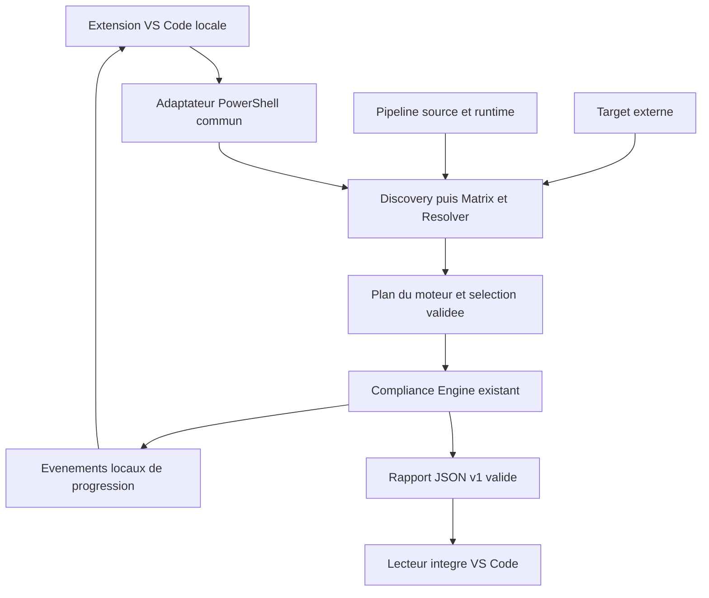

# Plan d'evolution : pipelines locaux dans VS Code

## Objectif et perimetre

Ouvrir Compliance Platform, choisir une Target locale externe, examiner ses technologies et lancer son audit depuis une vue VS Code. La Pipeline source reste cette installation de la plateforme, avec son catalogue, son moteur et son runtime partage. Aucun compte de forge, serveur web, service distant ou copie du runtime dans la Target.

Ce document propose une evolution progressive, pas une implementation. Le parcours CLI et les contrats existants restent utilisables. Aucun commit, push ou changement de branche distante ne fait partie du travail.

## Etat des lieux verifie

L'analyse couvre les sources, scripts, configurations caches, catalogue, schemas, adaptateurs, taches, documentation et toutes les suites de tests du depot, ainsi que les resumes des rapports locaux. Les dependances installees et caches ne constituent pas des sources a reecrire.

| Existant reutilisable | Constat et ecart utilisateur |
| --- | --- |
| [Architecture](docs/architecture-current.md), [utilisation](docs/utilisation.md), [maintenance](docs/maintenance.md), [README](README.md) | Parcours documente mais manuel : commandes, permissions, recherche du JSON et lecture des sorties. |
| [Quality Gate](scripts/quality-gate.ps1) : `Get-Technology`, `Get-CapabilityMatrix`, `Resolve-CapabilityTool` | Preuves, racines, ambiguities, erreurs et disponibilites existent. Ces fonctions sont internes a un script avec etat global et `exit`, pas encore une API reutilisable de preparation. Discovery appelle deja Matrix/Resolver et peut lancer des sondes de version. |
| [Catalogue](.config/control-catalog.json), [schema](.config/control-catalog.schema.json), [module](src/Control.Catalog.psm1) | 28 controles pour 13 identifiants de technologie, avec outils, effets, permissions, parametres, limites et dependances. Aucun modele de pipeline propre a l'interface n'est necessaire. |
| [Moteur](src/Compliance.Engine.psm1) | `New-CompliancePlan` construit les instances par technologie/capacite/outil/racine et trie le DAG. `Invoke-CompliancePlan` execute sequentiellement et restitue durees, stdout/stderr et diagnostics. Pas de debut d'etape observable, selection partielle ni annulation cooperative. |
| `Invoke-BoundedProcess` dans le Quality Gate | Controle l'integrite, les timeouts et l'arbre Windows. `ReadToEndAsync` bufferise les flux ; la troncature intervient apres capture. Pas de logs incrementaux ni de limite memoire effective pendant la capture. |
| [Rapport v1](.config/compliance-report.schema.json), `New-ComplianceReport`, `Test-ComplianceReport` | Contrat riche et verdict consultatif : findings, diagnostics, couverture, limites et metadonnees. Le `run_id` est cree seulement lors du rapport final ; la destination par defaut est reutilisee. Pas de lecteur humain integre ni de garantie de rapport apres panne d'ecriture. |
| [Adaptateur](src/Compliance.Adapter.psm1), [wrapper](scripts/compliance-adapter.ps1), [Git Bash](scripts/compliance.sh) | Contrat local partage PowerShell/Bash/VSCode/GitLab ; seuls les parcours plan et audit sont exposes. Ne pas multiplier les scripts de facade. |
| [Taches VS Code](.vscode/tasks.json), [extensions recommandees](.vscode/extensions.json) | `Compliance v1` cible `${workspaceFolder}`, donc la plateforme. Aucun selecteur externe, extension produit, vue de progression ou lecteur de rapport. |
| [Bootstrap](scripts/bootstrap.ps1), [Doctor](scripts/doctor.ps1), [provenance](src/Tool.Provenance.psm1), [support](src/Platform.Support.psm1) | Runtime partage, pins, hashes, lock et qualification reutilisables. Windows x64 est experimental au niveau produit ; les cinq autres couples restent targeted. |
| [Tests](scripts/test.ps1), [unitaires moteur](tests/unit/compliance-engine.Tests.ps1), [integration moteur](tests/integration/compliance-engine.Tests.ps1), [Quality Gate](tests/integration/quality-gate.Tests.ps1) | Fixtures externes, racines, permissions, DAG, timeouts, integrite et rapport deja testes. Assertions PowerShell maison, pas Pester. Les tests adaptateurs VSCode appellent PowerShell, sans demarrer VS Code. |

Limites a exposer, pas a masquer :

- Terraform/OpenTofu : format, lint et securite dans le catalogue ; init/validate existent dans le parcours historique Terraform, pas dans le plan Compliance. Aucun plan Terraform n'y est configure.
- Terragrunt : controle de format ; Ansible : YAML lint et ansible-lint, ce dernier incompatible avec un controleur Windows natif.
- Python : format, lint, tests, securite et audit des dependances ; cet audit consommateur exige `requirements.txt`. PowerShell : lint et syntaxe via l'adaptateur existant.
- Docker et Docker Compose partagent aujourd'hui `docker`. Hadolint ne valide pas Compose ; Trivy propose un scan filesystem. Kubernetes/Helm ont des controles Checkov/Trivy, sans rendu implicite des templates.
- Shell : ShellCheck non fourni sous Windows. Markdown : hook pre-commit soumis a execution de code. JavaScript/TypeScript : controles sans outil configure, donc capacites indisponibles, pas pipelines vertes.
- La liste des technologies et les invocations sont actuellement codees dans la Discovery et le moteur. Ajouter une technologie peut demander du travail backend ; cela ne doit jamais demander de reecrire l'interface.
- `.vscode/compliance-rapport.ps1` n'existe pas. Aucun convertisseur ni producteur de `compliance-report.md` n'est present : ne pas recreer ce parcours fragile.

## Architecture cible

### Interface et responsabilites

- Creer une petite extension TypeScript dans `vscode-extension/` : commandes, `TreeDataProvider`, client processus et lecteur de rapport. APIs VS Code stables ; pas de framework frontend ni de backend Node dupliquant Compliance.
- Vue native : Target, Pipeline source avec chemin/version moteur/hash catalogue/statut runtime et produit, preparation, puis technologie, racine et controles dans l'ordre du plan. Afficher les technologies ambigues et indisponibles ; masquer les technologies absentes par defaut, avec acces aux details.
- Une pipeline est un regroupement des controles du plan par technologie et racine, pas un fichier de workflow supplementaire. Une capacite peut contenir plusieurs outils complementaires ; conserver toutes les instances et les alternatives non retenues dans les details.
- La barre de commandes propose selection du dossier, actualisation, lancement global et ouverture du dernier rapport. Actions contextuelles pour pipeline, etape, logs et findings ; ne pas demander a l'utilisateur de saisir les parametres internes.
- Un `OutputChannel` presente les logs ; un panneau `WebviewPanel` sobre presente le rapport et les details. L'extension ne decide ni applicabilite, outils, ordre, permissions effectives, dependances ni verdict.
- Conserver une TreeView native, des commandes VS Code et une Webview simple : aucun framework frontend, serveur local, second moteur de workflow ou duplication du Compliance Engine.
- Etendre le wrapper commun pour preparer/executer une session et recevoir ses options. Extraire sans reimplementation la preparation et le runner du Quality Gate vers un module partage, probablement `src/Compliance.Orchestration.psm1`. Le Quality Gate et le wrapper consomment ensuite ce meme module ; adapter les tests qui extraient actuellement les fonctions par AST.

### Session, progression et rapport

- Creer le `run_id` au debut ; le propager aux evenements et au rapport. Une seule execution active dans l'extension pour commencer ; pas de parallelisme des controles ni de scheduler supplementaire.
- Ajouter un mode de transport opt-in : evenements NDJSON UTF-8 sur stdout, diagnostics de transport sur stderr, rapport final dans un fichier identifie par la session. Sans cette option, preserver le JSON unique sur stdout et `-HumanSummary` sur stderr des CLI actuelles.
- Contrat d'evenements separe et versionne : `run_id`, numero de sequence, type, horodatage, `control_id` si pertinent, motif structure et charge utile. Pour le premier MVP, emettre debut et fin de controle, statut, duree et sorties a la fin ; l'absence de fin ne vaut jamais succes. Le streaming stdout/stderr ligne par ligne est une amelioration ulterieure, pas un prerequis.
- Le moteur emet les evenements ; une interface de callback optionnelle ne doit pas polluer son flux de resultats PowerShell. Conserver initialement `Invoke-BoundedProcess`, son integrite, ses timeouts et l'arret de l'arbre ; ne pas le fragiliser pour imposer des fragments incrementaux. Borner les sorties et rafraichissements UI, signaler la troncature et respecter le masquage. Une evolution ulterieure du runner devra borner capture et file d'attente avant d'activer le streaming detaille.
- Pendant `Running`, afficher le temps ecoule ; apres fin, utiliser `duration_ms` du moteur. Pour une pipeline, afficher sa duree mesuree, pas un total arbitraire des horodatages de controles omis. Pour une etape jamais executee, afficher une duree non applicable.
- Sessions, rapports et journaux de l'extension sous `.tools/state/runs/<run_id>/` de la Pipeline source par defaut ; cet espace est ignore par Git et Discovery via l'exclusion existante de `.tools/`. La Target externe ne recoit jamais ces fichiers. Ecriture temporaire puis remplacement atomique, validation avant presentation, maintien des destinations CLI historiques sous `reports/`. Ne jamais lire un ancien fichier comme resultat de la session courante.
- Le lecteur charge directement le JSON valide, y compris un rapport existant choisi dans VS Code : verdict, raisons, couverture, pipelines, resultats, findings et limites. Pas de conversion Markdown requise. Export du JSON et ouverture des logs par actions explicites.
- Les findings actuels sont surtout des diagnostics par controle, pas un format universel fichier/ligne/regle. Afficher ce qui existe ; ouvrir un fichier seulement lorsqu'une localisation fiable est disponible et contenue dans la Target. Enrichir les parseurs backend ulterieurement, sans inventer de positions dans l'UI.

### Statuts et securite

Les neuf statuts sont des etats de presentation. Conserver `success`, `fail`, `error`, `skipped` et le verdict canonique du rapport v1 ; ajouter des motifs structures retrocompatibles dans le plan/les diagnostics et adapter schema, validateur et tests. Chaque statut Blocked, Skipped, Warning ou Not applicable exige un motif structure avec code et message. Ne pas analyser des phrases libres pour choisir un statut.

| Statut affiche | Regle de presentation |
| --- | --- |
| Pending | Controle eligible du plan, pas encore commence. |
| Running | Evenement de debut recu, aucun evenement terminal. |
| Succeeded | Resultat `success`, sans avertissement applicable. |
| Failed | Resultat `fail` : controle execute correctement ayant detecte un defaut. |
| Error | Resultat `error` : controle incapable de produire un resultat fiable, notamment panne ou timeout. |
| Warning | Diagnostic non critique, sortie tronquee ou couverture partielle sans echec prioritaire ; ne transforme jamais un FAIL en PASS. |
| Skipped | Controle dans le perimetre volontairement omis, notamment permission refusee ou annulation avant lancement ; motif explicite. |
| Blocked | Prerequis non satisfait, scan incomplet, ambiguite, capacite/outil requis indisponible ou integrite invalide. |
| Not applicable | Technologie absente, aucune preuve pertinente, capacite non requise ou alternative non retenue. |

Pour une pipeline, prioriser blocage/echec, puis execution en cours, attente et avertissements ; une pipeline entierement non applicable ne devient pas `Succeeded`. Afficher le verdict moteur separement : PASS avec couverture partielle reste accompagne d'un avertissement. Les erreurs non critiques ne deviennent pas artificiellement bloquantes pour le verdict.

- Refuser par defaut reseau et execution de code. Avant l'audit, lister les controles concernes, effets et raisons avec deux choix independants non coches. Consentement limite a la session, reconfirme apres changement de Target/source/perimetre ; Checkov exige les deux. Reconstruire le plan cote moteur avec ces permissions.
- La preparation peut executer des sondes de version ; l'indiquer comme verification des outils, non comme execution de tests du depot. Respecter Workspace Trust avant tout lancement de processus et demander une confirmation de confiance propre a la Target externe.
- Aucun Bootstrap automatique en selectionnant une Target. Si le runtime manque, offrir Doctor puis installation explicite dans la source, avec consentement reseau distinct ; ne jamais installer d'outil ou hook dans la Target.
- Arguments passes comme tableau a un processus sans shell ; valider les chemins, l'identite de la source et les messages de webview. Texte de logs traite comme non fiable, HTML echappe, CSP restrictive sans contenu distant ni scripts provenant de la Target.
- Annulation cooperative : terminer l'arbre de controles puis finaliser un rapport incomplet, jamais PASS complet ; traiter aussi fermeture de VS Code et panne du processus. Aucun `apply`, `destroy`, deploiement ou build d'image ajoute. Les permissions ne sont pas un sandbox et ne garantissent pas l'absence d'ecriture par un outil autorise.

## Phases d'implementation

### 1. Choisir la Target et afficher le plan

**Fonctionnalite visible :** dans un Extension Development Host, selectionner un dossier externe et obtenir automatiquement technologies, racines, capacites et etapes proposees, avec Target et Pipeline source toujours distinctes.

**Travail :** creer le squelette d'extension et un client du wrapper ; reutiliser d'abord `-PlanOnly`, qui inclut deja Discovery/Matrix/Resolver. Cette premiere iteration ne lance aucun controle, lecteur Webview complet, lancement partiel ou streaming detaille. Extraire ensuite la preparation partagee quand necessaire pour exposer une operation sans `exit`. Ajouter les motifs structures d'omission, sans changer la semantique v1. Ne pas creer de controles fictifs init/plan/tests.

**Composants :** `vscode-extension/package.json`, lock et sources a creer ; [wrapper](scripts/compliance-adapter.ps1), [adaptateur](src/Compliance.Adapter.psm1), nouveau module d'orchestration, [Quality Gate](scripts/quality-gate.ps1), [moteur](src/Compliance.Engine.psm1), schemas et tests existants correspondants.

**Acceptation :** selection annulee ou dossier invalide gere sans rapport vide ; Target avec espaces et accents ; monorepo Terraform/OpenTofu/Python/PowerShell correctement groupe ; Compose, JS/TS, Shell et ambiguities visibles sans fausse couverture. Aucun controle execute en preparation, hors sondes explicites ; aucun outil copie dans la Target. Tests de preparation, projection UI et commandes dans un vrai host VS Code ; CLI plan-only inchangee.

### 2. Lancer l'audit global et suivre son execution

**Fonctionnalite visible :** lancer toutes les pipelines, accorder ou refuser les permissions, suivre etapes/durees/logs en direct et annuler.

**Travail :** introduire le transport NDJSON optionnel, les evenements debut/fin du moteur, statut, duree et sorties a la fin, l'identite de session et les chemins uniques. Le streaming incremental borne reste une amelioration ulterieure si son ajout complique ou fragilise le runner. Repreparer avant lancement pour ne pas executer un ancien plan ; garder un snapshot du plan execute. Appliquer les statuts ci-dessus, sans modifier le calcul du verdict.

**Composants :** module d'orchestration, [moteur](src/Compliance.Engine.psm1), [wrapper](scripts/compliance-adapter.ps1), [adaptateur](src/Compliance.Adapter.psm1), nouveau schema d'evenements sous `.config/`, client processus et etats UI ; tests unitaires/integration moteur et adaptateurs.

**Acceptation :** `Running` visible avant la fin d'une fixture lente ; statut, duree et sorties accessibles a la fin ; refus de permissions n'execute aucun controle protege. Tester NDJSON fragmente, accents, doublons/sequences invalides, gros flux, timeout, integrite alteree, panne et annulation sans processus enfant restant. Une erreur de transport est visible et ne produit pas un succes. stdout des adaptateurs historiques conserve son contrat hors option streaming. Le test de premiers logs avant la fin est reserve a l'amelioration du streaming detaille.

### 3. Presenter le rapport et les problemes sans conversion

**Fonctionnalite visible :** ouvrir automatiquement le rapport lisible a la fin, puis consulter chaque etape, stdout/stderr et findings ; rouvrir un rapport apres redemarrage.

**Travail :** lecteur de JSON v1, panneau de synthese/detailles, export et acces aux journaux de session sous `.tools/state/runs/`. Ajouter uniquement les localisations backend fiables utiles ; conserver les diagnostics sans localisation. Appliquer masquage et retention aux sessions avec politique explicite ; la retention CLI actuelle ne couvre que les anciens `compliance-report*.json` sous `reports/`.

**Composants :** lecteur/webview de l'extension, [schema rapport](.config/compliance-report.schema.json), `New-ComplianceReport`/`Test-ComplianceReport`, fonctions de masquage/retention du Quality Gate et module partage ; tests de rapports existants.

**Acceptation :** parite verdict/findings/coverage entre JSON et vue ; anciens rapports v1 sans metrics acceptes. JSON vide, invalide, mauvaise version, destination non inscriptible ou rapport absent donnent une erreur actionable, jamais une page vide ni un ancien resultat. Fixture HTML hostile affichee comme texte ; navigation de fichier hors Target refusee ; secret de fixture masque dans logs et rapport. Tests du lecteur, integration de persistance et parcours UI dans VS Code.

### 4. Lancer une pipeline ou une etape et prouver l'extensibilite

**Fonctionnalite visible :** lancer une technologie/racine, puis une etape avec ses prerequis affiches avant confirmation ; une nouvelle technologie backend apparait sans modification du rendu UI.

**Travail :** selection par identifiants de controles cote moteur, fermeture transitive des dependances et tri topologique existant. Les prerequis sont reexecutes dans cette session, jamais supposes reussis d'apres un ancien rapport. Retenir les instances non selectionnees avec motif `out_of_scope` et resultat `skipped`, afin de respecter le contrat resultat/plan ; ajouter une metadata de perimetre et empecher `coverage.complete` global sur un audit partiel. Le verdict doit etre clairement presente comme limite a la selection.

**Composants :** [moteur](src/Compliance.Engine.psm1), contrat de l'adaptateur/wrapper, schema rapport/validateur, actions contextuelles UI, tests DAG/coverage existants. Pour distinguer Compose, faire evoluer Discovery et catalogue/schema cote backend avec migration des rapports `docker` ; aucun test de nom de fichier dans l'extension.

**Acceptation :** selection inconnue refusee ; fermeture des prerequis, echec bloquant, alternatives et plusieurs racines testes. Les controles hors selection ne s'executent pas et n'apparaissent pas comme resultats manquants. UI et JSON portent le meme perimetre ; aucune execution partielle presentee comme audit global complet. Fixture d'une technologie/capacite inconnue de l'UI rendue generiquement ; Compose seul ne propose pas Hadolint comme validation Compose. Ajouts reels d'outils JS/TS ou autres controles restent des changements catalogue/runtime/invocation testes, pas un prerequis a l'interface generique.

### 5. Distribuer l'extension et basculer le parcours principal

**Fonctionnalite visible :** installer un VSIX local, ouvrir la plateforme et effectuer selection, audit et lecture du rapport sans commande PowerShell memorisee.

**Travail :** packaging local reproductible ; epingler Node, TypeScript, outils VSIX et tests d'extension, avec lock et outils/caches sous `.tools/` ou emplacement local documente. Le Node du hook Markdown n'est pas presume suffisant pour construire l'extension. Fournir une tache de construction/installation explicite, sans publication Marketplace imposee. Gerer source absente, runtime indisponible et host non qualifie avec diagnostic visible.

**Composants :** package/lock de l'extension, [.vscode/tasks.json](.vscode/tasks.json), [.vscode/extensions.json](.vscode/extensions.json), [.gitignore](.gitignore), exclusions Discovery/Doctor/scanner pour les nouveaux artefacts generes, [tests](scripts/test.ps1), hooks/CI si necessaire et documentation existante. Ignorer uniquement les repertoires generes justifies, notamment dependances/compilation de l'extension ; ne pas masquer ses sources JS/TS aux analyses.

**Acceptation :** test Extension Host puis essai sur VSIX installe avec Target externe autorisee ; navigation clavier, themes clair/sombre, textes longs, erreurs, relance et changement de Target testes. Reutiliser les fixtures PowerShell, ajouter les tests TypeScript et des parcours UI automatises avec outillage VS Code epingle ; ces tests doivent entrer dans Full/Ci. Quick apres chaque changement significatif, Full avant cloture, aucun finding exclu. Documenter les limites Windows/Linux/macOS/ARM64 sans annoncer de qualification inexistante.

## Migration et elements a conserver ou retirer

| Element | Decision |
| --- | --- |
| Catalogue, Matrix, Resolver, plan, moteur, provenance et JSON v1 | Conserver comme autorites ; enrichissements additifs testes. Ne pas transformer `.config/quality-gate.yml`, descriptif, en moteur de politique pour l'UI. |
| Quick, Full, Ci, Fix et `-Category` | Conserver pour maintenance de la Pipeline source, hooks et CI. Les afficher comme commandes avancees du socle, distinctes des pipelines de la Target. Fix reste explicite, a effets de bord et non combine avec Compliance. |
| Adaptateurs PowerShell/Git Bash/GitLab | Conserver avec tests de parite et codes de sortie actuels ; l'interface locale n'utilise pas la conversion consultative du code GitLab. Aucune forge requise. |
| Tache `Compliance v1` | Conserver comme secours technique pendant migration, puis adapter a une selection externe explicite ou remplacer son entree principale par la commande d'extension. Adapter les tests qui exigent actuellement ce label. |
| Conversion manuelle JSON/Markdown | Retirer du parcours utilisateur. Le script cite n'existe pas : rien a supprimer dans les sources. Ne pas ajouter un nouveau convertisseur parallele. |
| Fonctions de preparation/runner deplacees | Supprimer leurs copies du Quality Gate une fois les appels partages et regressions valides ; ne pas maintenir deux implementations. |
| Documentation actuelle | Mettre a jour README et tutoriel pour le parcours VS Code ; architecture pour evenements/perimetres ; maintenance pour outils, VSIX et qualification. Garder la CLI en parcours avance, sans creer une seconde documentation equivalente. |

Chaque phase livre un parcours testable avant la suivante. Les phases 1 a 3 constituent le premier parcours global utilisable ; les lancements partiels arrivent ensuite. La CLI reste le repli jusqu'a validation du VSIX et de ses tests. Les risques connus de Full restent visibles pendant le developpement et interdisent une declaration de qualification complete.

## Risques et blocages constates

- Le rapport Full initial du 12 octobre 2026 contient 11 PASS, 1 FAIL, 1 WARN, 6 SKIP, code 1 : seul l'audit des dependances Python echoue. La maintenance documente les pins Checkov/asteval 1.0.6/ecdsa 0.19.2 et les avis associes. Ne pas les exclure ni les corriger hors perimetre de cette evolution UX.
- Verification apres creation de ce plan : Markdownlint et Quick passent ; Full termine avec 10 PASS, 1 FAIL, 1 WARN, 6 SKIP, 1 ERROR, code 1. L'audit retrouve les avis asteval/ecdsa ; les tests du socle depassent le budget de 420 secondes. Leur reussite n'est donc pas confirmee sur cette execution. Diagnostiquer ce timeout separement, sans supprimer de test ni augmenter automatiquement le budget pour obtenir un gate vert.
- Pas de projet d'extension, de lock JavaScript ou de tests Extension Host existants : effort a ajouter, pas preuve que VS Code ou Node seraient indisponibles. Les outils de cette future chaine restent a choisir et qualifier avec versions fixes.
- Windows x64 reste experimental ; Linux/macOS/ARM64, poste neuf, runner GitLab reel et corpus consommateur reel ne disposent pas des preuves de qualification requises. Cela n'empeche pas le prototype local, mais bloque les promesses de support et la qualification produit.
- Etendre le streaming sans conserver les bornes, le masquage et la terminaison d'arbre aggraverait les risques actuels de memoire et de confidentialite. Tester les limites avant d'activer ce transport comme parcours principal.
- La preparation est couplee a des variables de script ; son extraction exige des regressions de parite, notamment les tests par AST. La selection partielle exige une evolution de couverture, sinon les controles omis deviennent erreurs de contrat ou produisent une fausse impression d'audit complet.
- Changer de Target, modifier le catalogue ou relancer une session ne doit jamais reutiliser un consentement ou resultat ancien. Conserver les identites, hashes, perimetres et dates ; en cas d'interruption, afficher l'etat incomplet et les preuves disponibles.
- Aucun responsable/SLA ni licence de distribution n'est defini dans le depot. Le VSIX local peut servir a qualifier l'experience ; une distribution publique necessite de clarifier ces points, sans en faire une dependance a une forge.
